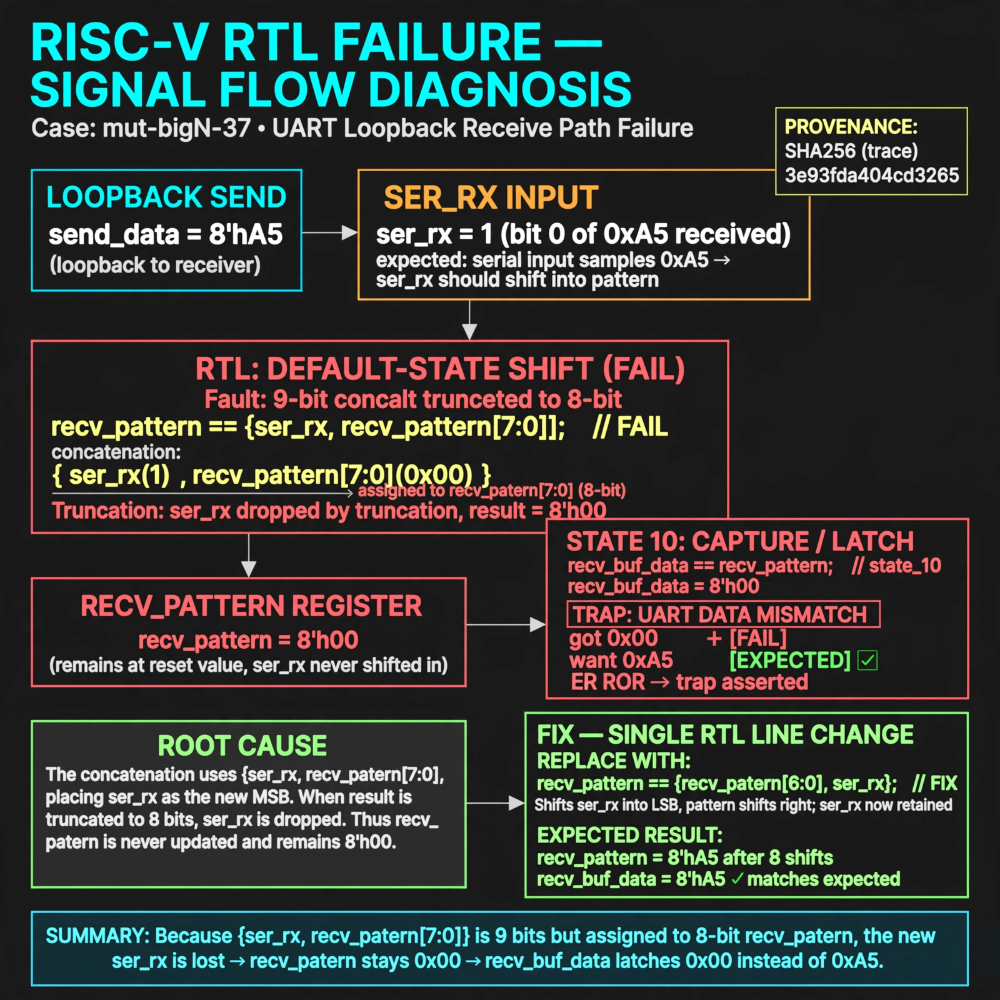

# Afterglow run report: verbatim-mut-bigN-37

case `mut-bigN-37` | status **GREEN** | mode `live` | seed `42`

wall start `2026-10-30T16:45:15Z` | wall end `2026-10-30T16:46:47Z` | time-to-green `92.1s`

retries `0` | human_touches `0` | diagnosed `True` | fixed_unaided `True` | patch_source `model-verbatim`

## Verdicts (from sim, not typed)

- BEFORE: tohost=FAIL 0xdead checksum=dbb50cbb61b3704d4ab04bba47dd54874597339897bb0d0354152efa03feeb20 cycles=2652 seed=42 pass=False
- AFTER: tohost=PASS checksum=5c8f58d0f0818c97d014d2f851a6140882bd1efc96a2537047806252c0c2caf9 cycles=2652 seed=42 pass=True

## Diagnosis (verbatim from api/text_response.json)

```
Loopback send 0xa5 was latched as 0x00 in recv_buf_data, causing TRAP uart data mismatch got 0x00 want 0xa5. The default-state shift uses {ser_rx, recv_pattern[7:0]} which is 9 bits and truncates to the old recv_pattern, so ser_rx is never shifted in. Thus recv_pattern stays at reset and state 10 copies 0x00 to recv_buf_data.
```

expected re-sim signal: tohost PASS 0x1, loopback got 0xa5 want 0xa5 with no TRAP

## Patch (2 lines, guard-checked)

```diff
diff --git a/picosoc/simpleuart.v b/picosoc/simpleuart.v
--- a/picosoc/simpleuart.v
+++ b/picosoc/simpleuart.v
@@ -96,7 +96,7 @@
 				default: begin
 					if (recv_divcnt > cfg_divider) begin
-						recv_pattern <= {ser_rx, recv_pattern[7:0]};
+						recv_pattern <= {ser_rx, recv_pattern[7:1]};
 						recv_state <= recv_state + 1;
 						recv_divcnt <= 0;
 					end
 				end

```

## Provenance (judge checks)

- prompt file `/home/tuncay/afterglow/agent/prompts/v2.txt` sha256 `d31e1ef6b74ddf52ee59e790ebff2f3defa9b03be82e699f45ef620cf8e27a6e`
- input_trace.txt sha256 `3e93fda404cd32657e79f69c41ef8deda4d9c37807aa6c1ab9ce2c5a8275405a` (9 lines, 68 tokens)
- prompt tokens `688` (cap 2500)
- text model `muse-spark-1.3-contributor` latency `61833ms` request `chatcmpl-01a18db4-79e5-7364-899c-7b998dfe0727`
- image model `muse-image-1.0` latency `29723ms` request `52222bb1-1ace-47f1-8a37-92d73ccf2c34` status `ok`
- image prompt sha256 `d68a7d2743fde574e3cf8d398db164503f75a31b393aed036d61a0c3533fa512`, trace sha `3e93fda404cd32657e79f69c41ef8deda4d9c37807aa6c1ab9ce2c5a8275405a` (see api/image_request.json)

## Explanation diagram



## Bundle completeness

- present (12): artifacts/input_trace.txt, artifacts/boot.log, artifacts/boot_after.log, artifacts/verdict_before.json, artifacts/verdict_after.json, api/text_request.json, api/text_response.json, api/image_request.json, api/image_response.json, explain.png, patch.diff, meta.json
- missing (0): none

