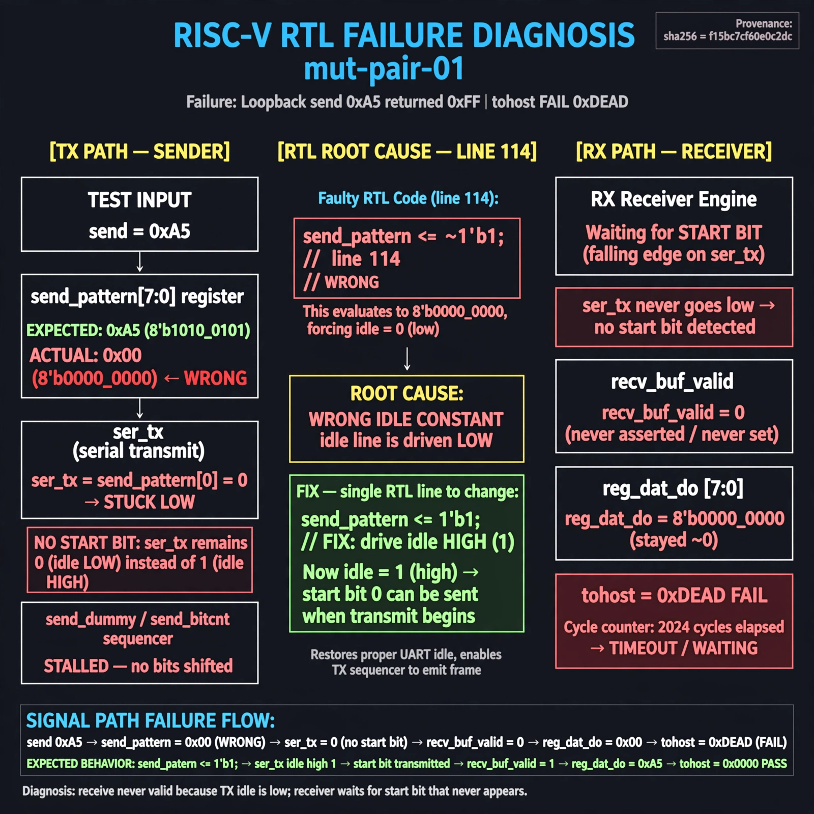

# Afterglow run report: verbatim-mut-pair-01

case `mut-pair-01` | status **RED** | mode `live` | seed `42`

wall start `2026-10-30T16:46:47Z` | wall end `2026-10-30T16:58:03Z` | time-to-green `676.1s`

retries `2` | human_touches `0` | diagnosed `True` | fixed_unaided `False` | patch_source `model-verbatim`

## Verdicts (from sim, not typed)

- BEFORE: tohost=FAIL 0xdead checksum=e82517390f8726caabcc777759a3dbb48c59fd1d160e409515f1b95dfe3d420c cycles=22023 seed=42 pass=False
- AFTER: tohost=FAIL 0xdead checksum=e82517390f8726caabcc777759a3dbb48c59fd1d160e409515f1b95dfe3d420c cycles=22023 seed=42 pass=False

## Diagnosis (verbatim from api/text_response.json)

```
Loopback send 0xa5 returned 0xff with tohost FAIL 0xdead because recv_buf_valid never set so reg_dat_do stayed ~0. ser_tx equals send_pattern[0] and reset send_pattern <= ~1 at line 114 forces idle low instead of high so no start-bit is seen. The wrong idle constant stalls the send_dummy/send_bitcnt sequencer from emitting a valid frame, leaving the receiver waiting to 2024 cycles.
```

expected re-sim signal: tohost PASS, uart loopback got 0xa5 want 0xa5 TRAP gone

## Patch (2 lines, guard-checked)

```diff
diff --git a/picosoc/simpleuart.v b/picosoc/simpleuart.v
--- a/picosoc/simpleuart.v
+++ b/picosoc/simpleuart.v
@@ -113,5 +113,5 @@
 		if (!resetn) begin
-			send_pattern <= ~1;
+			send_pattern <= ~0;
 			send_bitcnt <= 0;
 			send_divcnt <= 0;
 			send_dummy <= 1;

```

## Provenance (judge checks)

- prompt file `/home/tuncay/afterglow/agent/prompts/v2.txt` sha256 `d31e1ef6b74ddf52ee59e790ebff2f3defa9b03be82e699f45ef620cf8e27a6e`
- input_trace.txt sha256 `f15bc7cf60e0c2dc7bb57b987c1736b99a3b946f465500014dd32458dad71afa` (9 lines, 68 tokens)
- prompt tokens `1084` (cap 2500)
- text model `muse-spark-1.3-contributor` latency `91544ms` request `chatcmpl-01a18dbe-e07e-76d4-8e38-04d69ad0a5a0`
- image model `muse-image-1.0` latency `24223ms` request `b28c9bfb-78a3-44b7-8ad0-23fdd207f17a` status `ok`
- image prompt sha256 `b78ae274e8c34776a211f79b541c3b1c4e5d644b8791ed81c9c8f78794165d3b`, trace sha `f15bc7cf60e0c2dc7bb57b987c1736b99a3b946f465500014dd32458dad71afa` (see api/image_request.json)

## Explanation diagram



## Bundle completeness

- present (12): artifacts/input_trace.txt, artifacts/boot.log, artifacts/boot_after.log, artifacts/verdict_before.json, artifacts/verdict_after.json, api/text_request.json, api/text_response.json, api/image_request.json, api/image_response.json, explain.png, patch.diff, meta.json
- missing (0): none

