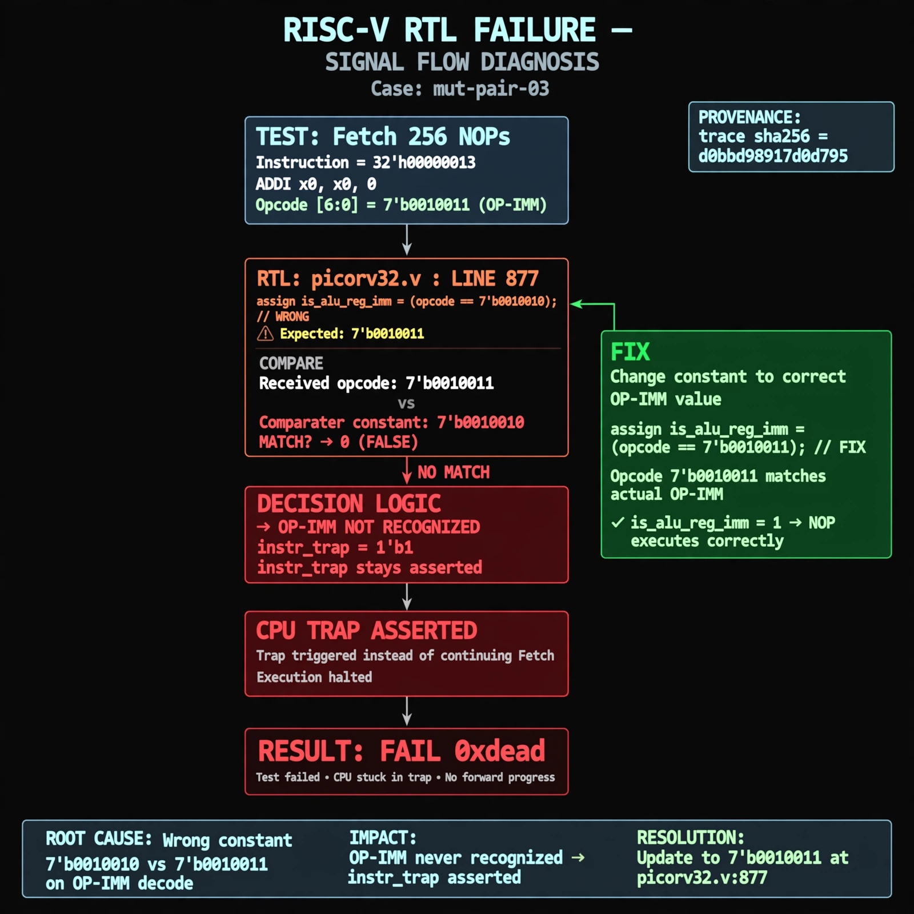

# Afterglow run report: verbatim-mut-pair-03

case `mut-pair-03` | status **RED** | mode `live` | seed `42`

wall start `2026-10-30T16:58:04Z` | wall end `2026-10-30T17:18:45Z` | time-to-green `1241.8s`

retries `2` | human_touches `0` | diagnosed `True` | fixed_unaided `False` | patch_source `model-verbatim`

## Verdicts (from sim, not typed)

- BEFORE: tohost=FAIL 0xdead checksum=c2a7a4d6295484feeb9ec1ea9381732b8e39a7ccd1997c7d70f6454da2fb4659 cycles=2009 seed=42 pass=False
- AFTER: tohost=FAIL 0xdead checksum=c2a7a4d6295484feeb9ec1ea9381732b8e39a7ccd1997c7d70f6454da2fb4659 cycles=2009 seed=42 pass=False

## Diagnosis (verbatim from api/text_response.json)

```
Fetch test with 256 NOPs (ADDI x0,x0,0 opcode 0010011) asserted cpu trap instead of progressing. is_alu_reg_imm at picorv32.v:877 compares to 7'b0010010 vs expected 7'b0010011, so OP-IMM is never recognized and instr_trap stays asserted causing FAIL 0xdead.
```

expected re-sim signal: tohost PASS (no TRAP asserted), checksum != c2a7a4d6295484feeb9ec1ea9381732b8e39a7ccd1997c7d70f6454da2fb4659

## Patch (2 lines, guard-checked)

```diff
diff --git a/picorv32.v b/picorv32.v
--- a/picorv32.v
+++ b/picorv32.v
@@ -875,4 +875,4 @@
 			is_lb_lh_lw_lbu_lhu          <= mem_rdata_latched[6:0] == 7'b0000011;
 			is_sb_sh_sw                  <= mem_rdata_latched[6:0] == 7'b0100011;
-			is_alu_reg_imm               <= mem_rdata_latched[6:0] == 7'b0010010;
+			is_alu_reg_imm               <= mem_rdata_latched[6:0] == 7'b0010011;
 			is_alu_reg_reg               <= mem_rdata_latched[6:0] == 7'b0110011;

 			{ decoded_imm_j[31:20], decoded_imm_j[10:1], decoded_imm_j[11], decoded_imm_j[19:12], decoded_imm_j[0] } <= $signed({mem_rdata_latched[31:12], 1'b0});

```

## Provenance (judge checks)

- prompt file `/home/tuncay/afterglow/agent/prompts/v2.txt` sha256 `d31e1ef6b74ddf52ee59e790ebff2f3defa9b03be82e699f45ef620cf8e27a6e`
- input_trace.txt sha256 `d0bbd98917d0d795291e3b1d1e0495fc05fe7ac6d1bb3a316227f89e65ea7b60` (9 lines, 69 tokens)
- prompt tokens `1151` (cap 2500)
- text model `muse-spark-1.3-contributor` latency `86504ms` request `chatcmpl-01a18dc8-d100-705a-bb64-35dde7b1c43b`
- image model `muse-image-1.0` latency `14048ms` request `23175d24-36f6-40e5-8626-26c7ace482f6` status `ok`
- image prompt sha256 `5eeae1a0b77bc3bcf440bdea8f561765a69ca09ddb4acef4185e6cac461aaafe`, trace sha `d0bbd98917d0d795291e3b1d1e0495fc05fe7ac6d1bb3a316227f89e65ea7b60` (see api/image_request.json)

## Explanation diagram



## Bundle completeness

- present (12): artifacts/input_trace.txt, artifacts/boot.log, artifacts/boot_after.log, artifacts/verdict_before.json, artifacts/verdict_after.json, api/text_request.json, api/text_response.json, api/image_request.json, api/image_response.json, explain.png, patch.diff, meta.json
- missing (0): none

