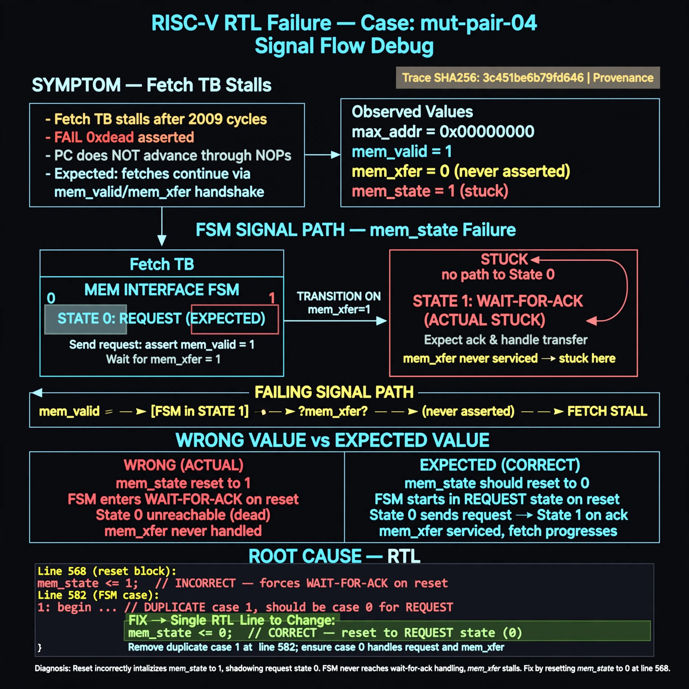

# Afterglow run report: verbatim-mut-pair-04

case `mut-pair-04` | status **GREEN** | mode `live` | seed `42`

wall start `2026-10-30T17:18:45Z` | wall end `2026-10-30T17:20:22Z` | time-to-green `96.4s`

retries `0` | human_touches `0` | diagnosed `True` | fixed_unaided `True` | patch_source `model-verbatim`

## Verdicts (from sim, not typed)

- BEFORE: tohost=FAIL 0xdead checksum=563b7c10626ff25de2b3c430956c7c113e448c4efaea068f9b83a198d4322b15 cycles=2009 seed=42 pass=False
- AFTER: tohost=PASS checksum=5c28238265cb94168311e9914f0df355642c557d04dba11845d557ac8a64aa4a cycles=2009 seed=42 pass=True

## Diagnosis (verbatim from api/text_response.json)

```
Fetch TB stalls with max_addr=0x00000000 and FAIL 0xdead after 2009 cycles instead of advancing PC through NOPs. Expected mem_valid/mem_xfer handshake to progress fetches but FSM never reaches the wait-for-ack handling. Root cause is reset mem_state<=1 at line 568 combined with duplicated case 1: at line 582 (request state should be 0), leaving state 0 dead and state 1 shadowing the transfer branch so mem_xfer is never serviced.
```

expected re-sim signal: tohost PASS (not FAIL 0xdead) with forward progress max_addr>0 and clean $finish in tb_picorv32_fetch

## Patch (4 lines, guard-checked)

```diff
diff --git a/picorv32.v b/picorv32.v
--- a/picorv32.v
+++ b/picorv32.v
@@ -565,7 +565,7 @@
 	always @(posedge clk) begin
 		if (!resetn || trap) begin
 			if (!resetn)
-				mem_state <= 1;
+				mem_state <= 0;
 			if (!resetn || mem_ready)
 				mem_valid <= 0;
 			mem_la_secondword <= 0;
@@ -580,5 +580,5 @@
 			end
 			case (mem_state)
-				1: begin
+				0: begin
 					if (mem_do_prefetch || mem_do_rinst || mem_do_rdata) begin
 						mem_valid <= !mem_la_use_prefetched_high_word;

```

## Provenance (judge checks)

- prompt file `/home/tuncay/afterglow/agent/prompts/v2.txt` sha256 `d31e1ef6b74ddf52ee59e790ebff2f3defa9b03be82e699f45ef620cf8e27a6e`
- input_trace.txt sha256 `3c451be6b79fd64621d9d16df1c6e6ed4609d72ba4491e9bbcd945f5777a6dda` (9 lines, 69 tokens)
- prompt tokens `881` (cap 2500)
- text model `muse-spark-1.3-contributor` latency `58729ms` request `chatcmpl-01a18dd3-1a84-718f-bb71-ca57572724a4`
- image model `muse-image-1.0` latency `36940ms` request `a3b0eccd-160c-412b-afda-bdab0968dde4` status `ok`
- image prompt sha256 `1a0547db9f78591c268b9c9d592906ecbe10b3a913c62b7a6c17fcc54435330b`, trace sha `3c451be6b79fd64621d9d16df1c6e6ed4609d72ba4491e9bbcd945f5777a6dda` (see api/image_request.json)

## Explanation diagram



## Bundle completeness

- present (12): artifacts/input_trace.txt, artifacts/boot.log, artifacts/boot_after.log, artifacts/verdict_before.json, artifacts/verdict_after.json, api/text_request.json, api/text_response.json, api/image_request.json, api/image_response.json, explain.png, patch.diff, meta.json
- missing (0): none

