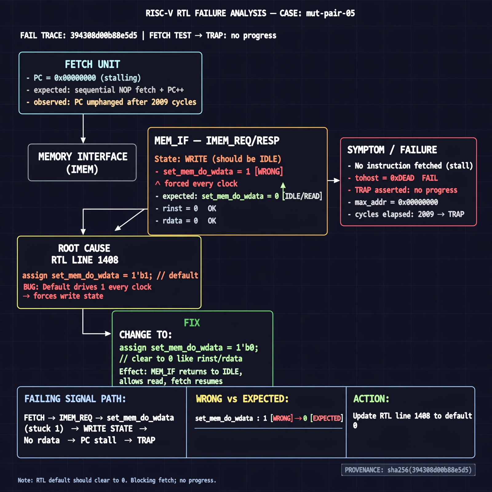

# Afterglow run report: verbatim-mut-pair-05

case `mut-pair-05` | status **GREEN** | mode `live` | seed `42`

wall start `2026-10-30T17:20:22Z` | wall end `2026-10-30T17:25:05Z` | time-to-green `283.0s`

retries `1` | human_touches `0` | diagnosed `True` | fixed_unaided `True` | patch_source `model-verbatim`

## Verdicts (from sim, not typed)

- BEFORE: tohost=FAIL 0xdead checksum=563b7c10626ff25de2b3c430956c7c113e448c4efaea068f9b83a198d4322b15 cycles=2009 seed=42 pass=False
- AFTER: tohost=PASS checksum=5c28238265cb94168311e9914f0df355642c557d04dba11845d557ac8a64aa4a cycles=2009 seed=42 pass=True

## Diagnosis (verbatim from api/text_response.json)

```
Fetch test reports TRAP: no progress max_addr=0x00000000 with tohost FAIL 0xdead after 2009 cycles, expected sequential NOP fetch to advance PC. Default set_mem_do_wdata=1 every clock forces the memory interface into write state instead of idle. Root cause is line 1408 in the excerpt which should clear to 0 like rinst/rdata, stalling fetch and blocking progress.
```

expected re-sim signal: tohost PASS (not FAIL 0xdead), TRAP no progress cleared with max_addr advancing beyond 0x00000000

## Patch (4 lines, guard-checked)

```diff
diff --git a/picorv32.v b/picorv32.v
--- a/picorv32.v
+++ b/picorv32.v
@@ -1446,9 +1446,9 @@
 		decoder_trigger <= mem_do_rinst && mem_done;
 		decoder_trigger_q <= decoder_trigger;
 		decoder_pseudo_trigger <= 0;
 		decoder_pseudo_trigger_q <= decoder_pseudo_trigger;
-		do_waitirq <= 1;
+		do_waitirq <= 0;
 
 		trace_valid <= 0;
 
 		if (!ENABLE_TRACE)
diff --git a/picorv32.v b/picorv32.v
--- a/picorv32.v
+++ b/picorv32.v
@@ -1405,7 +1405,7 @@
 		reg_out <= 'bx;
 		set_mem_do_rinst = 0;
 		set_mem_do_rdata = 0;
-		set_mem_do_wdata = 1;
+		set_mem_do_wdata = 0;
 
 		alu_out_0_q <= alu_out_0;
 		alu_out_q <= alu_out;

```

## Provenance (judge checks)

- prompt file `/home/tuncay/afterglow/agent/prompts/v2.txt` sha256 `d31e1ef6b74ddf52ee59e790ebff2f3defa9b03be82e699f45ef620cf8e27a6e`
- input_trace.txt sha256 `394308d00b88e5d5cf2a156cb6b43b6b574d1c76482d928d88b695be9cec7f79` (9 lines, 69 tokens)
- prompt tokens `1093` (cap 2500)
- text model `muse-spark-1.3-contributor` latency `59539ms` request `chatcmpl-01a18dd7-bfaf-7275-a68e-2309f510205a`
- image model `muse-image-1.0` latency `15608ms` request `5864ecaf-cb9b-4222-bc47-fa9009f06133` status `ok`
- image prompt sha256 `6edc0d03b8da194aa8016e8f9d42ca1611cf283a94daaa8fde43b19e267b433e`, trace sha `394308d00b88e5d5cf2a156cb6b43b6b574d1c76482d928d88b695be9cec7f79` (see api/image_request.json)

## Explanation diagram



## Bundle completeness

- present (12): artifacts/input_trace.txt, artifacts/boot.log, artifacts/boot_after.log, artifacts/verdict_before.json, artifacts/verdict_after.json, api/text_request.json, api/text_response.json, api/image_request.json, api/image_response.json, explain.png, patch.diff, meta.json
- missing (0): none

