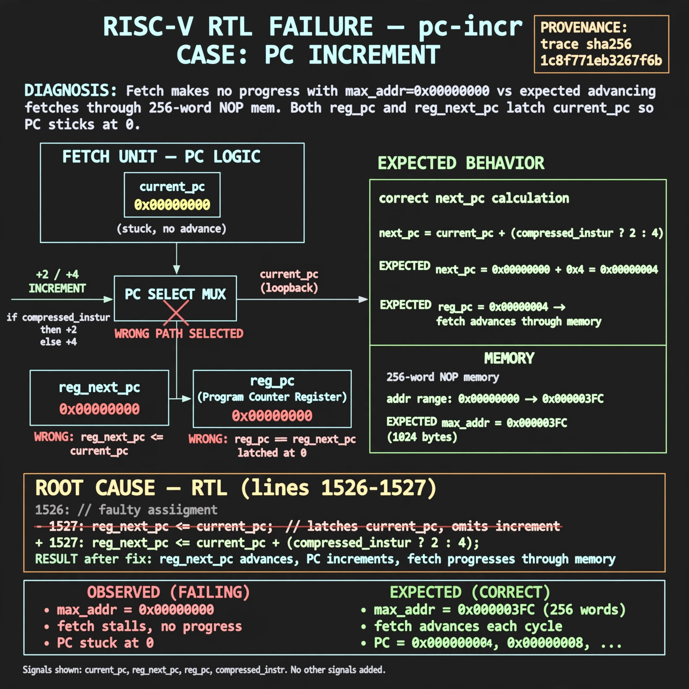

# Afterglow run report: verbatim-pc-incr

case `pc-incr` | status **RED** | mode `live` | seed `42`

wall start `2026-10-30T17:28:11Z` | wall end `2026-10-30T17:51:42Z` | time-to-green `1410.1s`

retries `1` | human_touches `0` | diagnosed `True` | fixed_unaided `False` | patch_source `model-verbatim`

## Verdicts (from sim, not typed)

- BEFORE: tohost=FAIL 0xdead checksum=563b7c10626ff25de2b3c430956c7c113e448c4efaea068f9b83a198d4322b15 cycles=2009 seed=42 pass=False
- AFTER: tohost=FAIL 0xdead checksum=2380078a93590da06f8e9ac7ff4e6eb90974634703b56ca2bacd5dcc122b9516 cycles=2009 seed=42 pass=False

## Diagnosis (verbatim from api/text_response.json)

```
Fetch makes no progress with max_addr=0x00000000 vs expected advancing fetches through 256-word NOP mem. Both reg_pc and reg_next_pc latch current_pc so PC sticks at 0. Root cause is lines 1526-1527 where reg_next_pc <= current_pc omits the +2/+4 increment selected by compressed_instr.
```

expected re-sim signal: tohost PASS (not FAIL 0xdead), max_addr advancing beyond 0x0 with fetch progress

## Patch (2 lines, guard-checked)

```diff
diff --git a/picorv32.v b/picorv32.v
--- a/picorv32.v
+++ b/picorv32.v
@@ -1526,2 +1526,2 @@
 				reg_pc <= current_pc;
-				reg_next_pc <= current_pc;
+				reg_next_pc <= current_pc + (compressed_instr ? 2 : 4);

```

## Provenance (judge checks)

- prompt file `/home/tuncay/afterglow/agent/prompts/v2.txt` sha256 `d31e1ef6b74ddf52ee59e790ebff2f3defa9b03be82e699f45ef620cf8e27a6e`
- input_trace.txt sha256 `1c8f771eb3267f6b23d0c64d11efcbc940a873c306503f9d268e32e3b3a0e048` (9 lines, 69 tokens)
- prompt tokens `714` (cap 2500)
- text model `muse-spark-1.3-contributor` latency `86583ms` request `chatcmpl-01a18ddc-2a92-7458-bb73-3be73a7e0987`
- image model `muse-image-1.0` latency `30669ms` request `148b85b2-96e9-4b39-b82b-66cf04abac1f` status `ok`
- image prompt sha256 `18b2448d743912db79259ae2b8ea5fa467d01b2cb347a2b4027de9df8505b809`, trace sha `1c8f771eb3267f6b23d0c64d11efcbc940a873c306503f9d268e32e3b3a0e048` (see api/image_request.json)

## Explanation diagram



## Bundle completeness

- present (12): artifacts/input_trace.txt, artifacts/boot.log, artifacts/boot_after.log, artifacts/verdict_before.json, artifacts/verdict_after.json, api/text_request.json, api/text_response.json, api/image_request.json, api/image_response.json, explain.png, patch.diff, meta.json
- missing (0): none

