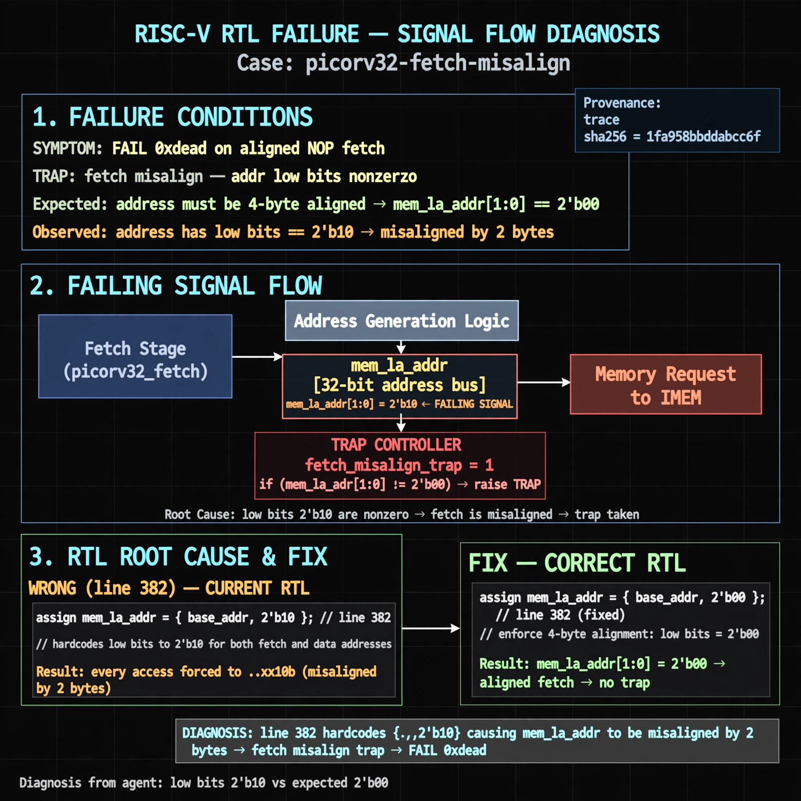

# Afterglow run report: verbatim-picorv32-fetch-misalign

case `picorv32-fetch-misalign` | status **GREEN** | mode `live` | seed `42`

wall start `2026-10-30T17:25:05Z` | wall end `2026-10-30T17:26:03Z` | time-to-green `57.9s`

retries `0` | human_touches `0` | diagnosed `True` | fixed_unaided `True` | patch_source `model-verbatim`

## Verdicts (from sim, not typed)

- BEFORE: tohost=FAIL 0xdead checksum=a29998cd8e81501b64b44a66e009c12b297662db5ef5369b12ef3feae608e5d5 cycles=2009 seed=42 pass=False
- AFTER: tohost=PASS checksum=5c28238265cb94168311e9914f0df355642c557d04dba11845d557ac8a64aa4a cycles=2009 seed=42 pass=True

## Diagnosis (verbatim from api/text_response.json)

```
Failing signal is mem_la_addr with low bits 2'b10 vs expected 2'b00, causing TRAP: fetch misalign addr low bits nonzero. Line 382 hardcodes {..,2'b10} for both fetch and data addresses so every access is misaligned by 2 bytes. This directly explains FAIL 0xdead on aligned NOP fetch.
```

expected re-sim signal: tohost PASS (FAIL 0xdead cleared, no fetch misalign trap)

## Patch (2 lines, guard-checked)

```diff
diff --git a/picorv32.v b/picorv32.v
--- a/picorv32.v
+++ b/picorv32.v
@@ -382,1 +382,1 @@
-	assign mem_la_addr = (mem_do_prefetch || mem_do_rinst) ? {next_pc[31:2] + mem_la_firstword_xfer, 2'b10} : {reg_op1[31:2], 2'b10};
+	assign mem_la_addr = (mem_do_prefetch || mem_do_rinst) ? {next_pc[31:2] + mem_la_firstword_xfer, 2'b00} : {reg_op1[31:2], 2'b00};

```

## Provenance (judge checks)

- prompt file `/home/tuncay/afterglow/agent/prompts/v2.txt` sha256 `d31e1ef6b74ddf52ee59e790ebff2f3defa9b03be82e699f45ef620cf8e27a6e`
- input_trace.txt sha256 `1fa958bbddabcc6f8edfd929831f9ade594dacbaf24c6aeb7a6055d70b0498d9` (9 lines, 72 tokens)
- prompt tokens `942` (cap 2500)
- text model `muse-spark-1.3-contributor` latency `40386ms` request `chatcmpl-01a18dd8-9d8b-77db-a454-cc78cda19690`
- image model `muse-image-1.0` latency `16820ms` request `cf9b95e2-e77f-4bcb-a17b-55c36a49b698` status `ok`
- image prompt sha256 `781f4fab60245d8ffea825757df94dbdcc1b76c2afae433353d6f2c785e5020a`, trace sha `1fa958bbddabcc6f8edfd929831f9ade594dacbaf24c6aeb7a6055d70b0498d9` (see api/image_request.json)

## Explanation diagram



## Bundle completeness

- present (12): artifacts/input_trace.txt, artifacts/boot.log, artifacts/boot_after.log, artifacts/verdict_before.json, artifacts/verdict_after.json, api/text_request.json, api/text_response.json, api/image_request.json, api/image_response.json, explain.png, patch.diff, meta.json
- missing (0): none

