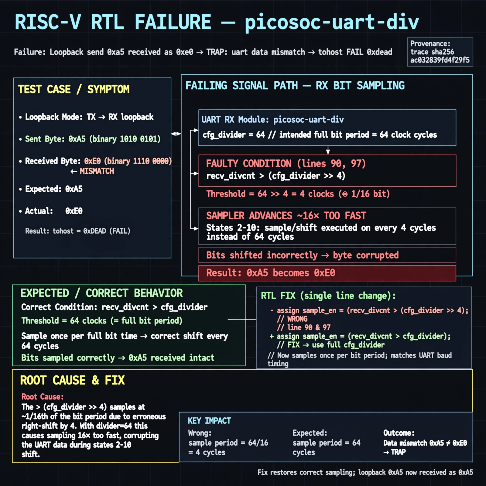

# Afterglow run report: verbatim-picosoc-uart-div

case `picosoc-uart-div` | status **GREEN** | mode `live` | seed `42`

wall start `2026-10-30T17:26:03Z` | wall end `2026-10-30T17:27:02Z` | time-to-green `58.7s`

retries `0` | human_touches `0` | diagnosed `True` | fixed_unaided `True` | patch_source `model-verbatim`

## Verdicts (from sim, not typed)

- BEFORE: tohost=FAIL 0xdead checksum=27ee482b473c74db5dce8b5ab1a233084cce3055c317a1f2045faa6dbc13a1c6 cycles=2112 seed=42 pass=False
- AFTER: tohost=PASS checksum=5c8f58d0f0818c97d014d2f851a6140882bd1efc96a2537047806252c0c2caf9 cycles=2652 seed=42 pass=True

## Diagnosis (verbatim from api/text_response.json)

```
Loopback send 0xa5 was received as 0xe0, causing TRAP uart data mismatch and tohost FAIL 0xdead. States 2-10 sample/shift in excerpt use `recv_divcnt > (cfg_divider >> 4)` on lines 90 and 97, i.e. ~1/16th of a bit period instead of full `cfg_divider`. With divider 64 this samples ~16x too fast and corrupts the byte, so root cause is the erroneous `>> 4` divide.
```

expected re-sim signal: tohost PASS, no TRAP uart data mismatch, loopback 0xa5 matches

## Patch (4 lines, guard-checked)

```diff
diff --git a/picosoc/simpleuart.v b/picosoc/simpleuart.v
--- a/picosoc/simpleuart.v
+++ b/picosoc/simpleuart.v
@@ -89,14 +89,14 @@
 				10: begin
-					if (recv_divcnt > (cfg_divider >> 4)) begin
+					if (recv_divcnt > cfg_divider) begin
 						recv_buf_data <= recv_pattern;
 						recv_buf_valid <= 1;
 						recv_state <= 0;
 					end
 				end
 				default: begin
-					if (recv_divcnt > (cfg_divider >> 4)) begin
+					if (recv_divcnt > cfg_divider) begin
 						recv_pattern <= {ser_rx, recv_pattern[7:1]};
 						recv_state <= recv_state + 1;
 						recv_divcnt <= 0;
 					end
 				end

```

## Provenance (judge checks)

- prompt file `/home/tuncay/afterglow/agent/prompts/v2.txt` sha256 `d31e1ef6b74ddf52ee59e790ebff2f3defa9b03be82e699f45ef620cf8e27a6e`
- input_trace.txt sha256 `ac032839fd4f29f55b737989e7012254f7213abac232b4783a41db6bbac0a072` (9 lines, 68 tokens)
- prompt tokens `818` (cap 2500)
- text model `muse-spark-1.3-contributor` latency `42483ms` request `chatcmpl-01a18dd9-87ea-74a9-b264-3dec98b221c6`
- image model `muse-image-1.0` latency `15598ms` request `41ea40fc-0da9-4da9-b916-ec5fcb45687e` status `ok`
- image prompt sha256 `7fb948f94481c6e42ccedfcb412ff91bf57379984fb08c4844820ccea95a8d48`, trace sha `ac032839fd4f29f55b737989e7012254f7213abac232b4783a41db6bbac0a072` (see api/image_request.json)

## Explanation diagram



## Bundle completeness

- present (12): artifacts/input_trace.txt, artifacts/boot.log, artifacts/boot_after.log, artifacts/verdict_before.json, artifacts/verdict_after.json, api/text_request.json, api/text_response.json, api/image_request.json, api/image_response.json, explain.png, patch.diff, meta.json
- missing (0): none

