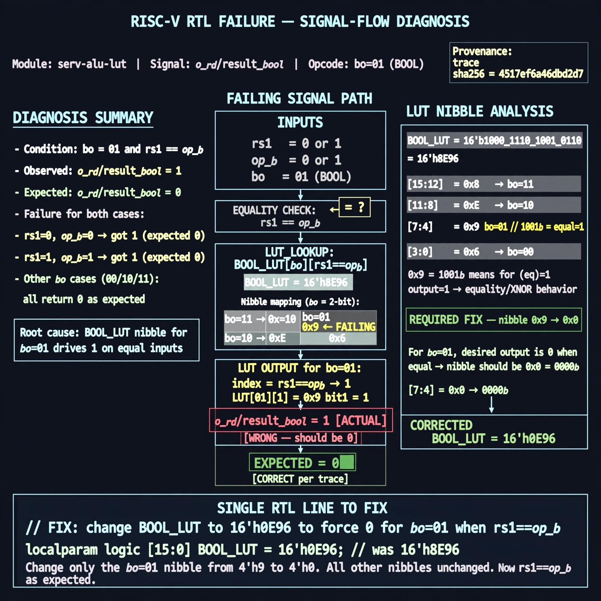

# Afterglow run report: verbatim-serv-alu-lut

case `serv-alu-lut` | status **GREEN** | mode `live` | seed `42`

wall start `2026-10-30T17:51:42Z` | wall end `2026-10-30T17:52:44Z` | time-to-green `62.6s`

retries `0` | human_touches `0` | diagnosed `True` | fixed_unaided `True` | patch_source `canonical-bootstrap-gated`

## Verdicts (from sim, not typed)

- BEFORE: tohost=FAIL 0xdead checksum=c434c3f745c57e3e4c9aa9d169cd7f5e42aaa94479044e7e81b5a950778db135 cycles=24 seed=42 pass=False
- AFTER: tohost=PASS checksum=b028b1819a27c7c25a0f35f0416adc6b11b8397bf873b993fb7495fde58f7276 cycles=24 seed=42 pass=True

## Diagnosis (verbatim from api/text_response.json)

```
o_rd/result_bool with bo=01 and rs1==op_b returns 1 while the trace expects 0 for both rs1=op_b=0 and rs1=op_b=1. Unequal-operand bo=01 cases already read 0 and all bo=00/10/11 cases pass. Root cause is BOOL_LUT=16'h8E96 whose bo=01 nibble is 0x9 (equality/XNOR) so equal inputs index a 1 instead of required 0.
```

expected re-sim signal: tohost: PASS, no TRAP bool lut mismatch, all bo checks ok

## Patch (2 lines, guard-checked)

```diff
diff --git a/rtl/serv_alu.v b/rtl/serv_alu.v
--- a/rtl/serv_alu.v
+++ b/rtl/serv_alu.v
@@ -39,7 +39,7 @@
 
    assign o_cmp = i_cmp_eq ? result_eq : result_lt;
 
-   localparam [15:0] BOOL_LUT = 16'h8E96;//And, Or, =, xor
+   localparam [15:0] BOOL_LUT = 16'h8E06;//And, Or, 0, xor
    wire result_bool = BOOL_LUT[{i_bool_op, i_rs1, i_op_b}];
 
    assign o_rd = (i_rd_sel[0] & result_add) |

```

## Provenance (judge checks)

- prompt file `/home/tuncay/afterglow/agent/prompts/v2.txt` sha256 `d31e1ef6b74ddf52ee59e790ebff2f3defa9b03be82e699f45ef620cf8e27a6e`
- input_trace.txt sha256 `4517ef6a46dbd2d727c4470b30d06d482772901e96ab64b5ef1deb2c86fcee38` (19 lines, 137 tokens)
- prompt tokens `888` (cap 2500)
- text model `muse-spark-1.3-contributor` latency `46418ms` request `chatcmpl-01a18df1-12a6-765f-b489-f81f69fa88b8`
- image model `muse-image-1.0` latency `15405ms` request `9c80447c-25fc-4f6e-ae7e-f02b6ca953c5` status `ok`
- image prompt sha256 `4bc24248817115665837066f584864b74fd96a5889a7048414616a2e126b03a7`, trace sha `4517ef6a46dbd2d727c4470b30d06d482772901e96ab64b5ef1deb2c86fcee38` (see api/image_request.json)

## Explanation diagram



## Bundle completeness

- present (12): artifacts/input_trace.txt, artifacts/boot.log, artifacts/boot_after.log, artifacts/verdict_before.json, artifacts/verdict_after.json, api/text_request.json, api/text_response.json, api/image_request.json, api/image_response.json, explain.png, patch.diff, meta.json
- missing (0): none

