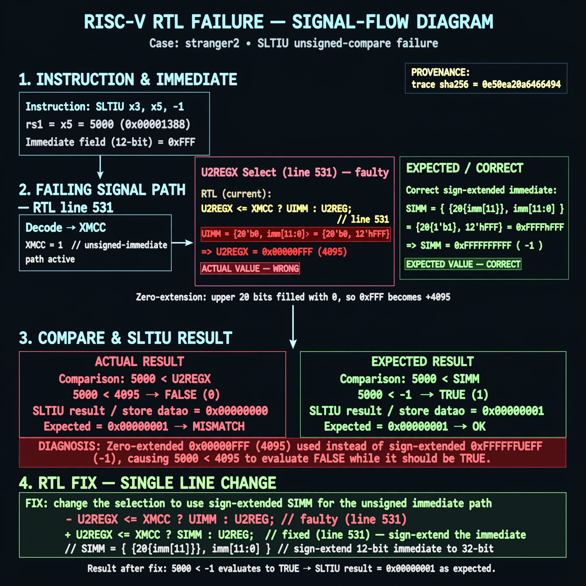

# Afterglow run report: verbatim-stranger2

case `stranger2` | status **GREEN** | mode `live` | seed `42`

wall start `2026-10-30T17:52:44Z` | wall end `2026-10-30T17:53:59Z` | time-to-green `74.9s`

retries `0` | human_touches `0` | diagnosed `True` | fixed_unaided `True` | patch_source `model-verbatim`

## Verdicts (from sim, not typed)

- BEFORE: tohost=FAIL 0xdead checksum=f4c01ef9454981bd93e52388b13a48719e5eea9443874bce9897c0eb347af824 cycles=13 seed=42 pass=False
- AFTER: tohost=PASS checksum=f143d378eb0f6e75985e23015eb95484fffe99510f7d1415362b98ff6ccf7471 cycles=13 seed=42 pass=True

## Diagnosis (verbatim from api/text_response.json)

```
SLTIU result x3/store datao is 0x00000000 vs expected 0x00000001 for 5000 < -1 immediate. Excerpt line 531 defines U2REGX as XMCC ? UIMM : U2REG, selecting zero-extended UIMM for the unsigned immediate path. With imm 0xFFF this yields 0x00000FFF (4095) instead of sign-extended SIMM 0xFFFFFFFF, so unsigned compare 5000 < 4095 is false.
```

expected re-sim signal: tohost: PASS 0x1 with store daddr=00000000 datao=00000001 (x3=1 for 5000 < 0xFFFFFFFF)

## Patch (2 lines, guard-checked)

```diff
diff --git a/rtl/darkriscv.v b/rtl/darkriscv.v
--- a/rtl/darkriscv.v
+++ b/rtl/darkriscv.v
@@ -530,2 +530,2 @@
     wire signed [31:0] S2REGX = XMCC ? SIMM : S2REG;
-    wire        [31:0] U2REGX = XMCC ? UIMM : U2REG;
+    wire        [31:0] U2REGX = XMCC ? SIMM : U2REG;

```

## Provenance (judge checks)

- prompt file `/home/tuncay/afterglow/agent/prompts/v2.txt` sha256 `d31e1ef6b74ddf52ee59e790ebff2f3defa9b03be82e699f45ef620cf8e27a6e`
- input_trace.txt sha256 `0e50ea20a6466494435f40d812b1ce4029fe85260265c2e77d7953ef8761475f` (10 lines, 78 tokens)
- prompt tokens `674` (cap 2500)
- text model `muse-spark-1.3-contributor` latency `33028ms` request `chatcmpl-01a18df1-d31e-719e-9c85-985c0174e7a9`
- image model `muse-image-1.0` latency `41075ms` request `69e766e1-f0a8-47d6-9fef-2a10aed82c19` status `ok`
- image prompt sha256 `b0209e2ca7ffd83ed6a51645bac1904750da443c155899519121847958206900`, trace sha `0e50ea20a6466494435f40d812b1ce4029fe85260265c2e77d7953ef8761475f` (see api/image_request.json)

## Explanation diagram



## Bundle completeness

- present (12): artifacts/input_trace.txt, artifacts/boot.log, artifacts/boot_after.log, artifacts/verdict_before.json, artifacts/verdict_after.json, api/text_request.json, api/text_response.json, api/image_request.json, api/image_response.json, explain.png, patch.diff, meta.json
- missing (0): none

