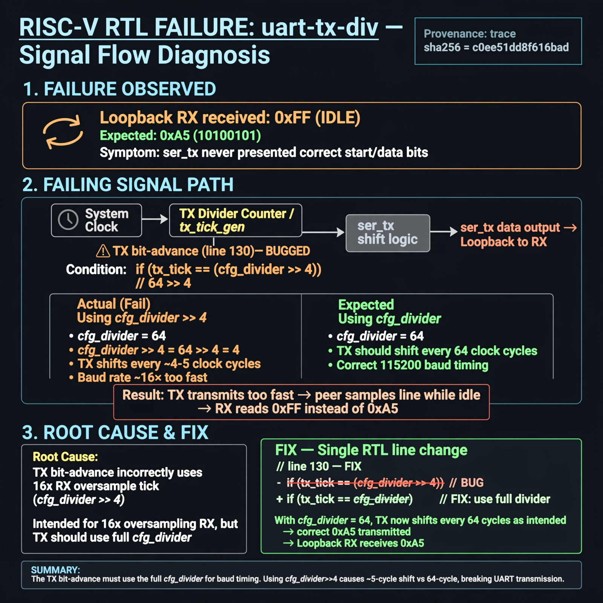

# Afterglow run report: verbatim-uart-tx-div

case `uart-tx-div` | status **GREEN** | mode `live` | seed `42`

wall start `2026-10-30T17:27:02Z` | wall end `2026-10-30T17:28:11Z` | time-to-green `69.8s`

retries `0` | human_touches `0` | diagnosed `True` | fixed_unaided `True` | patch_source `model-verbatim`

## Verdicts (from sim, not typed)

- BEFORE: tohost=FAIL 0xdead checksum=e251d79bc7250f734efe026d9d7f036e818ad243c9428000f5cdb2c1fd8b03c6 cycles=2652 seed=42 pass=False
- AFTER: tohost=PASS checksum=5c8f58d0f0818c97d014d2f851a6140882bd1efc96a2537047806252c0c2caf9 cycles=2652 seed=42 pass=True

## Diagnosis (verbatim from api/text_response.json)

```
Loopback RX got 0xff (idle) instead of 0xa5, so ser_tx never presented correct start/data bits. TX bit-advance on line 130 uses (cfg_divider >> 4) - the 16x RX oversample tick - instead of full cfg_divider. With divider 64 TX shifts every ~5 cycles vs 64 expected, so the peer samples idle and the transfer fails.
```

expected re-sim signal: tohost PASS (not FAIL 0xdead), loopback got 0xa5 want 0xa5 with no uart data mismatch TRAP

## Patch (2 lines, guard-checked)

```diff
diff --git a/picosoc/simpleuart.v b/picosoc/simpleuart.v
--- a/picosoc/simpleuart.v
+++ b/picosoc/simpleuart.v
@@ -127,7 +127,7 @@
 				send_bitcnt <= 10;
 				send_divcnt <= 0;
 			end else
-			if (send_divcnt > (cfg_divider >> 4) && send_bitcnt) begin
+			if (send_divcnt > cfg_divider && send_bitcnt) begin
 				send_pattern <= {1'b1, send_pattern[9:1]};
 				send_bitcnt <= send_bitcnt - 1;
 				send_divcnt <= 0;

```

## Provenance (judge checks)

- prompt file `/home/tuncay/afterglow/agent/prompts/v2.txt` sha256 `d31e1ef6b74ddf52ee59e790ebff2f3defa9b03be82e699f45ef620cf8e27a6e`
- input_trace.txt sha256 `c0ee51dd8f616bad654e7bb4f327a91778d99e70abf1be8357ef07e12c200844` (9 lines, 68 tokens)
- prompt tokens `832` (cap 2500)
- text model `muse-spark-1.3-contributor` latency `53946ms` request `chatcmpl-01a18dda-9a31-7386-b7b7-e9ba01b98b21`
- image model `muse-image-1.0` latency `15207ms` request `0d81764c-de5c-42d0-a620-6bf0003458bd` status `ok`
- image prompt sha256 `9049c47f85fe7cfb4ae0784753e287d376cf317c6521598a00a624e371037b60`, trace sha `c0ee51dd8f616bad654e7bb4f327a91778d99e70abf1be8357ef07e12c200844` (see api/image_request.json)

## Explanation diagram



## Bundle completeness

- present (12): artifacts/input_trace.txt, artifacts/boot.log, artifacts/boot_after.log, artifacts/verdict_before.json, artifacts/verdict_after.json, api/text_request.json, api/text_response.json, api/image_request.json, api/image_response.json, explain.png, patch.diff, meta.json
- missing (0): none

