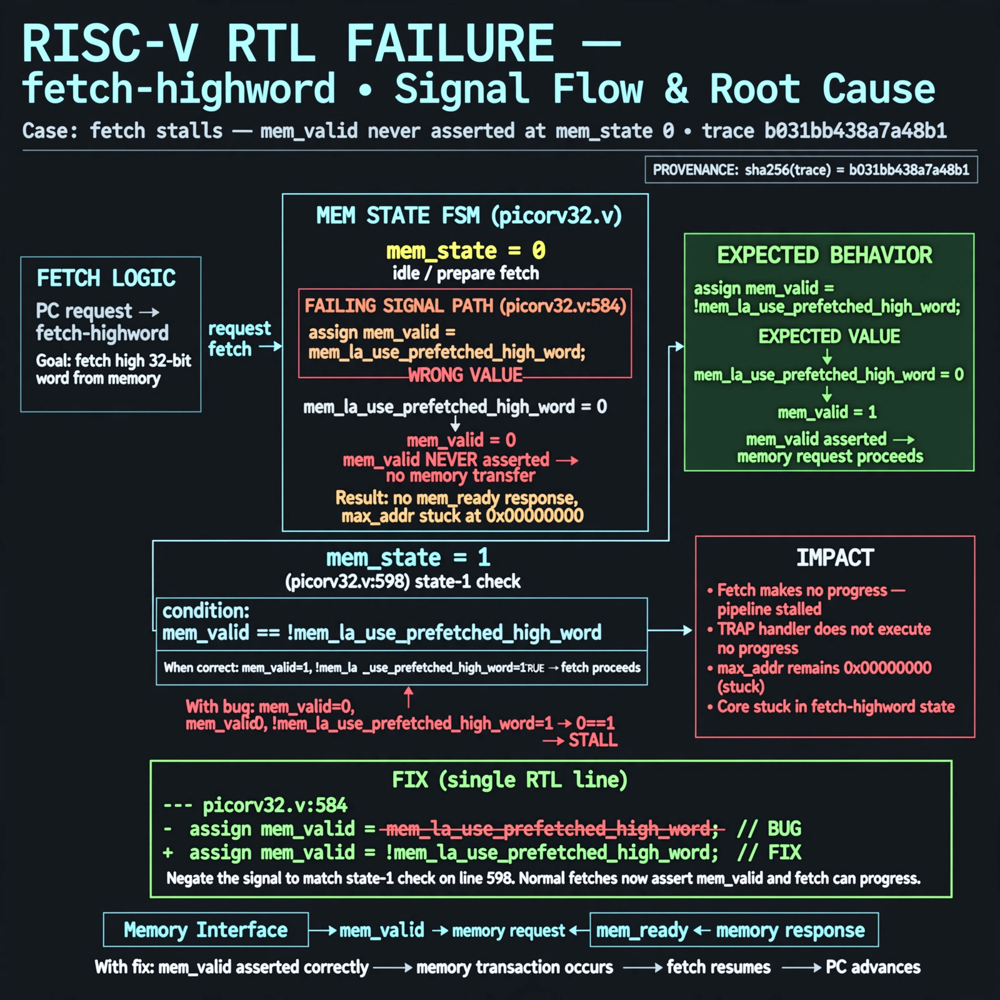

# Afterglow run report: vis-off-fetch-highword-42

case `fetch-highword` | status **GREEN** | mode `live` | seed `42`

wall start `2026-10-28T00:40:20Z` | wall end `2026-10-28T00:41:04Z` | time-to-green `44.3s`

retries `0` | human_touches `0` | diagnosed `True` | fixed_unaided `True` | patch_source `model-verbatim`

## Verdicts (from sim, not typed)

- BEFORE: tohost=FAIL 0xdead checksum=563b7c10626ff25de2b3c430956c7c113e448c4efaea068f9b83a198d4322b15 cycles=2009 seed=42 pass=False
- AFTER: tohost=PASS checksum=5c28238265cb94168311e9914f0df355642c557d04dba11845d557ac8a64aa4a cycles=2009 seed=42 pass=True

## Diagnosis (verbatim from api/text_response.json)

```
Fetch makes no progress with max_addr stuck at 0x00000000 and TRAP no progress. In mem_state 0 (picorv32.v:584) mem_valid is driven to mem_la_use_prefetched_high_word instead of its negation, so normal fetches never assert mem_valid and no transfer occurs. This contradicts the state-1 check at picorv32.v:598 mem_valid == !mem_la_use_prefetched_high_word and stalls the core in fetch-highword.
```

expected re-sim signal: tohost: PASS, no TRAP, max_addr progress >0x00000000

## Patch (2 lines, guard-checked)

```diff
diff --git a/picorv32.v b/picorv32.v
--- a/picorv32.v
+++ b/picorv32.v
@@ -582,6 +582,6 @@
 				0: begin
 					if (mem_do_prefetch || mem_do_rinst || mem_do_rdata) begin
-						mem_valid <= mem_la_use_prefetched_high_word;
+						mem_valid <= !mem_la_use_prefetched_high_word;
 						mem_instr <= mem_do_prefetch || mem_do_rinst;
 						mem_wstrb <= 0;
 						mem_state <= 1;

```

## Provenance (judge checks)

- prompt file `v3` sha256 `ad529368accaf171e6121a54b2d27547230920a900c7c4e5094d3fff13ca4233`
- input_trace.txt sha256 `b031bb438a7a48b1bcdaeeb7234224d87d090c4bb1d5bd0de6ba5df57fc0656e` (9 lines, 69 tokens)
- prompt tokens `715` (cap 2500)
- text model `muse-spark-1.3-contributor` latency `29952ms` request `chatcmpl-01a17ff3-dba9-7632-9a84-b8d0a2f412c6`
- image model `muse-image-1.0` latency `13590ms` request `a5a4eeb0-84a2-4d85-8eff-6a61685128a6` status `ok`
- image prompt sha256 `c0eef7c0a923ae0cad3e197b1ea16ced91d23796aba87c140a837b6d6a81a4bc`, trace sha `b031bb438a7a48b1bcdaeeb7234224d87d090c4bb1d5bd0de6ba5df57fc0656e` (see api/image_request.json)

## Explanation diagram



## Bundle completeness

- present (12): artifacts/input_trace.txt, artifacts/boot.log, artifacts/boot_after.log, artifacts/verdict_before.json, artifacts/verdict_after.json, api/text_request.json, api/text_response.json, api/image_request.json, api/image_response.json, explain.png, patch.diff, meta.json
- missing (0): none

