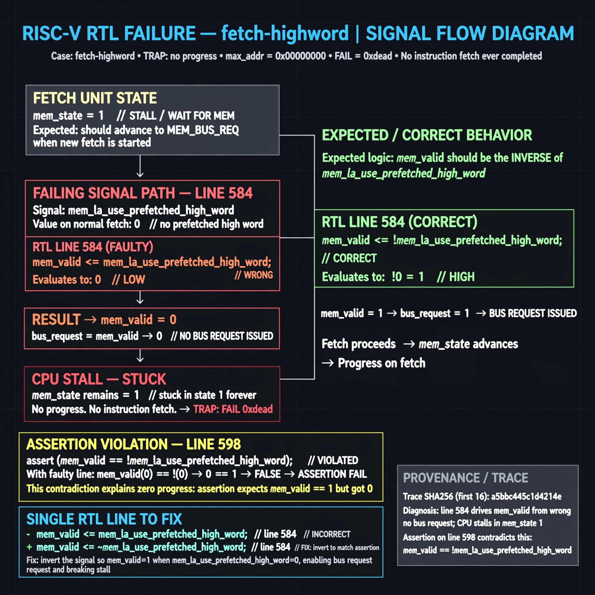

# Afterglow run report: vis-off-fetch-highword-43

case `fetch-highword` | status **GREEN** | mode `live` | seed `43`

wall start `2026-10-28T00:42:13Z` | wall end `2026-10-28T00:43:07Z` | time-to-green `54.3s`

retries `0` | human_touches `0` | diagnosed `True` | fixed_unaided `True` | patch_source `model-verbatim`

## Verdicts (from sim, not typed)

- BEFORE: tohost=FAIL 0xdead checksum=563b7c10626ff25de2b3c430956c7c113e448c4efaea068f9b83a198d4322b15 cycles=2009 seed=43 pass=False
- AFTER: tohost=PASS checksum=5c28238265cb94168311e9914f0df355642c557d04dba11845d557ac8a64aa4a cycles=2009 seed=43 pass=True

## Diagnosis (verbatim from api/text_response.json)

```
Trace shows TRAP: no progress max_addr=0x00000000 with FAIL 0xdead, meaning no instruction fetch ever completed. Excerpt line 584 drives mem_valid <= mem_la_use_prefetched_high_word (0 on a normal fetch) instead of !mem_la_use_prefetched_high_word, so no bus request is issued and CPU stalls in mem_state 1 forever. This contradicts the line 598 assert mem_valid == !mem_la_use_prefetched_high_word and explains zero progress.
```

expected re-sim signal: tohost PASS (no TRAP: no progress, max_addr>0x00000000, progress advancing)

## Patch (2 lines, guard-checked)

```diff
diff --git a/picorv32.v b/picorv32.v
--- a/picorv32.v
+++ b/picorv32.v
@@ -581,7 +581,7 @@
 			case (mem_state)
 				0: begin
 					if (mem_do_prefetch || mem_do_rinst || mem_do_rdata) begin
-						mem_valid <= mem_la_use_prefetched_high_word;
+						mem_valid <= !mem_la_use_prefetched_high_word;
 						mem_instr <= mem_do_prefetch || mem_do_rinst;
 						mem_wstrb <= 0;
 						mem_state <= 1;

```

## Provenance (judge checks)

- prompt file `v3` sha256 `ad529368accaf171e6121a54b2d27547230920a900c7c4e5094d3fff13ca4233`
- input_trace.txt sha256 `a5bbc445c1d4214e116eff4dc75ff715abdcbf8613f4e0cb9a752596edd26814` (9 lines, 69 tokens)
- prompt tokens `715` (cap 2500)
- text model `muse-spark-1.3-contributor` latency `26631ms` request `chatcmpl-01a17ff5-881c-7698-878c-2b9102b1fcca`
- image model `muse-image-1.0` latency `27053ms` request `4d8cca30-7be3-45f6-b271-668d7334ac04` status `ok`
- image prompt sha256 `f5fdea95fc8aeddfe751e8de4687c12f53a54eabd93e6a69db127b999e1a4619`, trace sha `a5bbc445c1d4214e116eff4dc75ff715abdcbf8613f4e0cb9a752596edd26814` (see api/image_request.json)

## Explanation diagram



## Bundle completeness

- present (12): artifacts/input_trace.txt, artifacts/boot.log, artifacts/boot_after.log, artifacts/verdict_before.json, artifacts/verdict_after.json, api/text_request.json, api/text_response.json, api/image_request.json, api/image_response.json, explain.png, patch.diff, meta.json
- missing (0): none

