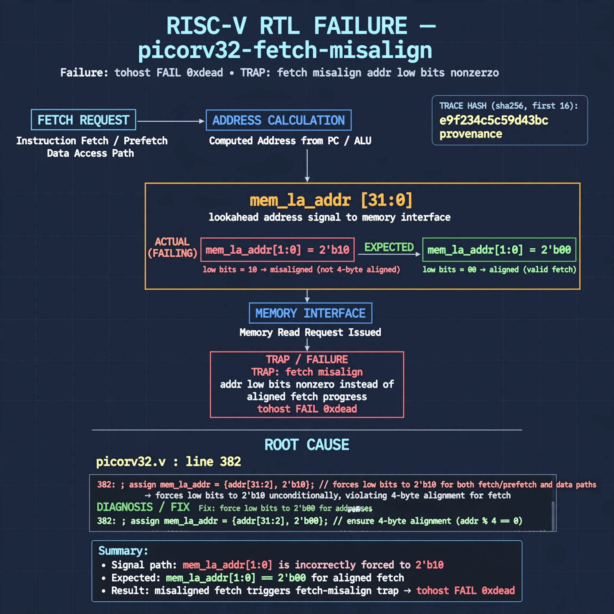

# Afterglow run report: vis-off-picorv32-fetch-misalign-42

case `picorv32-fetch-misalign` | status **GREEN** | mode `live` | seed `42`

wall start `2026-10-28T00:31:21Z` | wall end `2026-10-28T00:31:51Z` | time-to-green `29.8s`

retries `0` | human_touches `0` | diagnosed `True` | fixed_unaided `True` | patch_source `model-verbatim`

## Verdicts (from sim, not typed)

- BEFORE: tohost=FAIL 0xdead checksum=a29998cd8e81501b64b44a66e009c12b297662db5ef5369b12ef3feae608e5d5 cycles=2009 seed=42 pass=False
- AFTER: tohost=PASS checksum=5c28238265cb94168311e9914f0df355642c557d04dba11845d557ac8a64aa4a cycles=2009 seed=42 pass=True

## Diagnosis (verbatim from api/text_response.json)

```
Trace shows tohost FAIL 0xdead with TRAP: fetch misalign addr low bits nonzero instead of aligned fetch progress. Expected mem_la_addr[1:0]==2'b00 but excerpt drives 2'b10. Root cause is picorv32.v:382 where mem_la_addr forces low bits to 2'b10 for both fetch/prefetch and data paths, making every lookahead access misaligned.
```

expected re-sim signal: tohost PASS with no TRAP: fetch misalign addr low bits nonzero, VERDICT pass:true (checksum != a29998cd8e81501b64b44a66e009c12b297662db5ef5369b12ef3feae608e5d5)

## Patch (2 lines, guard-checked)

```diff
diff --git a/picorv32.v b/picorv32.v
--- a/picorv32.v
+++ b/picorv32.v
@@ -382,1 +382,1 @@
-	assign mem_la_addr = (mem_do_prefetch || mem_do_rinst) ? {next_pc[31:2] + mem_la_firstword_xfer, 2'b10} : {reg_op1[31:2], 2'b10};
+	assign mem_la_addr = (mem_do_prefetch || mem_do_rinst) ? {next_pc[31:2] + mem_la_firstword_xfer, 2'b00} : {reg_op1[31:2], 2'b00};

```

## Provenance (judge checks)

- prompt file `v3` sha256 `ad529368accaf171e6121a54b2d27547230920a900c7c4e5094d3fff13ca4233`
- input_trace.txt sha256 `e9f234c5c59d43bc91cb16031208c96ce6f86df6ca875b63ec9f1dcee4ee20f3` (9 lines, 72 tokens)
- prompt tokens `780` (cap 2500)
- text model `muse-spark-1.3-contributor` latency `15913ms` request `chatcmpl-01a17feb-6e60-76ae-a5af-8f6d1fc524f6`
- image model `muse-image-1.0` latency `13058ms` request `4fea5f53-4e49-4210-b88a-3c975d33ddf5` status `ok`
- image prompt sha256 `676143f7904557536f5b46676d81b42da697f26e15aa87879f4b9854c3dabebc`, trace sha `e9f234c5c59d43bc91cb16031208c96ce6f86df6ca875b63ec9f1dcee4ee20f3` (see api/image_request.json)

## Explanation diagram



## Bundle completeness

- present (12): artifacts/input_trace.txt, artifacts/boot.log, artifacts/boot_after.log, artifacts/verdict_before.json, artifacts/verdict_after.json, api/text_request.json, api/text_response.json, api/image_request.json, api/image_response.json, explain.png, patch.diff, meta.json
- missing (0): none

