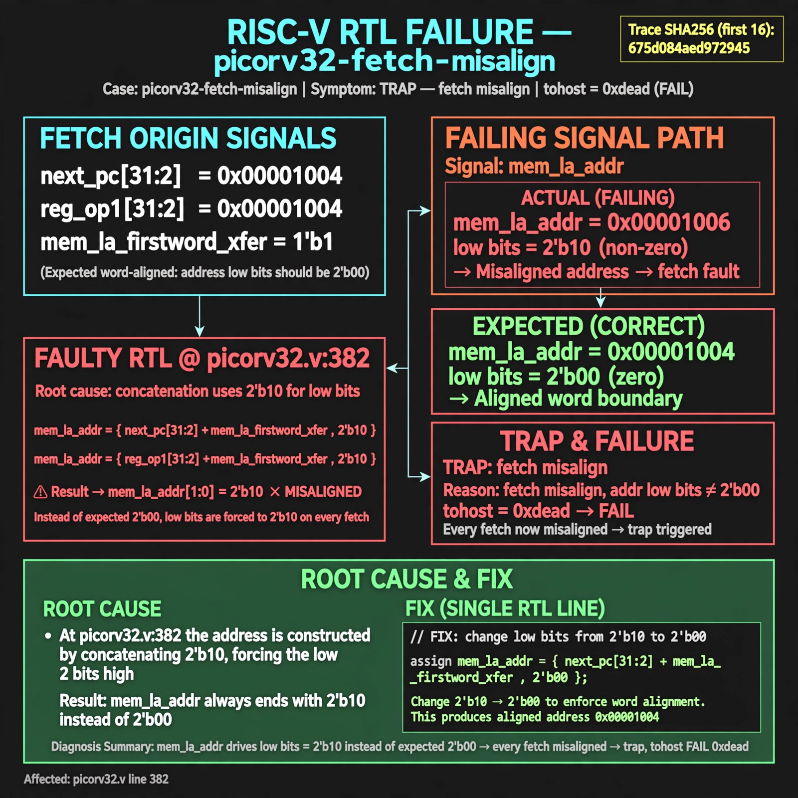

# Afterglow run report: vis-off-picorv32-fetch-misalign-43

case `picorv32-fetch-misalign` | status **GREEN** | mode `live` | seed `43`

wall start `2026-10-28T00:32:52Z` | wall end `2026-10-28T00:33:40Z` | time-to-green `47.9s`

retries `0` | human_touches `0` | diagnosed `True` | fixed_unaided `True` | patch_source `model-verbatim`

## Verdicts (from sim, not typed)

- BEFORE: tohost=FAIL 0xdead checksum=a29998cd8e81501b64b44a66e009c12b297662db5ef5369b12ef3feae608e5d5 cycles=2009 seed=43 pass=False
- AFTER: tohost=PASS checksum=5c28238265cb94168311e9914f0df355642c557d04dba11845d557ac8a64aa4a cycles=2009 seed=43 pass=True

## Diagnosis (verbatim from api/text_response.json)

```
Trace shows TRAP: fetch misalign addr low bits nonzero with tohost FAIL 0xdead. mem_la_addr drives low bits as 2'b10 instead of expected 2'b00, so every fetch is misaligned. Root cause is picorv32.v:382 which builds {next_pc[31:2]+mem_la_firstword_xfer,2'b10} and {reg_op1[31:2],2'b10}.
```

expected re-sim signal: tohost PASS (not FAIL 0xdead) with no TRAP: fetch misalign addr low bits nonzero

## Patch (2 lines, guard-checked)

```diff
diff --git a/picorv32.v b/picorv32.v
--- a/picorv32.v
+++ b/picorv32.v
@@ -382,1 +382,1 @@
-	assign mem_la_addr = (mem_do_prefetch || mem_do_rinst) ? {next_pc[31:2] + mem_la_firstword_xfer, 2'b10} : {reg_op1[31:2], 2'b10};
+	assign mem_la_addr = (mem_do_prefetch || mem_do_rinst) ? {next_pc[31:2] + mem_la_firstword_xfer, 2'b00} : {reg_op1[31:2], 2'b00};

```

## Provenance (judge checks)

- prompt file `v3` sha256 `ad529368accaf171e6121a54b2d27547230920a900c7c4e5094d3fff13ca4233`
- input_trace.txt sha256 `675d084aed9729455ab11e8f33fe3e0448b08df1b04debea4985c94c4728e601` (9 lines, 72 tokens)
- prompt tokens `780` (cap 2500)
- text model `muse-spark-1.3-contributor` latency `22545ms` request `chatcmpl-01a17fec-eb92-72af-a7b6-c4ef689957a6`
- image model `muse-image-1.0` latency `24494ms` request `e66509b4-cbd3-4faa-a856-49e2ca05eb94` status `ok`
- image prompt sha256 `aeabde612bcb935ced212eb49fd0a6b09d4772e0ac652ea7d571679510112de0`, trace sha `675d084aed9729455ab11e8f33fe3e0448b08df1b04debea4985c94c4728e601` (see api/image_request.json)

## Explanation diagram



## Bundle completeness

- present (12): artifacts/input_trace.txt, artifacts/boot.log, artifacts/boot_after.log, artifacts/verdict_before.json, artifacts/verdict_after.json, api/text_request.json, api/text_response.json, api/image_request.json, api/image_response.json, explain.png, patch.diff, meta.json
- missing (0): none

