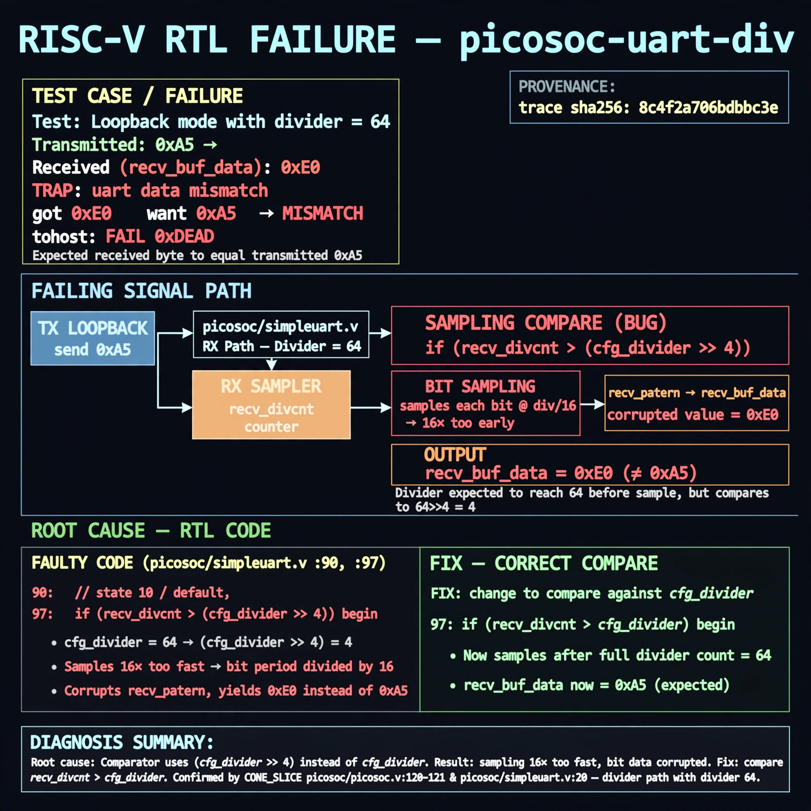

# Afterglow run report: vis-off-picosoc-uart-div-42

case `picosoc-uart-div` | status **GREEN** | mode `live` | seed `42`

wall start `2026-10-28T00:02:00Z` | wall end `2026-10-28T00:02:49Z` | time-to-green `48.9s`

retries `0` | human_touches `0` | diagnosed `True` | fixed_unaided `True` | patch_source `model-verbatim`

## Verdicts (from sim, not typed)

- BEFORE: tohost=FAIL 0xdead checksum=27ee482b473c74db5dce8b5ab1a233084cce3055c317a1f2045faa6dbc13a1c6 cycles=2112 seed=42 pass=False
- AFTER: tohost=PASS checksum=5c8f58d0f0818c97d014d2f851a6140882bd1efc96a2537047806252c0c2caf9 cycles=2652 seed=42 pass=True

## Diagnosis (verbatim from api/text_response.json)

```
Loopback with divider 64 sent 0xa5 but recv_buf_data returned 0xe0 causing TRAP: uart data mismatch got 0xe0 want 0xa5 and tohost FAIL 0xdead. CONE_SLICE picosoc/picosoc.v:120-121 and picosoc/simpleuart.v:20 confirm divider path, agreeing with trace divider 64. Root cause in excerpt at lines 90 and 97: states 10/default compare recv_divcnt > (cfg_divider >> 4) instead of > cfg_divider, sampling each bit 16x too fast and corrupting recv_pattern into recv_buf_data.
```

expected re-sim signal: tohost PASS, no TRAP uart data mismatch, loopback 0xa5 received correctly, checksum != 27ee482b473c74db5dce8b5ab1a233084cce3055c317a1f2045faa6dbc13a1c6

## Patch (4 lines, guard-checked)

```diff
diff --git a/picosoc/simpleuart.v b/picosoc/simpleuart.v
--- a/picosoc/simpleuart.v
+++ b/picosoc/simpleuart.v
@@ -89,12 +89,12 @@
 				10: begin
-					if (recv_divcnt > (cfg_divider >> 4)) begin
+					if (recv_divcnt > cfg_divider) begin
 						recv_buf_data <= recv_pattern;
 						recv_buf_valid <= 1;
 						recv_state <= 0;
 					end
 				end
 				default: begin
-					if (recv_divcnt > (cfg_divider >> 4)) begin
+					if (recv_divcnt > cfg_divider) begin
 						recv_pattern <= {ser_rx, recv_pattern[7:1]};
 						recv_state <= recv_state + 1;
 						recv_divcnt <= 0;

```

## Provenance (judge checks)

- prompt file `v3` sha256 `ad529368accaf171e6121a54b2d27547230920a900c7c4e5094d3fff13ca4233`
- input_trace.txt sha256 `8c4f2a706bdbbc3ef5433e545f1edf18cf38e0ea222de914e10b67f214ade435` (9 lines, 68 tokens)
- prompt tokens `809` (cap 2500)
- text model `muse-spark-1.3-contributor` latency `32398ms` request `chatcmpl-01a17fd0-ce8f-7058-8ed3-ccb802d2332d`
- image model `muse-image-1.0` latency `15753ms` request `8cfea7e6-1cfc-4e40-89ca-7202974a141e` status `ok`
- image prompt sha256 `613fbca669df22e2d57222a6583c6c5acf66c9690f1328b6e696fd3f2ec9160f`, trace sha `8c4f2a706bdbbc3ef5433e545f1edf18cf38e0ea222de914e10b67f214ade435` (see api/image_request.json)

## Explanation diagram



## Bundle completeness

- present (12): artifacts/input_trace.txt, artifacts/boot.log, artifacts/boot_after.log, artifacts/verdict_before.json, artifacts/verdict_after.json, api/text_request.json, api/text_response.json, api/image_request.json, api/image_response.json, explain.png, patch.diff, meta.json
- missing (0): none

