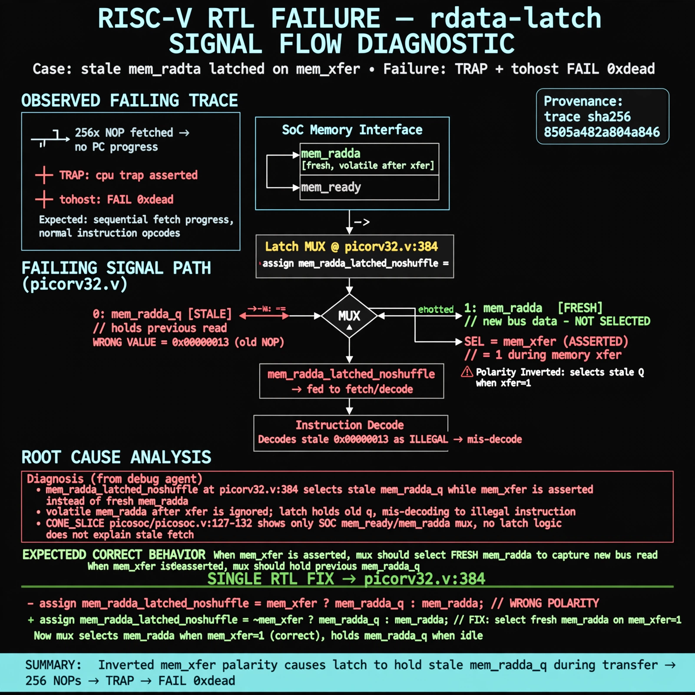

# Afterglow run report: vis-off-rdata-latch-43

case `rdata-latch` | status **GREEN** | mode `live` | seed `43`

wall start `2026-10-28T00:46:48Z` | wall end `2026-10-28T00:48:00Z` | time-to-green `72.6s`

retries `0` | human_touches `0` | diagnosed `True` | fixed_unaided `True` | patch_source `model-verbatim`

## Verdicts (from sim, not typed)

- BEFORE: tohost=FAIL 0xdead checksum=c2a7a4d6295484feeb9ec1ea9381732b8e39a7ccd1997c7d70f6454da2fb4659 cycles=2009 seed=43 pass=False
- AFTER: tohost=PASS checksum=5c28238265cb94168311e9914f0df355642c557d04dba11845d557ac8a64aa4a cycles=2009 seed=43 pass=True

## Diagnosis (verbatim from api/text_response.json)

```
Trace shows 256 NOP fetches ending in `TRAP: cpu trap asserted` and `tohost: FAIL 0xdead` instead of sequential fetch progress. `mem_rdata_latched_noshuffle` at picorv32.v:384 selects stale `mem_rdata_q` while `mem_xfer` is asserted instead of fresh `mem_rdata`, and volatile `mem_rdata` after xfer instead of held `q`, mis-decoding to illegal. CONE_SLICE picosoc/picosoc.v:127-132 only shows SoC `mem_ready`/`mem_rdata` mux and does not explain the stale fetch, so trace wins and root cause is inverted `mem_xfer` polarity in the latch mux.
```

expected re-sim signal: tohost PASS (not FAIL 0xdead), no `TRAP: cpu trap asserted`, checksum != c2a7a4d6295484feeb9ec1ea9381732b8e39a7ccd1997c7d70f6454da2fb4659

## Patch (2 lines, guard-checked)

```diff
diff --git a/picorv32.v b/picorv32.v
--- a/picorv32.v
+++ b/picorv32.v
@@ -384,1 +384,1 @@
-	assign mem_rdata_latched_noshuffle = (mem_xfer || LATCHED_MEM_RDATA) ? mem_rdata_q : mem_rdata;
+	assign mem_rdata_latched_noshuffle = (!mem_xfer || LATCHED_MEM_RDATA) ? mem_rdata_q : mem_rdata;

```

## Provenance (judge checks)

- prompt file `v3` sha256 `ad529368accaf171e6121a54b2d27547230920a900c7c4e5094d3fff13ca4233`
- input_trace.txt sha256 `8505a482a804a846acb09ed5c8797f531d62698689dea6da8aca7796be7cbf35` (9 lines, 69 tokens)
- prompt tokens `1011` (cap 2500)
- text model `muse-spark-1.3-contributor` latency `35589ms` request `chatcmpl-01a17ff9-dd38-706f-a049-a2a849f922bf`
- image model `muse-image-1.0` latency `36326ms` request `699de46a-50da-471a-a752-c5569751f484` status `ok`
- image prompt sha256 `ae14c54ddc27346321841101cc35092ea710b67e9c0ae880c784b9277afb0890`, trace sha `8505a482a804a846acb09ed5c8797f531d62698689dea6da8aca7796be7cbf35` (see api/image_request.json)

## Explanation diagram



## Bundle completeness

- present (12): artifacts/input_trace.txt, artifacts/boot.log, artifacts/boot_after.log, artifacts/verdict_before.json, artifacts/verdict_after.json, api/text_request.json, api/text_response.json, api/image_request.json, api/image_response.json, explain.png, patch.diff, meta.json
- missing (0): none

