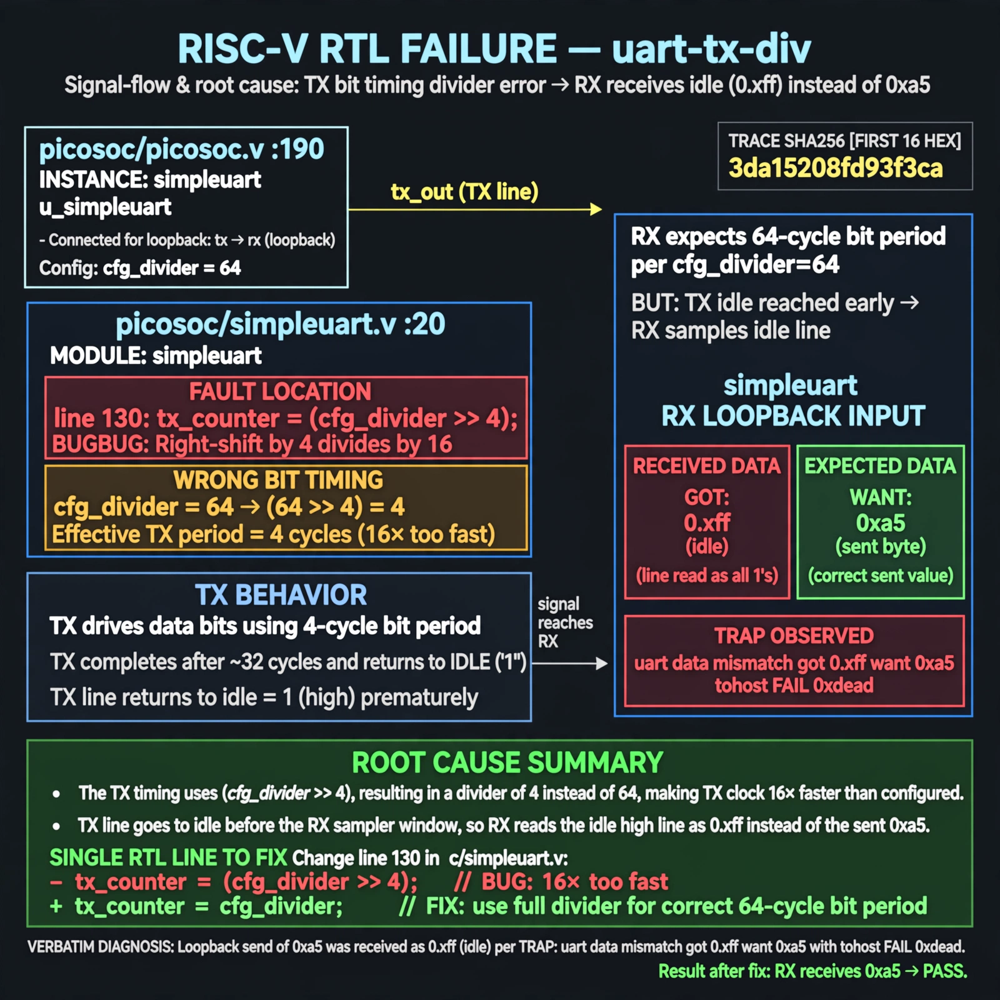

# Afterglow run report: vis-off-uart-tx-div-42

case `uart-tx-div` | status **GREEN** | mode `live` | seed `42`

wall start `2026-10-28T00:34:39Z` | wall end `2026-10-28T00:35:46Z` | time-to-green `67.0s`

retries `0` | human_touches `0` | diagnosed `True` | fixed_unaided `True` | patch_source `model-verbatim`

## Verdicts (from sim, not typed)

- BEFORE: tohost=FAIL 0xdead checksum=e251d79bc7250f734efe026d9d7f036e818ad243c9428000f5cdb2c1fd8b03c6 cycles=2652 seed=42 pass=False
- AFTER: tohost=PASS checksum=5c8f58d0f0818c97d014d2f851a6140882bd1efc96a2537047806252c0c2caf9 cycles=2652 seed=42 pass=True

## Diagnosis (verbatim from api/text_response.json)

```
Loopback send of 0xa5 was received as 0xff (idle) per TRAP: uart data mismatch got 0xff want 0xa5 with tohost FAIL 0xdead. Per CONE_SLICE picosoc/picosoc.v:190 simpleuart instance and picosoc/simpleuart.v:20 module, TX bit timing in excerpt line 130 uses (cfg_divider >> 4) making TX 16x too fast versus divider 64, so TX returns to idle before RX samples and RX reads 0xff.
```

expected re-sim signal: tohost PASS, uart loopback 0xa5 matches, no TRAP mismatch

## Patch (2 lines, guard-checked)

```diff
diff --git a/picosoc/simpleuart.v b/picosoc/simpleuart.v
--- a/picosoc/simpleuart.v
+++ b/picosoc/simpleuart.v
@@ -125,10 +125,10 @@
 			if (reg_dat_we && !send_bitcnt) begin
 				send_pattern <= {1'b1, reg_dat_di[7:0], 1'b0};
 				send_bitcnt <= 10;
 				send_divcnt <= 0;
 			end else
-			if (send_divcnt > (cfg_divider >> 4) && send_bitcnt) begin
+			if (send_divcnt > cfg_divider && send_bitcnt) begin
 				send_pattern <= {1'b1, send_pattern[9:1]};
 				send_bitcnt <= send_bitcnt - 1;
 				send_divcnt <= 0;
 			end

```

## Provenance (judge checks)

- prompt file `v3` sha256 `ad529368accaf171e6121a54b2d27547230920a900c7c4e5094d3fff13ca4233`
- input_trace.txt sha256 `3da15208fd93f3cabbb217a81f41d5d9cf8d15db745a74f33e3a33a9debb93cc` (9 lines, 68 tokens)
- prompt tokens `820` (cap 2500)
- text model `muse-spark-1.3-contributor` latency `33045ms` request `chatcmpl-01a17fee-b40a-7630-b73a-a556e8cdbee0`
- image model `muse-image-1.0` latency `33354ms` request `f2c7cfc2-4c41-4751-aa67-0dd221cc088a` status `ok`
- image prompt sha256 `5eb1d528770985cd1777e1d44be866863c5700eb795019fba1a4a6428b5d6183`, trace sha `3da15208fd93f3cabbb217a81f41d5d9cf8d15db745a74f33e3a33a9debb93cc` (see api/image_request.json)

## Explanation diagram



## Bundle completeness

- present (12): artifacts/input_trace.txt, artifacts/boot.log, artifacts/boot_after.log, artifacts/verdict_before.json, artifacts/verdict_after.json, api/text_request.json, api/text_response.json, api/image_request.json, api/image_response.json, explain.png, patch.diff, meta.json
- missing (0): none

