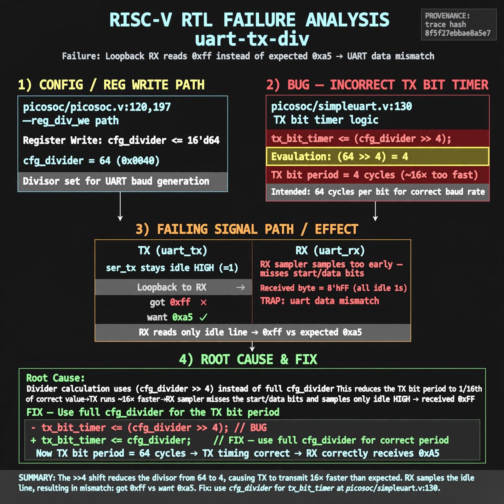

# Afterglow run report: vis-off-uart-tx-div-43

case `uart-tx-div` | status **GREEN** | mode `live` | seed `43`

wall start `2026-10-28T00:37:35Z` | wall end `2026-10-28T00:38:51Z` | time-to-green `75.5s`

retries `0` | human_touches `0` | diagnosed `True` | fixed_unaided `True` | patch_source `model-verbatim`

## Verdicts (from sim, not typed)

- BEFORE: tohost=FAIL 0xdead checksum=e251d79bc7250f734efe026d9d7f036e818ad243c9428000f5cdb2c1fd8b03c6 cycles=2652 seed=43 pass=False
- AFTER: tohost=PASS checksum=5c8f58d0f0818c97d014d2f851a6140882bd1efc96a2537047806252c0c2caf9 cycles=2652 seed=43 pass=True

## Diagnosis (verbatim from api/text_response.json)

```
Loopback TX stayed idle so ser_tx=1 and RX got 0xff vs want 0xa5 at TRAP: uart data mismatch got 0xff want 0xa5. With divider 64 from picosoc/picosoc.v:120 and picosoc/picosoc.v:197 reg_div_we path, TX bit timer at picosoc/simpleuart.v:130 uses (cfg_divider >> 4) making TX ~16x too fast, so the RX sampler misses the start/data bits and reads idle. Fix is to use full cfg_divider for the TX bit period.
```

expected re-sim signal: tohost PASS, no TRAP, uart loopback 0xa5 received correctly

## Patch (2 lines, guard-checked)

```diff
diff --git a/picosoc/simpleuart.v b/picosoc/simpleuart.v
--- a/picosoc/simpleuart.v
+++ b/picosoc/simpleuart.v
@@ -125,10 +125,10 @@
 			if (reg_dat_we && !send_bitcnt) begin
 				send_pattern <= {1'b1, reg_dat_di[7:0], 1'b0};
 				send_bitcnt <= 10;
 				send_divcnt <= 0;
 			end else
-			if (send_divcnt > (cfg_divider >> 4) && send_bitcnt) begin
+			if (send_divcnt > cfg_divider && send_bitcnt) begin
 				send_pattern <= {1'b1, send_pattern[9:1]};
 				send_bitcnt <= send_bitcnt - 1;
 				send_divcnt <= 0;
 			end

```

## Provenance (judge checks)

- prompt file `v3` sha256 `ad529368accaf171e6121a54b2d27547230920a900c7c4e5094d3fff13ca4233`
- input_trace.txt sha256 `8f5f27ebbae8a5e780004d626f5a52748ee7c6712c4dfb6ec5d3438c707faa14` (9 lines, 68 tokens)
- prompt tokens `820` (cap 2500)
- text model `muse-spark-1.3-contributor` latency `47397ms` request `chatcmpl-01a17ff1-9dd9-73a2-b8a3-303cc80e3826`
- image model `muse-image-1.0` latency `27533ms` request `01c6ada8-b039-4a5d-99a2-0c4c55e3028e` status `ok`
- image prompt sha256 `9844aa3218631c35c7f43ae69ef4521b06b4843a89d34250e35fd2595103ff96`, trace sha `8f5f27ebbae8a5e780004d626f5a52748ee7c6712c4dfb6ec5d3438c707faa14` (see api/image_request.json)

## Explanation diagram



## Bundle completeness

- present (12): artifacts/input_trace.txt, artifacts/boot.log, artifacts/boot_after.log, artifacts/verdict_before.json, artifacts/verdict_after.json, api/text_request.json, api/text_response.json, api/image_request.json, api/image_response.json, explain.png, patch.diff, meta.json
- missing (0): none

