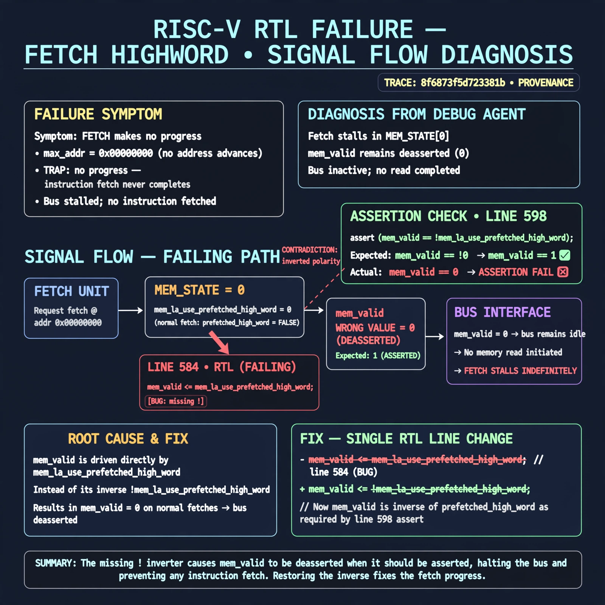

# Afterglow run report: vis-on-fetch-highword-42

case `fetch-highword` | status **GREEN** | mode `live` | seed `42`

wall start `2026-10-28T00:41:04Z` | wall end `2026-10-28T00:42:13Z` | time-to-green `68.6s`

retries `0` | human_touches `0` | diagnosed `True` | fixed_unaided `True` | patch_source `model-verbatim`

## Verdicts (from sim, not typed)

- BEFORE: tohost=FAIL 0xdead checksum=563b7c10626ff25de2b3c430956c7c113e448c4efaea068f9b83a198d4322b15 cycles=2009 seed=42 pass=False
- AFTER: tohost=PASS checksum=5c28238265cb94168311e9914f0df355642c557d04dba11845d557ac8a64aa4a cycles=2009 seed=42 pass=True

## Diagnosis (verbatim from api/text_response.json)

```
Fetch makes no progress with max_addr=0x00000000 and TRAP: no progress, so no instruction fetch ever completes. In mem_state 0 line 584 sets mem_valid <= mem_la_use_prefetched_high_word instead of its inverse, deasserting mem_valid on normal fetches and stalling the bus. This contradicts the line 598 assert mem_valid == !mem_la_use_prefetched_high_word, confirming inverted polarity from a missing `!`.
```

expected re-sim signal: tohost PASS (not FAIL 0xdead), no TRAP: no progress, max_addr advances beyond 0x00000000 with fetch progress

## Patch (2 lines, guard-checked)

```diff
diff --git a/picorv32.v b/picorv32.v
--- a/picorv32.v
+++ b/picorv32.v
@@ -582,7 +582,7 @@
 				0: begin
 					if (mem_do_prefetch || mem_do_rinst || mem_do_rdata) begin
-						mem_valid <= mem_la_use_prefetched_high_word;
+						mem_valid <= !mem_la_use_prefetched_high_word;
 						mem_instr <= mem_do_prefetch || mem_do_rinst;
 						mem_wstrb <= 0;
 						mem_state <= 1;
 					end

```

## Provenance (judge checks)

- prompt file `v3` sha256 `ad529368accaf171e6121a54b2d27547230920a900c7c4e5094d3fff13ca4233`
- input_trace.txt sha256 `8f6873f5d723381b559a49fd52484d73e05bb56ead79aa5faf2ff5c66eb9db8a` (9 lines, 69 tokens)
- prompt tokens `715` (cap 2500)
- text model `muse-spark-1.3-contributor` latency `32409ms` request `chatcmpl-01a17ff4-9240-72c8-aac2-3583c48c7707`
- image model `muse-image-1.0` latency `16319ms` request `bcf99221-bb73-4580-ad27-1d6a1220791e` status `ok`
- image prompt sha256 `8669b815159392773e695076ef0db75c088166219eb6acb5d5320fa646e23b65`, trace sha `8f6873f5d723381b559a49fd52484d73e05bb56ead79aa5faf2ff5c66eb9db8a` (see api/image_request.json)

## Explanation diagram



## Bundle completeness

- present (12): artifacts/input_trace.txt, artifacts/boot.log, artifacts/boot_after.log, artifacts/verdict_before.json, artifacts/verdict_after.json, api/text_request.json, api/text_response.json, api/image_request.json, api/image_response.json, explain.png, patch.diff, meta.json
- missing (0): none

