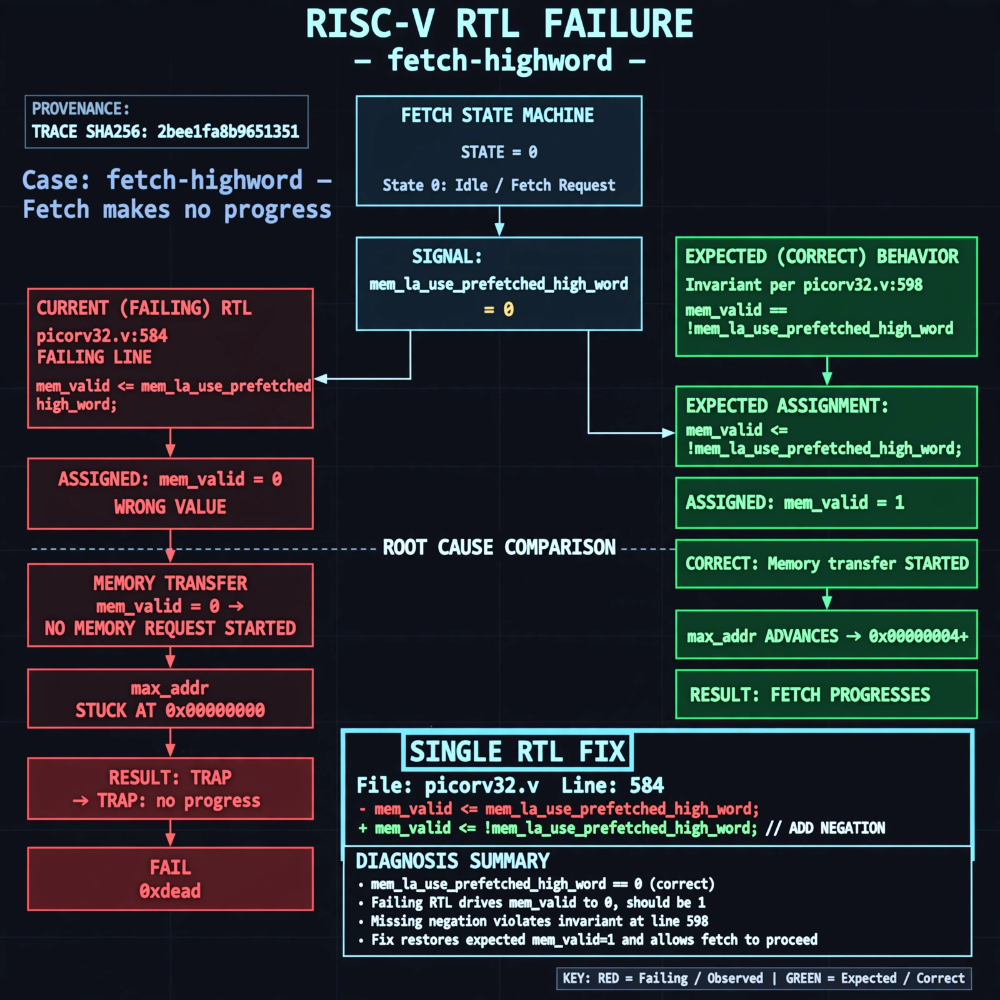

# Afterglow run report: vis-on-fetch-highword-43

case `fetch-highword` | status **GREEN** | mode `live` | seed `43`

wall start `2026-10-28T00:43:07Z` | wall end `2026-10-28T00:44:00Z` | time-to-green `52.6s`

retries `0` | human_touches `0` | diagnosed `True` | fixed_unaided `True` | patch_source `model-verbatim`

## Verdicts (from sim, not typed)

- BEFORE: tohost=FAIL 0xdead checksum=563b7c10626ff25de2b3c430956c7c113e448c4efaea068f9b83a198d4322b15 cycles=2009 seed=43 pass=False
- AFTER: tohost=PASS checksum=5c28238265cb94168311e9914f0df355642c557d04dba11845d557ac8a64aa4a cycles=2009 seed=43 pass=True

## Diagnosis (verbatim from api/text_response.json)

```
Fetch makes no progress with max_addr stuck at 0x00000000 leading to TRAP: no progress and FAIL 0xdead instead of advancing fetches. In state 0 mem_valid is driven to 0 when mem_la_use_prefetched_high_word==0 so no memory transfer is ever started, versus expected 1. Root cause is picorv32.v:584 missing negation `mem_valid <= mem_la_use_prefetched_high_word` which directly contradicts the invariant at picorv32.v:598 `mem_valid == !mem_la_use_prefetched_high_word`.
```

expected re-sim signal: tohost PASS with progress, max_addr advancing beyond 0x00000000, no TRAP: no progress

## Patch (2 lines, guard-checked)

```diff
diff --git a/picorv32.v b/picorv32.v
--- a/picorv32.v
+++ b/picorv32.v
@@ -581,7 +581,7 @@
 			case (mem_state)
 				0: begin
 					if (mem_do_prefetch || mem_do_rinst || mem_do_rdata) begin
-						mem_valid <= mem_la_use_prefetched_high_word;
+						mem_valid <= !mem_la_use_prefetched_high_word;
 						mem_instr <= mem_do_prefetch || mem_do_rinst;
 						mem_wstrb <= 0;
 						mem_state <= 1;

```

## Provenance (judge checks)

- prompt file `v3` sha256 `ad529368accaf171e6121a54b2d27547230920a900c7c4e5094d3fff13ca4233`
- input_trace.txt sha256 `2bee1fa8b9651351d35641279d6199acb926d7805c7441714a8598944cd6eb7c` (9 lines, 69 tokens)
- prompt tokens `715` (cap 2500)
- text model `muse-spark-1.3-contributor` latency `15765ms` request `chatcmpl-01a17ff6-3235-7077-877c-eff911003549`
- image model `muse-image-1.0` latency `13125ms` request `e300fa74-b0f4-4e5d-8b64-13b90639a0c9` status `ok`
- image prompt sha256 `b3068f6c860f140c9c8f00d28da94a7e4e3528b44f997e066ed90dc8fa445c94`, trace sha `2bee1fa8b9651351d35641279d6199acb926d7805c7441714a8598944cd6eb7c` (see api/image_request.json)

## Explanation diagram



## Bundle completeness

- present (12): artifacts/input_trace.txt, artifacts/boot.log, artifacts/boot_after.log, artifacts/verdict_before.json, artifacts/verdict_after.json, api/text_request.json, api/text_response.json, api/image_request.json, api/image_response.json, explain.png, patch.diff, meta.json
- missing (0): none

