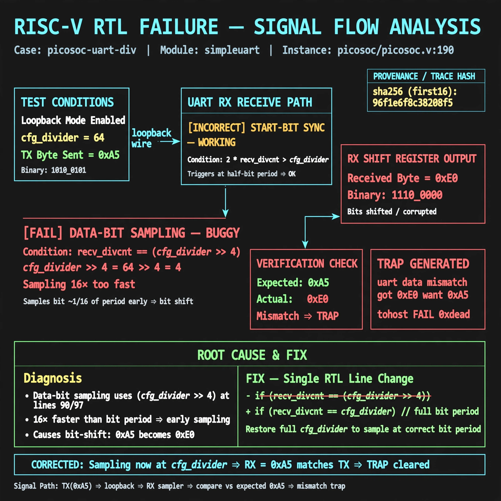

# Afterglow run report: vis-on-picosoc-uart-div-42

case `picosoc-uart-div` | status **TRIAGE** | mode `live` | seed `42`

wall start `2026-10-28T00:02:49Z` | wall end `2026-10-28T00:15:05Z` | time-to-green `736.4s`

retries `2` | human_touches `0` | diagnosed `True` | fixed_unaided `False` | patch_source `none`

## Verdicts (from sim, not typed)

- BEFORE: tohost=FAIL 0xdead checksum=27ee482b473c74db5dce8b5ab1a233084cce3055c317a1f2045faa6dbc13a1c6 cycles=2112 seed=42 pass=False
- AFTER: tohost=None checksum=None cycles=None seed=42 pass=False

## Diagnosis (verbatim from api/text_response.json)

```
MISSING (text call produced no diagnosis)
```

expected re-sim signal: -

## Patch (0 lines, guard-checked)

```diff
(no patch applied)
```

## Provenance (judge checks)

- prompt file `v3` sha256 `ad529368accaf171e6121a54b2d27547230920a900c7c4e5094d3fff13ca4233`
- input_trace.txt sha256 `96f1e6f8c38288f58acb31b09cc290f2cc620654e5a843be1ea86cc07fa9dc02` (9 lines, 68 tokens)
- prompt tokens `979` (cap 2500)
- text model `muse-spark-1.3-contributor` latency `?ms` request `?`
- image model `muse-image-1.0` latency `13873ms` request `fd14a3c6-4624-4906-a0a2-0743d28de4e6` status `ok`
- image prompt sha256 `33156e6301453b1c05288207f7e24014df63c69ab517f9fc07e03fe08dc18625`, trace sha `96f1e6f8c38288f58acb31b09cc290f2cc620654e5a843be1ea86cc07fa9dc02` (see api/image_request.json)

## Explanation diagram



## Bundle completeness

- present (12): artifacts/input_trace.txt, artifacts/boot.log, artifacts/boot_after.log, artifacts/verdict_before.json, artifacts/verdict_after.json, api/text_request.json, api/text_response.json, api/image_request.json, api/image_response.json, explain.png, patch.diff, meta.json
- missing (0): none

