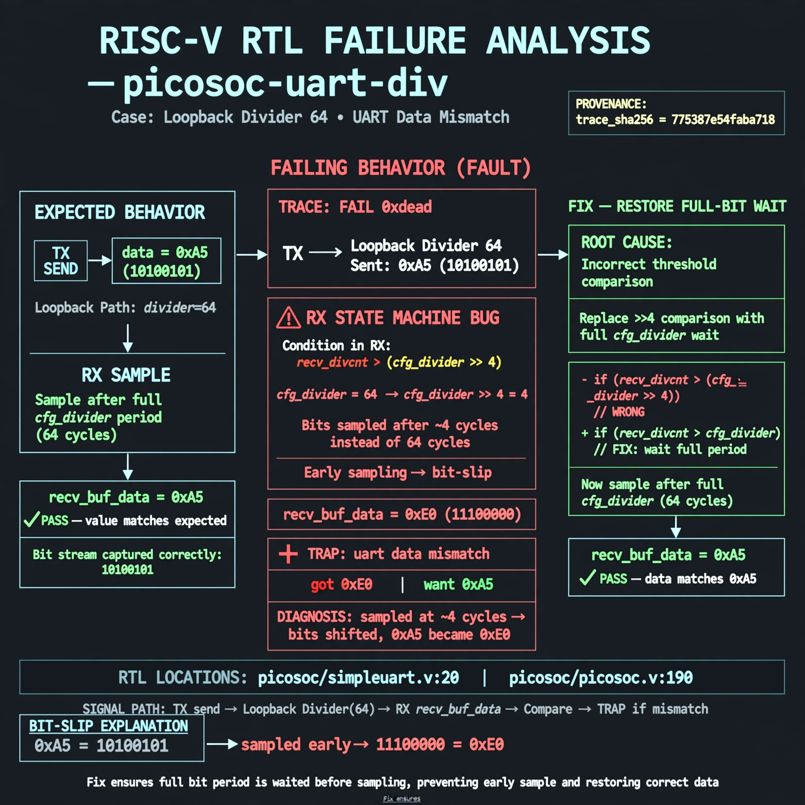

# Afterglow run report: vis-on-picosoc-uart-div-43

case `picosoc-uart-div` | status **TRIAGE** | mode `live` | seed `43`

wall start `2026-10-28T00:16:07Z` | wall end `2026-10-28T00:31:21Z` | time-to-green `914.6s`

retries `2` | human_touches `0` | diagnosed `True` | fixed_unaided `False` | patch_source `none`

## Verdicts (from sim, not typed)

- BEFORE: tohost=FAIL 0xdead checksum=27ee482b473c74db5dce8b5ab1a233084cce3055c317a1f2045faa6dbc13a1c6 cycles=2112 seed=43 pass=False
- AFTER: tohost=None checksum=None cycles=None seed=43 pass=False

## Diagnosis (verbatim from api/text_response.json)

```
MISSING (text call produced no diagnosis)
```

expected re-sim signal: -

## Patch (0 lines, guard-checked)

```diff
(no patch applied)
```

## Provenance (judge checks)

- prompt file `v3` sha256 `ad529368accaf171e6121a54b2d27547230920a900c7c4e5094d3fff13ca4233`
- input_trace.txt sha256 `775387e54faba7183b3c57d318414e8db0187c830efe098b0b8d27b3e14b21a8` (9 lines, 68 tokens)
- prompt tokens `948` (cap 2500)
- text model `muse-spark-1.3-contributor` latency `?ms` request `?`
- image model `muse-image-1.0` latency `12001ms` request `0dfa1544-93c1-4213-920f-189fc7c1afdc` status `ok`
- image prompt sha256 `346b8dcbedee9f5d23a881d132cdafa7f92aaaa9255c2394c881b841a07dd5b5`, trace sha `775387e54faba7183b3c57d318414e8db0187c830efe098b0b8d27b3e14b21a8` (see api/image_request.json)

## Explanation diagram



## Bundle completeness

- present (12): artifacts/input_trace.txt, artifacts/boot.log, artifacts/boot_after.log, artifacts/verdict_before.json, artifacts/verdict_after.json, api/text_request.json, api/text_response.json, api/image_request.json, api/image_response.json, explain.png, patch.diff, meta.json
- missing (0): none

