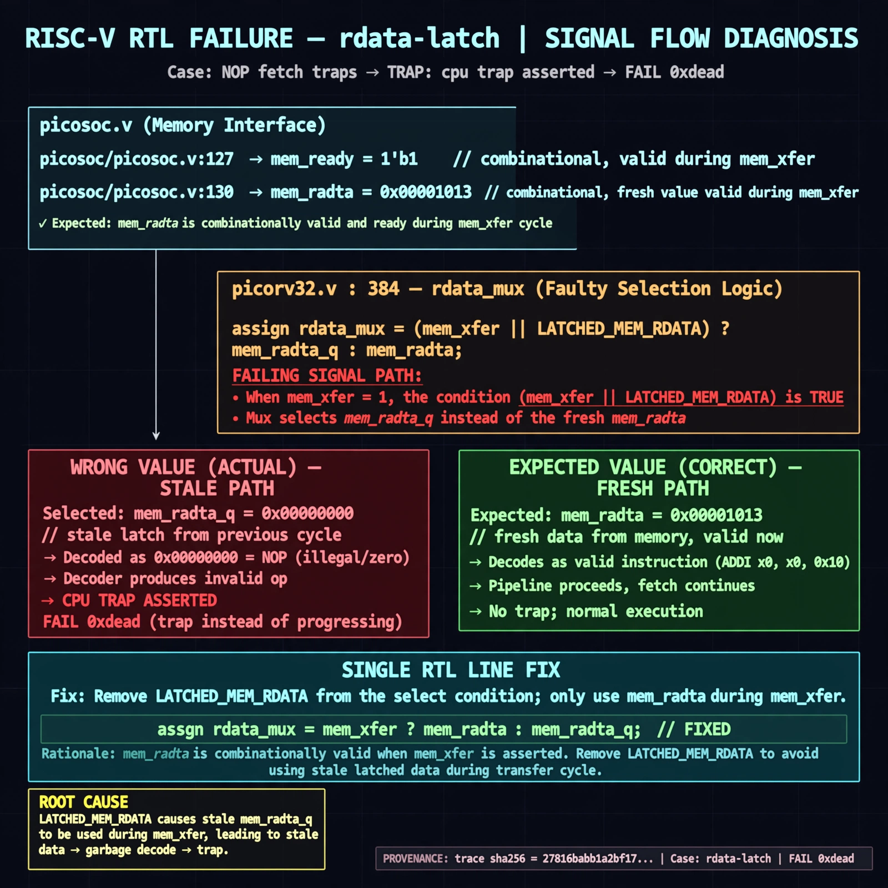

# Afterglow run report: vis-on-rdata-latch-43

case `rdata-latch` | status **GREEN** | mode `live` | seed `43`

wall start `2026-10-28T00:48:00Z` | wall end `2026-10-28T00:49:49Z` | time-to-green `108.5s`

retries `0` | human_touches `0` | diagnosed `True` | fixed_unaided `True` | patch_source `model-verbatim`

## Verdicts (from sim, not typed)

- BEFORE: tohost=FAIL 0xdead checksum=c2a7a4d6295484feeb9ec1ea9381732b8e39a7ccd1997c7d70f6454da2fb4659 cycles=2009 seed=43 pass=False
- AFTER: tohost=PASS checksum=5c28238265cb94168311e9914f0df355642c557d04dba11845d557ac8a64aa4a cycles=2009 seed=43 pass=True

## Diagnosis (verbatim from api/text_response.json)

```
NOP fetch traps with `TRAP: cpu trap asserted` and `FAIL 0xdead` instead of progressing. picosoc/picosoc.v:127 and picosoc/picosoc.v:130 show mem_ready/mem_rdata combinationally valid during mem_xfer, so fresh mem_rdata is expected. picorv32.v:384 selects mem_rdata_q when (mem_xfer || LATCHED_MEM_RDATA) and mem_rdata otherwise, using stale data on the transfer cycle and decoding garbage to trap.
```

expected re-sim signal: PASS tohost (not FAIL 0xdead) with no TRAP: cpu trap asserted

## Patch (2 lines, guard-checked)

```diff
diff --git a/picorv32.v b/picorv32.v
--- a/picorv32.v
+++ b/picorv32.v
@@ -384,1 +384,1 @@
-	assign mem_rdata_latched_noshuffle = (mem_xfer || LATCHED_MEM_RDATA) ? mem_rdata_q : mem_rdata;
+	assign mem_rdata_latched_noshuffle = (mem_xfer || LATCHED_MEM_RDATA) ? mem_rdata : mem_rdata_q;

```

## Provenance (judge checks)

- prompt file `v3` sha256 `ad529368accaf171e6121a54b2d27547230920a900c7c4e5094d3fff13ca4233`
- input_trace.txt sha256 `27816babb1a2bf17e649f8a32da7215e8855a299de5e302842be4126eaf41609` (9 lines, 69 tokens)
- prompt tokens `1011` (cap 2500)
- text model `muse-spark-1.3-contributor` latency `42797ms` request `chatcmpl-01a17ffb-1520-7610-85f9-ccc34e542cd0`
- image model `muse-image-1.0` latency `30348ms` request `90941f4f-d8ad-4543-9ead-bf69af346c38` status `ok`
- image prompt sha256 `4a62bcaf809cfcc41fa7b8f6f9d92a351e9b6347a46e1aecea559a65d2d12408`, trace sha `27816babb1a2bf17e649f8a32da7215e8855a299de5e302842be4126eaf41609` (see api/image_request.json)

## Explanation diagram



## Bundle completeness

- present (12): artifacts/input_trace.txt, artifacts/boot.log, artifacts/boot_after.log, artifacts/verdict_before.json, artifacts/verdict_after.json, api/text_request.json, api/text_response.json, api/image_request.json, api/image_response.json, explain.png, patch.diff, meta.json
- missing (0): none

