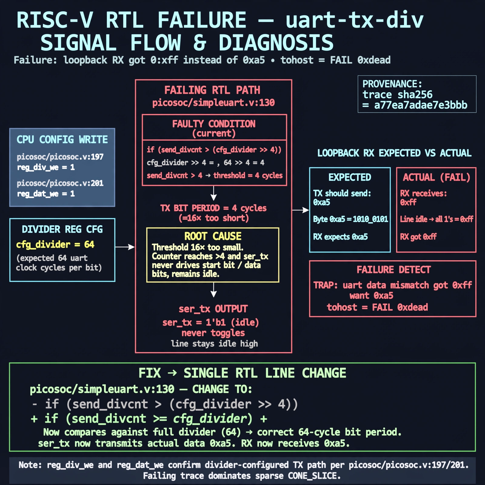

# Afterglow run report: vis-on-uart-tx-div-42

case `uart-tx-div` | status **GREEN** | mode `live` | seed `42`

wall start `2026-10-28T00:35:46Z` | wall end `2026-10-28T00:37:35Z` | time-to-green `109.4s`

retries `0` | human_touches `0` | diagnosed `True` | fixed_unaided `True` | patch_source `model-verbatim`

## Verdicts (from sim, not typed)

- BEFORE: tohost=FAIL 0xdead checksum=e251d79bc7250f734efe026d9d7f036e818ad243c9428000f5cdb2c1fd8b03c6 cycles=2652 seed=42 pass=False
- AFTER: tohost=PASS checksum=5c8f58d0f0818c97d014d2f851a6140882bd1efc96a2537047806252c0c2caf9 cycles=2652 seed=42 pass=True

## Diagnosis (verbatim from api/text_response.json)

```
ser_tx stayed idle so loopback RX got 0xff vs want 0xa5, causing TRAP: uart data mismatch got 0xff want 0xa5 and tohost FAIL 0xdead. Root cause is picosoc/simpleuart.v:130 `send_divcnt > (cfg_divider >> 4)` which makes the TX bit period 16x too short for divider 64, so the receiver samples idle and returns 0xff. Control wiring per picosoc/picosoc.v:197 reg_div_we and picosoc/picosoc.v:201 reg_dat_we confirms the divider-configured TX path; trace wins over sparse CONE_SLICE.
```

expected re-sim signal: tohost PASS with uart loopback 0xa5 OK, TRAP gone, checksum != e251d79bc7250f734efe026d9d7f036e818ad243c9428000f5cdb2c1fd8b03c6

## Patch (2 lines, guard-checked)

```diff
diff --git a/picosoc/simpleuart.v b/picosoc/simpleuart.v
--- a/picosoc/simpleuart.v
+++ b/picosoc/simpleuart.v
@@ -127,7 +127,7 @@
 				send_bitcnt <= 10;
 				send_divcnt <= 0;
 			end else
-			if (send_divcnt > (cfg_divider >> 4) && send_bitcnt) begin
+			if (send_divcnt > cfg_divider && send_bitcnt) begin
 				send_pattern <= {1'b1, send_pattern[9:1]};
 				send_bitcnt <= send_bitcnt - 1;
 				send_divcnt <= 0;

```

## Provenance (judge checks)

- prompt file `v3` sha256 `ad529368accaf171e6121a54b2d27547230920a900c7c4e5094d3fff13ca4233`
- input_trace.txt sha256 `a77ea7adae7e3bbb796897d8bd0f2560815552fa9f66f4d91c34722c695479d0` (9 lines, 68 tokens)
- prompt tokens `820` (cap 2500)
- text model `muse-spark-1.3-contributor` latency `56115ms` request `chatcmpl-01a17ff0-1403-74aa-a53b-ebb18a7b0004`
- image model `muse-image-1.0` latency `21802ms` request `ed9c357d-4b84-4a49-9cdd-129b060a830e` status `ok`
- image prompt sha256 `c5d5d3b438826ccfb959463399332c356790bbe3f950fefe32878ab83b228a2f`, trace sha `a77ea7adae7e3bbb796897d8bd0f2560815552fa9f66f4d91c34722c695479d0` (see api/image_request.json)

## Explanation diagram



## Bundle completeness

- present (12): artifacts/input_trace.txt, artifacts/boot.log, artifacts/boot_after.log, artifacts/verdict_before.json, artifacts/verdict_after.json, api/text_request.json, api/text_response.json, api/image_request.json, api/image_response.json, explain.png, patch.diff, meta.json
- missing (0): none

