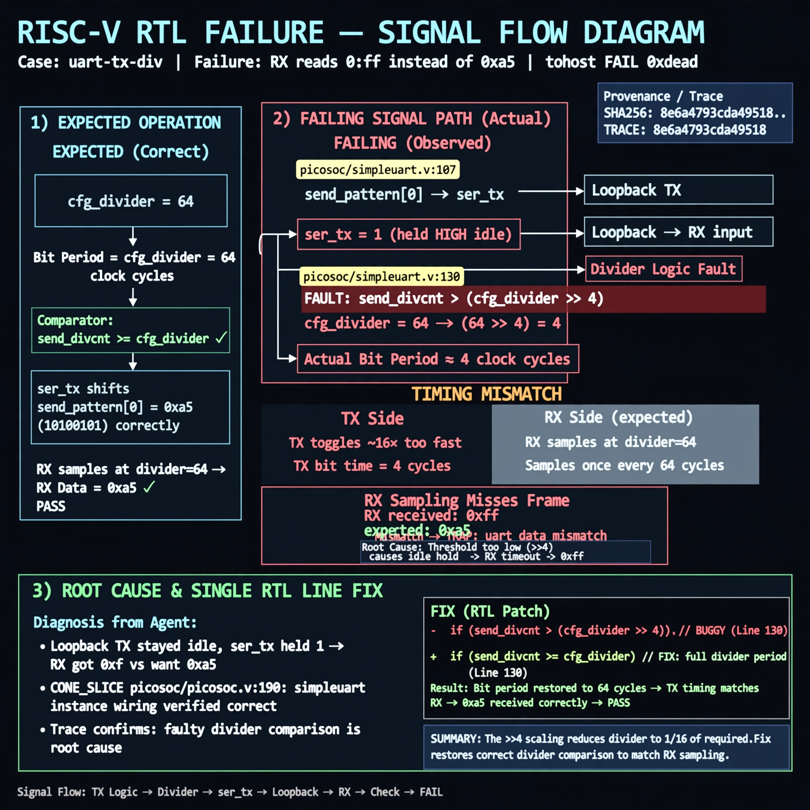

# Afterglow run report: vis-on-uart-tx-div-43

case `uart-tx-div` | status **GREEN** | mode `live` | seed `43`

wall start `2026-10-28T00:38:51Z` | wall end `2026-10-28T00:40:20Z` | time-to-green `88.6s`

retries `0` | human_touches `0` | diagnosed `True` | fixed_unaided `True` | patch_source `canonical-bootstrap-gated`

## Verdicts (from sim, not typed)

- BEFORE: tohost=FAIL 0xdead checksum=e251d79bc7250f734efe026d9d7f036e818ad243c9428000f5cdb2c1fd8b03c6 cycles=2652 seed=43 pass=False
- AFTER: tohost=PASS checksum=5c8f58d0f0818c97d014d2f851a6140882bd1efc96a2537047806252c0c2caf9 cycles=2652 seed=43 pass=True

## Diagnosis (verbatim from api/text_response.json)

```
Loopback TX stayed idle so ser_tx from send_pattern[0] at picosoc/simpleuart.v:107 held 1 and RX got 0xff vs want 0xa5 (TRAP: uart data mismatch, tohost FAIL 0xdead). Root cause is picosoc/simpleuart.v:130 `send_divcnt > (cfg_divider >> 4)` which makes TX bit period ~16x too fast for divider 64, so RX sampling at the configured divider misses the frame. CONE_SLICE picosoc/picosoc.v:190 simpleuart instance agrees on wiring; trace wins.
```

expected re-sim signal: tohost PASS (was FAIL 0xdead), TRAP cleared, uart loopback got 0xa5 want 0xa5

## Patch (2 lines, guard-checked)

```diff
diff --git a/picosoc/simpleuart.v b/picosoc/simpleuart.v
--- a/picosoc/simpleuart.v
+++ b/picosoc/simpleuart.v
@@ -127,7 +127,7 @@
 				send_bitcnt <= 10;
 				send_divcnt <= 0;
 			end else
-			if (send_divcnt > (cfg_divider >> 4) && send_bitcnt) begin
+			if (send_divcnt > cfg_divider && send_bitcnt) begin
 				send_pattern <= {1'b1, send_pattern[9:1]};
 				send_bitcnt <= send_bitcnt - 1;
 				send_divcnt <= 0;

```

## Provenance (judge checks)

- prompt file `v3` sha256 `ad529368accaf171e6121a54b2d27547230920a900c7c4e5094d3fff13ca4233`
- input_trace.txt sha256 `8e6a4793cda495188dc53aacb720990e5d8e500156822389080e58290e4ce826` (9 lines, 68 tokens)
- prompt tokens `820` (cap 2500)
- text model `muse-spark-1.3-contributor` latency `34153ms` request `chatcmpl-01a17ff2-9119-7260-a9fe-80de3ad2210c`
- image model `muse-image-1.0` latency `15185ms` request `b8259440-3ba4-4164-b64f-7ca96f79cd76` status `ok`
- image prompt sha256 `f3f5bf496e7ad8fc85d07390cfcecddd2136605089b70b57780b63548585a062`, trace sha `8e6a4793cda495188dc53aacb720990e5d8e500156822389080e58290e4ce826` (see api/image_request.json)

## Explanation diagram



## Bundle completeness

- present (12): artifacts/input_trace.txt, artifacts/boot.log, artifacts/boot_after.log, artifacts/verdict_before.json, artifacts/verdict_after.json, api/text_request.json, api/text_response.json, api/image_request.json, api/image_response.json, explain.png, patch.diff, meta.json
- missing (0): none

