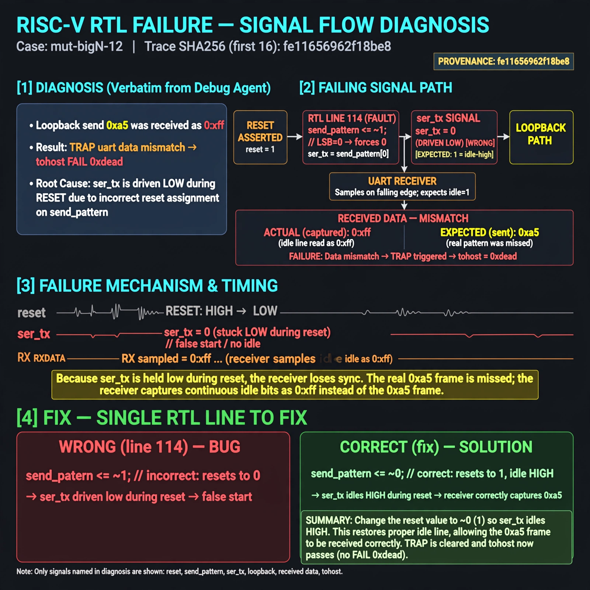

# Afterglow run report: wave-off-mut-bigN-12-42

case `mut-bigN-12` | status **GREEN** | mode `live` | seed `42`

wall start `2026-10-31T04:11:40Z` | wall end `2026-10-31T04:12:59Z` | time-to-green `78.9s`

retries `0` | human_touches `0` | diagnosed `True` | fixed_unaided `True` | patch_source `model-verbatim`

## Verdicts (from sim, not typed)

- BEFORE: tohost=FAIL 0xdead checksum=9e1b73c13d0a095f6b9512137fc937a720f9b8a80231ffc4b660d6d1459f6985 cycles=2024 seed=42 pass=False
- AFTER: tohost=PASS checksum=5c8f58d0f0818c97d014d2f851a6140882bd1efc96a2537047806252c0c2caf9 cycles=2652 seed=42 pass=True

## Diagnosis (verbatim from api/text_response.json)

```
Loopback send 0xa5 was received as 0xff causing TRAP uart data mismatch and tohost FAIL 0xdead. ser_tx = send_pattern[0] is driven low during reset because line 114 uses send_pattern <= ~1 (LSB 0) instead of idle-high ~0. This false start misaligns the receiver so the real 0xa5 frame is missed and idle 0xff is captured.
```

expected re-sim signal: tohost PASS (not FAIL 0xdead), uart loopback got 0xa5 want 0xa5 TRAP gone, checksum differs from 9e1b73c13d0a095f6b9512137fc937a720f9b8a80231ffc4b660d6d1459f6985

## Patch (2 lines, guard-checked)

```diff
diff --git a/picosoc/simpleuart.v b/picosoc/simpleuart.v
--- a/picosoc/simpleuart.v
+++ b/picosoc/simpleuart.v
@@ -110,8 +110,8 @@
 		if (reg_div_we)
 			send_dummy <= 1;
 		send_divcnt <= send_divcnt + 1;
 		if (!resetn) begin
-			send_pattern <= ~1;
+			send_pattern <= ~0;
 			send_bitcnt <= 0;
 			send_divcnt <= 0;
 			send_dummy <= 1;

```

## Provenance (judge checks)

- prompt file `/home/tuncay/afterglow/agent/prompts/v2.txt` sha256 `d31e1ef6b74ddf52ee59e790ebff2f3defa9b03be82e699f45ef620cf8e27a6e`
- input_trace.txt sha256 `fe11656962f18be825b25183c39f9e250cab15f34fac205a92cdd13c73f26781` (9 lines, 68 tokens)
- prompt tokens `705` (cap 2500)
- text model `muse-spark-1.3-contributor` latency `52767ms` request `chatcmpl-01a19028-c71e-77fe-8777-dcfbcebd8f09`
- image model `muse-image-1.0` latency `24578ms` request `d00c345b-bddb-4552-b8df-2b4b15e97e69` status `ok`
- image prompt sha256 `6f3bd009e64f4cfede26d3f1efb8cf102bdab148e1b3b6ec5c9a9e9977dfeafd`, trace sha `fe11656962f18be825b25183c39f9e250cab15f34fac205a92cdd13c73f26781` (see api/image_request.json)

## Explanation diagram



## Bundle completeness

- present (12): artifacts/input_trace.txt, artifacts/boot.log, artifacts/boot_after.log, artifacts/verdict_before.json, artifacts/verdict_after.json, api/text_request.json, api/text_response.json, api/image_request.json, api/image_response.json, explain.png, patch.diff, meta.json
- missing (0): none

