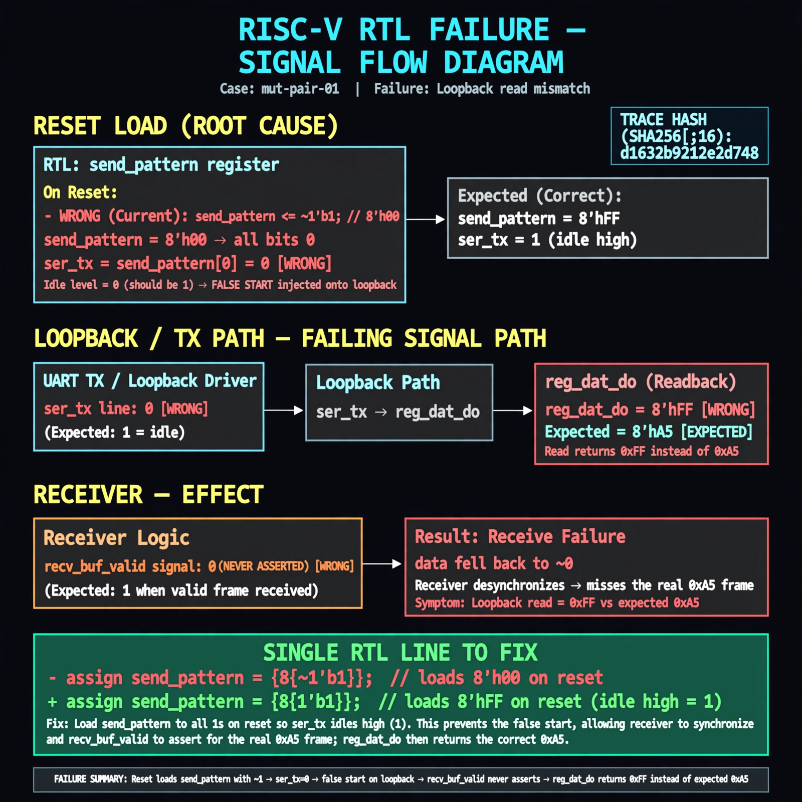

# Afterglow run report: wave-off-mut-pair-01-42

case `mut-pair-01` | status **RED** | mode `live` | seed `42`

wall start `2026-10-31T04:12:59Z` | wall end `2026-10-31T04:16:25Z` | time-to-green `206.6s`

retries `2` | human_touches `0` | diagnosed `True` | fixed_unaided `False` | patch_source `model-verbatim`

## Verdicts (from sim, not typed)

- BEFORE: tohost=FAIL 0xdead checksum=e82517390f8726caabcc777759a3dbb48c59fd1d160e409515f1b95dfe3d420c cycles=22023 seed=42 pass=False
- AFTER: tohost=FAIL 0xdead checksum=9e1b73c13d0a095f6b9512137fc937a720f9b8a80231ffc4b660d6d1459f6985 cycles=2024 seed=42 pass=False

## Diagnosis (verbatim from api/text_response.json)

```
Loopback send of 0xa5 at divider 64 never sets recv_buf_valid, so reg_dat_do never returns the byte and sim traps uart timeout after 22023 cycles vs expected RX. TX dummy logic quickly restores ser_tx to idle-high, so reset value is not fatal. Root cause is recv_state declared as reg [3:1] (3-bit, max 7) instead of [3:0], so states 8-10 are unreachable and receive never completes.
```

expected re-sim signal: tohost PASS (0x1) with loopback byte 0xa5 received, no uart timeout

## Patch (2 lines, guard-checked)

```diff
diff --git a/picosoc/simpleuart.v b/picosoc/simpleuart.v
--- a/picosoc/simpleuart.v
+++ b/picosoc/simpleuart.v
@@ -39,5 +39,5 @@
-	reg [3:1] recv_state;
+	reg [3:0] recv_state;
 	reg [31:0] recv_divcnt;
 	reg [7:0] recv_pattern;
 	reg [7:0] recv_buf_data;
 	reg recv_buf_valid;

```

## Provenance (judge checks)

- prompt file `/home/tuncay/afterglow/agent/prompts/v2.txt` sha256 `d31e1ef6b74ddf52ee59e790ebff2f3defa9b03be82e699f45ef620cf8e27a6e`
- input_trace.txt sha256 `d1632b9212e2d748ed007af6dc7fbd9cb5b1310ff09862961110396a82b2cc9d` (9 lines, 66 tokens)
- prompt tokens `863` (cap 2500)
- text model `muse-spark-1.3-contributor` latency `44968ms` request `chatcmpl-01a19029-dc55-77ae-a04d-6c69c0480630`
- image model `muse-image-1.0` latency `21357ms` request `5f1c8b31-3083-4b42-af1d-e708c0332a59` status `ok`
- image prompt sha256 `bbf4186371fc7aef006a892c0c7be988b799c96a82ded89eaf6fe47422c34b68`, trace sha `d1632b9212e2d748ed007af6dc7fbd9cb5b1310ff09862961110396a82b2cc9d` (see api/image_request.json)

## Explanation diagram



## Bundle completeness

- present (12): artifacts/input_trace.txt, artifacts/boot.log, artifacts/boot_after.log, artifacts/verdict_before.json, artifacts/verdict_after.json, api/text_request.json, api/text_response.json, api/image_request.json, api/image_response.json, explain.png, patch.diff, meta.json
- missing (0): none

