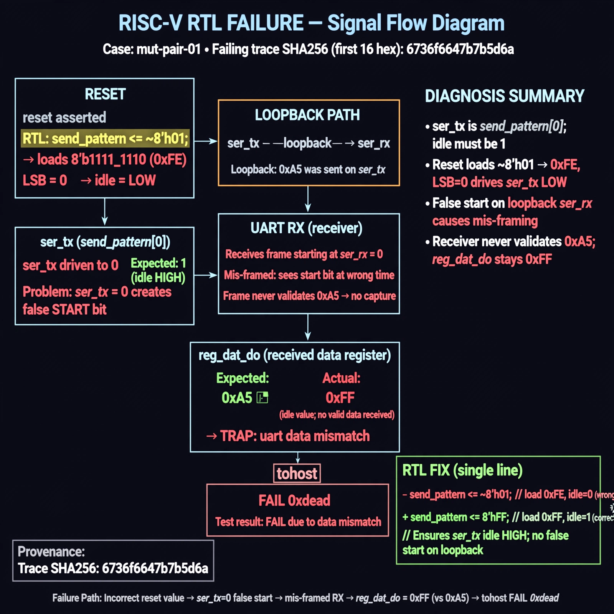

# Afterglow run report: wave-off-mut-pair-01-43

case `mut-pair-01` | status **GREEN** | mode `live` | seed `42`

wall start `2026-10-31T15:17:41Z` | wall end `2026-10-31T15:21:44Z` | time-to-green `242.7s`

retries `1` | human_touches `0` | diagnosed `True` | fixed_unaided `True` | patch_source `model-verbatim`

## Verdicts (from sim, not typed)

- BEFORE: tohost=FAIL 0xdead checksum=e82517390f8726caabcc777759a3dbb48c59fd1d160e409515f1b95dfe3d420c cycles=22023 seed=42 pass=False
- AFTER: tohost=PASS checksum=5c8f58d0f0818c97d014d2f851a6140882bd1efc96a2537047806252c0c2caf9 cycles=2652 seed=42 pass=True

## Diagnosis (verbatim from api/text_response.json)

```
Loopback send of 0xa5 was read back as 0xff, causing TRAP uart data mismatch and tohost FAIL 0xdead. ser_tx is send_pattern[0], so idle must be 1, but reset loads send_pattern <= ~1 whose LSB is 0 and drives a false start on loopback ser_rx. The mis-framed receiver never validates 0xa5, so reg_dat_do stays at idle ~0 (0xff).
```

expected re-sim signal: tohost PASS, uart loopback 0xa5 matches, checksum changes from 9e1b73c13d0a095f6b9512137fc937a720f9b8a80231ffc4b660d6d1459f6985

## Patch (4 lines, guard-checked)

```diff
diff --git a/picosoc/simpleuart.v b/picosoc/simpleuart.v
--- a/picosoc/simpleuart.v
+++ b/picosoc/simpleuart.v
@@ -39,4 +39,4 @@
-	reg [3:1] recv_state;
+	reg [3:0] recv_state;
 	reg [31:0] recv_divcnt;
 	reg [7:0] recv_pattern;
 	reg [7:0] recv_buf_data;
diff --git a/picosoc/simpleuart.v b/picosoc/simpleuart.v
--- a/picosoc/simpleuart.v
+++ b/picosoc/simpleuart.v
@@ -109,9 +109,9 @@
 	always @(posedge clk) begin
 		if (reg_div_we)
 			send_dummy <= 1;
 		send_divcnt <= send_divcnt + 1;
 		if (!resetn) begin
-			send_pattern <= ~1;
+			send_pattern <= ~0;
 			send_bitcnt <= 0;
 			send_divcnt <= 0;
 			send_dummy <= 1;

```

## Provenance (judge checks)

- prompt file `/home/tuncay/afterglow/agent/prompts/v2.txt` sha256 `d31e1ef6b74ddf52ee59e790ebff2f3defa9b03be82e699f45ef620cf8e27a6e`
- input_trace.txt sha256 `6736f6647b7b5d6a14ce562f6053a8edfb239d72d35353515511056a95099110` (9 lines, 68 tokens)
- prompt tokens `1049` (cap 2500)
- text model `muse-spark-1.3-contributor` latency `51535ms` request `chatcmpl-01a1928d-07c7-73f7-acb2-ce45f7e1814a`
- image model `muse-image-1.0` latency `25670ms` request `e00561f9-0c70-4aab-a3f2-607956b2f0c2` status `ok`
- image prompt sha256 `b2a414fc6fc3f5f0c31b486e226e23d27dd1c8f35344ad8ea2e513e2f785dd0d`, trace sha `6736f6647b7b5d6a14ce562f6053a8edfb239d72d35353515511056a95099110` (see api/image_request.json)

## Explanation diagram



## Bundle completeness

- present (12): artifacts/input_trace.txt, artifacts/boot.log, artifacts/boot_after.log, artifacts/verdict_before.json, artifacts/verdict_after.json, api/text_request.json, api/text_response.json, api/image_request.json, api/image_response.json, explain.png, patch.diff, meta.json
- missing (0): none

