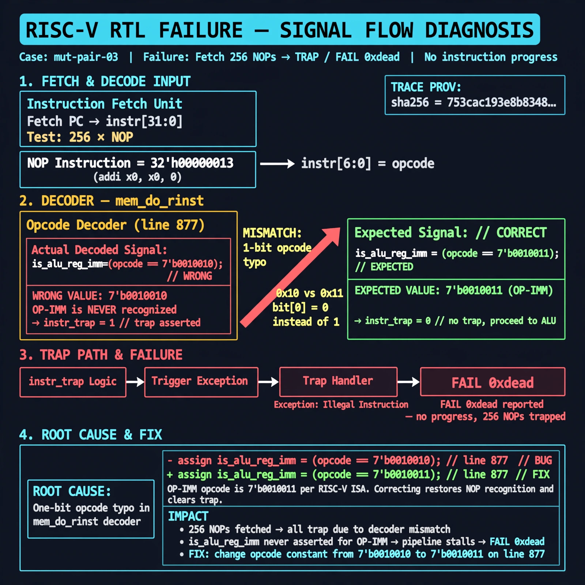

# Afterglow run report: wave-off-mut-pair-03-43

case `mut-pair-03` | status **GREEN** | mode `live` | seed `42`

wall start `2026-10-31T15:49:11Z` | wall end `2026-10-31T15:53:38Z` | time-to-green `267.0s`

retries `1` | human_touches `0` | diagnosed `True` | fixed_unaided `True` | patch_source `model-verbatim`

## Verdicts (from sim, not typed)

- BEFORE: tohost=FAIL 0xdead checksum=c2a7a4d6295484feeb9ec1ea9381732b8e39a7ccd1997c7d70f6454da2fb4659 cycles=2009 seed=42 pass=False
- AFTER: tohost=PASS checksum=5c28238265cb94168311e9914f0df355642c557d04dba11845d557ac8a64aa4a cycles=2009 seed=42 pass=True

## Diagnosis (verbatim from api/text_response.json)

```
Fetch test with 256 NOPs (OP-IMM opcode 7'b0010011, e.g. addi x0,x0,0) asserts TRAP and reports FAIL 0xdead with no progress. Current line 877 decodes is_alu_reg_imm as 7'b0010010 instead of 7'b0010011, so OP-IMM is never recognized and with the corrected instr_trap logic every NOP traps. Root cause is the one-bit opcode typo in the mem_do_rinst decoder.
```

expected re-sim signal: tohost PASS, TRAP deasserted, checksum != c2a7a4d6295484feeb9ec1ea9381732b8e39a7ccd1997c7d70f6454da2fb4659

## Patch (4 lines, guard-checked)

```diff
diff --git a/picorv32.v b/picorv32.v
--- a/picorv32.v
+++ b/picorv32.v
@@ -679,3 +679,3 @@
-	assign instr_trap = (CATCH_ILLINSN || WITH_PCPI) || !{instr_lui, instr_auipc, instr_jal, instr_jalr,
+	assign instr_trap = (CATCH_ILLINSN || WITH_PCPI) && !{instr_lui, instr_auipc, instr_jal, instr_jalr,
 			instr_beq, instr_bne, instr_blt, instr_bge, instr_bltu, instr_bgeu,
 			instr_lb, instr_lh, instr_lw, instr_lbu, instr_lhu, instr_sb, instr_sh, instr_sw,
diff --git a/picorv32.v b/picorv32.v
--- a/picorv32.v
+++ b/picorv32.v
@@ -877,4 +877,4 @@
-			is_alu_reg_imm               <= mem_rdata_latched[6:0] == 7'b0010010;
+			is_alu_reg_imm               <= mem_rdata_latched[6:0] == 7'b0010011;
 			is_alu_reg_reg               <= mem_rdata_latched[6:0] == 7'b0110011;
 
 			{ decoded_imm_j[31:20], decoded_imm_j[10:1], decoded_imm_j[11], decoded_imm_j[19:12], decoded_imm_j[0] } <= $signed({mem_rdata_latched[31:12], 1'b0});

```

## Provenance (judge checks)

- prompt file `/home/tuncay/afterglow/agent/prompts/v2.txt` sha256 `d31e1ef6b74ddf52ee59e790ebff2f3defa9b03be82e699f45ef620cf8e27a6e`
- input_trace.txt sha256 `753cac193e8b834829e9a11c345f86833a343df32db9310902a4863bf3bb0f49` (9 lines, 69 tokens)
- prompt tokens `1132` (cap 2500)
- text model `muse-spark-1.3-contributor` latency `79239ms` request `chatcmpl-01a192aa-04c2-733c-8064-d83b68014263`
- image model `muse-image-1.0` latency `39177ms` request `67295e2f-b664-4813-ac76-3b1c709df7c5` status `ok`
- image prompt sha256 `2173f078081d02eeb1f825a3de449a563beeba74429cb0e5fd9b44e6756e7cc2`, trace sha `753cac193e8b834829e9a11c345f86833a343df32db9310902a4863bf3bb0f49` (see api/image_request.json)

## Explanation diagram



## Bundle completeness

- present (12): artifacts/input_trace.txt, artifacts/boot.log, artifacts/boot_after.log, artifacts/verdict_before.json, artifacts/verdict_after.json, api/text_request.json, api/text_response.json, api/image_request.json, api/image_response.json, explain.png, patch.diff, meta.json
- missing (0): none

