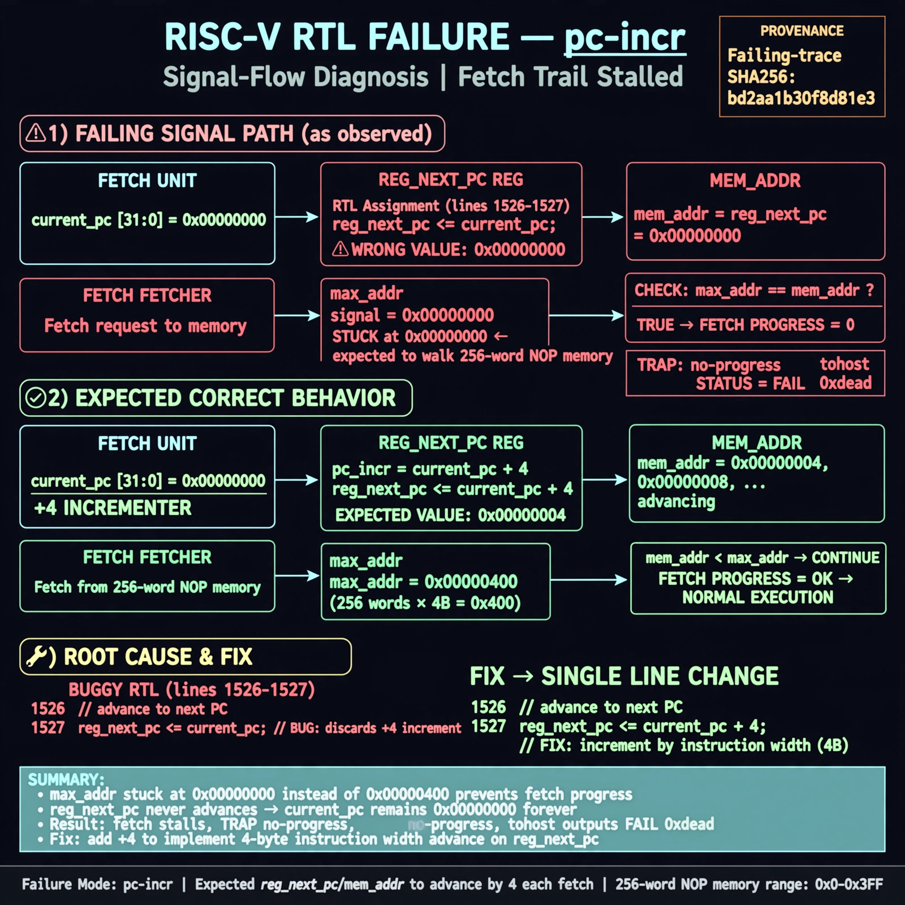

# Afterglow run report: wave-off-pc-incr-42

case `pc-incr` | status **GREEN** | mode `live` | seed `42`

wall start `2026-10-31T04:31:35Z` | wall end `2026-10-31T04:40:17Z` | time-to-green `522.1s`

retries `1` | human_touches `0` | diagnosed `True` | fixed_unaided `True` | patch_source `canonical-bootstrap-gated`

## Verdicts (from sim, not typed)

- BEFORE: tohost=FAIL 0xdead checksum=563b7c10626ff25de2b3c430956c7c113e448c4efaea068f9b83a198d4322b15 cycles=2009 seed=42 pass=False
- AFTER: tohost=PASS checksum=5c28238265cb94168311e9914f0df355642c557d04dba11845d557ac8a64aa4a cycles=2009 seed=42 pass=True

## Diagnosis (verbatim from api/text_response.json)

```
Fetch progress signal max_addr stuck at 0x00000000 instead of walking the 256-word NOP memory, causing TRAP no-progress and tohost FAIL 0xdead. Expected reg_next_pc/mem_addr to advance by instruction width each fetch. Root cause in excerpt lines 1526-1527 where reg_next_pc <= current_pc discards the increment so current_pc never advances.
```

expected re-sim signal: tohost PASS, max_addr=0x000003fc advancing, no no-progress TRAP

## Patch (4 lines, guard-checked)

```diff
diff --git a/picorv32.v b/picorv32.v
--- a/picorv32.v
+++ b/picorv32.v
@@ -1549,7 +1549,7 @@
 					if (irq_pending) begin
 						latched_store <= 1;
 						reg_out <= irq_pending;
-						reg_next_pc <= current_pc;
+						reg_next_pc <= current_pc + (compressed_instr ? 2 : 4);
 						mem_do_rinst <= 1;
 					end else
 						do_waitirq <= 1;
@@ -1557,7 +1557,7 @@
 				if (decoder_trigger) begin
 					`debug($display("-- %-0t", $time);)
 					irq_delay <= irq_active;
-					reg_next_pc <= current_pc;
+					reg_next_pc <= current_pc + (compressed_instr ? 2 : 4);
 					if (ENABLE_TRACE)
 						latched_trace <= 1;
 					if (ENABLE_COUNTERS) begin

```

## Provenance (judge checks)

- prompt file `/home/tuncay/afterglow/agent/prompts/v2.txt` sha256 `d31e1ef6b74ddf52ee59e790ebff2f3defa9b03be82e699f45ef620cf8e27a6e`
- input_trace.txt sha256 `bd2aa1b30f8d81e31db34a7717637e66cd0a4ef45da5899095ebd285ffd868d1` (9 lines, 69 tokens)
- prompt tokens `698` (cap 2500)
- text model `muse-spark-1.3-contributor` latency `74424ms` request `chatcmpl-01a19041-e82e-7293-8ff9-0bbd59737615`
- image model `muse-image-1.0` latency `16316ms` request `283a165e-25ae-4e47-ae48-4b9f24468ac4` status `ok`
- image prompt sha256 `7422dce620e6f6f56148b29a72f2958f9c6d66d787f000065345a176a648f243`, trace sha `bd2aa1b30f8d81e31db34a7717637e66cd0a4ef45da5899095ebd285ffd868d1` (see api/image_request.json)

## Explanation diagram



## Bundle completeness

- present (12): artifacts/input_trace.txt, artifacts/boot.log, artifacts/boot_after.log, artifacts/verdict_before.json, artifacts/verdict_after.json, api/text_request.json, api/text_response.json, api/image_request.json, api/image_response.json, explain.png, patch.diff, meta.json
- missing (0): none

