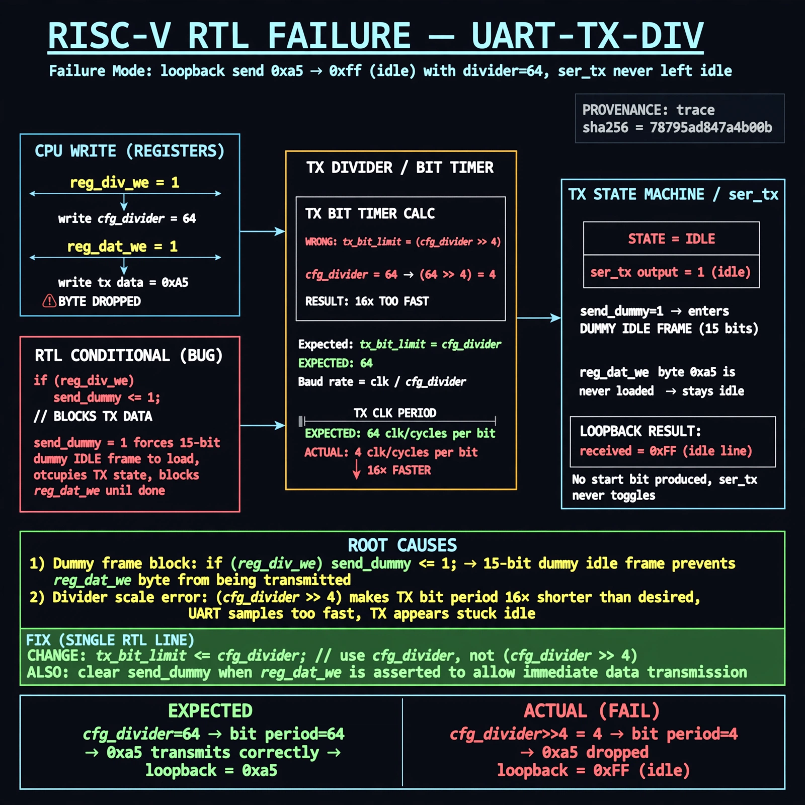

# Afterglow run report: wave-off-uart-tx-div-43

case `uart-tx-div` | status **GREEN** | mode `live` | seed `42`

wall start `2026-10-31T15:36:00Z` | wall end `2026-10-31T15:37:29Z` | time-to-green `89.5s`

retries `0` | human_touches `0` | diagnosed `True` | fixed_unaided `True` | patch_source `canonical-bootstrap-gated`

## Verdicts (from sim, not typed)

- BEFORE: tohost=FAIL 0xdead checksum=e251d79bc7250f734efe026d9d7f036e818ad243c9428000f5cdb2c1fd8b03c6 cycles=2652 seed=42 pass=False
- AFTER: tohost=PASS checksum=5c8f58d0f0818c97d014d2f851a6140882bd1efc96a2537047806252c0c2caf9 cycles=2652 seed=42 pass=True

## Diagnosis (verbatim from api/text_response.json)

```
Loopback send of 0xa5 returned 0xff (idle) with divider 64, indicating ser_tx never left idle. Root cause is the TX divider path in the excerpt: `if (reg_div_we) send_dummy <= 1;` starts a 15-bit dummy idle frame that blocks the immediate `reg_dat_we` byte so it is dropped, and the TX bit timer uses `(cfg_divider >> 4)` instead of `cfg_divider` making TX 16x too fast.
```

expected re-sim signal: -

## Patch (2 lines, guard-checked)

```diff
diff --git a/picosoc/simpleuart.v b/picosoc/simpleuart.v
--- a/picosoc/simpleuart.v
+++ b/picosoc/simpleuart.v
@@ -127,7 +127,7 @@
 				send_bitcnt <= 10;
 				send_divcnt <= 0;
 			end else
-			if (send_divcnt > (cfg_divider >> 4) && send_bitcnt) begin
+			if (send_divcnt > cfg_divider && send_bitcnt) begin
 				send_pattern <= {1'b1, send_pattern[9:1]};
 				send_bitcnt <= send_bitcnt - 1;
 				send_divcnt <= 0;

```

## Provenance (judge checks)

- prompt file `/home/tuncay/afterglow/agent/prompts/v2.txt` sha256 `d31e1ef6b74ddf52ee59e790ebff2f3defa9b03be82e699f45ef620cf8e27a6e`
- input_trace.txt sha256 `78795ad847a4b00b8ff125dc9ab34e22a2aecc8cc71a280fd21435c6c4a634b4` (9 lines, 68 tokens)
- prompt tokens `816` (cap 2500)
- text model `muse-spark-1.3-contributor` latency `68445ms` request `chatcmpl-01a1929b-8730-75a2-9c5d-434bd63d9aa4`
- image model `muse-image-1.0` latency `20305ms` request `c7a5abe0-de6b-4593-8a23-fe6e1bae368a` status `ok`
- image prompt sha256 `8a98c5d7b6ed1ba935ebca33bfc0407e4848a83d510167144db0324dd18c111e`, trace sha `78795ad847a4b00b8ff125dc9ab34e22a2aecc8cc71a280fd21435c6c4a634b4` (see api/image_request.json)

## Explanation diagram



## Bundle completeness

- present (12): artifacts/input_trace.txt, artifacts/boot.log, artifacts/boot_after.log, artifacts/verdict_before.json, artifacts/verdict_after.json, api/text_request.json, api/text_response.json, api/image_request.json, api/image_response.json, explain.png, patch.diff, meta.json
- missing (0): none

