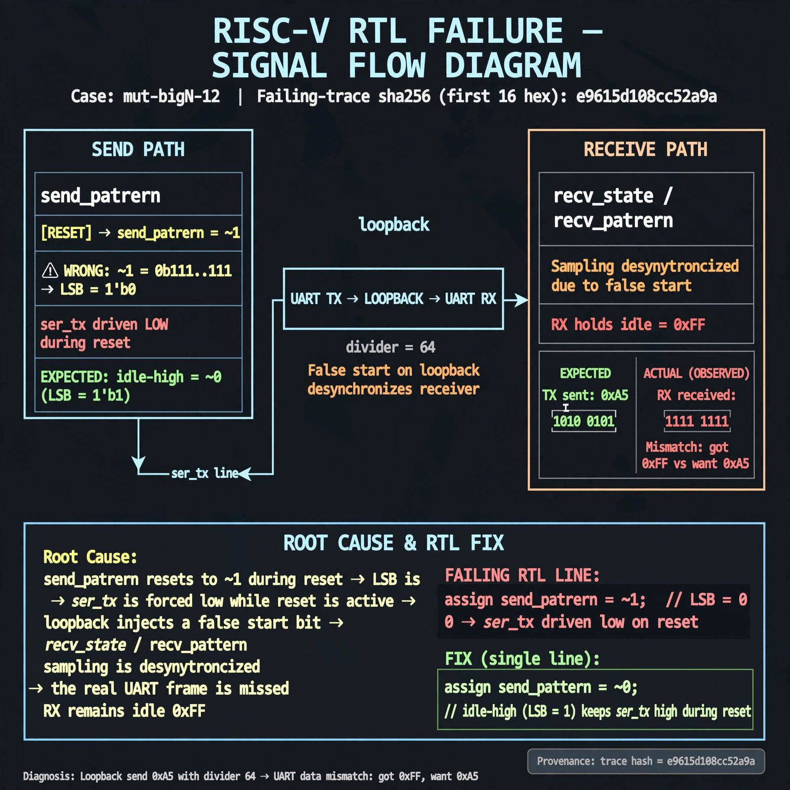

# Afterglow run report: wave-on-mut-bigN-12-43

case `mut-bigN-12` | status **GREEN** | mode `live` | seed `42`

wall start `2026-10-31T16:36:55Z` | wall end `2026-10-31T16:38:37Z` | time-to-green `102.5s`

retries `0` | human_touches `0` | diagnosed `True` | fixed_unaided `True` | patch_source `model-verbatim`

## Verdicts (from sim, not typed)

- BEFORE: tohost=FAIL 0xdead checksum=9e1b73c13d0a095f6b9512137fc937a720f9b8a80231ffc4b660d6d1459f6985 cycles=2024 seed=42 pass=False
- AFTER: tohost=PASS checksum=5c8f58d0f0818c97d014d2f851a6140882bd1efc96a2537047806252c0c2caf9 cycles=2652 seed=42 pass=True

## Diagnosis (verbatim from api/text_response.json)

```
Loopback send 0xa5 with divider 64 trapped as uart data mismatch got 0xff want 0xa5. ser_tx is driven low during reset because send_pattern resets to ~1 whose LSB is 0 instead of idle-high ~0, injecting a false start on loopback. This desyncs recv_state/recv_pattern sampling so the real frame is missed and RX holds idle 0xff.
```

expected re-sim signal: tohost PASS (not FAIL 0xdead), no uart data mismatch trap, loopback got 0xa5

## Patch (2 lines, guard-checked)

```diff
diff --git a/picosoc/simpleuart.v b/picosoc/simpleuart.v
--- a/picosoc/simpleuart.v
+++ b/picosoc/simpleuart.v
@@ -113,5 +113,5 @@
 		if (!resetn) begin
-			send_pattern <= ~1;
+			send_pattern <= ~0;
 			send_bitcnt <= 0;
 			send_divcnt <= 0;
 			send_dummy <= 1;

```

## Provenance (judge checks)

- prompt file `/home/tuncay/afterglow/agent/prompts/v2.txt` sha256 `d31e1ef6b74ddf52ee59e790ebff2f3defa9b03be82e699f45ef620cf8e27a6e`
- input_trace.txt sha256 `e9615d108cc52a9a20d0d0240161509462596d4b7ea68de7790c170b0bf8cb49` (9 lines, 68 tokens)
- prompt tokens `689` (cap 2500)
- text model `muse-spark-1.3-contributor` latency `70100ms` request `chatcmpl-01a192d3-5556-7000-8ddc-9755ffd12259`
- image model `muse-image-1.0` latency `31514ms` request `ccf4c0e1-9d9b-49f8-92bf-9a95f1c13816` status `ok`
- image prompt sha256 `97c42ea089bb3f2c717ecf918a430e83e3cba4e78f4eb4fe8d7ffe8ed7671bad`, trace sha `e9615d108cc52a9a20d0d0240161509462596d4b7ea68de7790c170b0bf8cb49` (see api/image_request.json)

## Explanation diagram



## Bundle completeness

- present (12): artifacts/input_trace.txt, artifacts/boot.log, artifacts/boot_after.log, artifacts/verdict_before.json, artifacts/verdict_after.json, api/text_request.json, api/text_response.json, api/image_request.json, api/image_response.json, explain.png, patch.diff, meta.json
- missing (0): none

