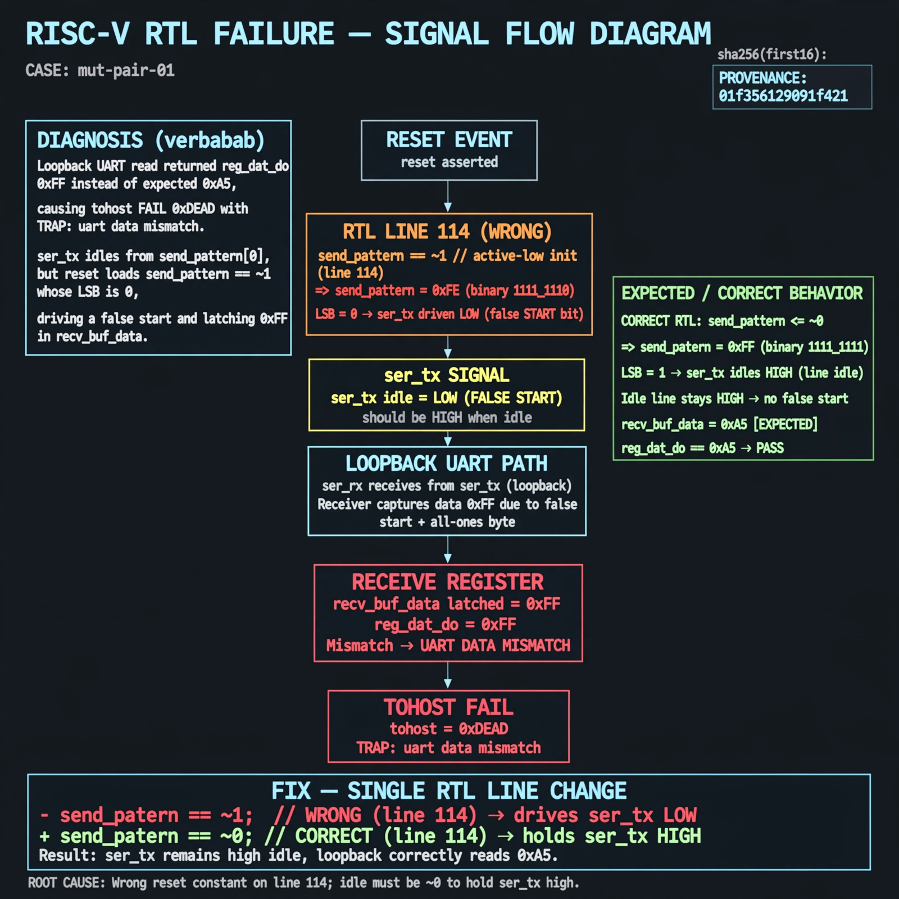

# Afterglow run report: wave-on-mut-pair-01-42

case `mut-pair-01` | status **GREEN** | mode `live` | seed `42`

wall start `2026-10-31T05:09:55Z` | wall end `2026-10-31T05:16:32Z` | time-to-green `396.6s`

retries `2` | human_touches `0` | diagnosed `True` | fixed_unaided `True` | patch_source `model-verbatim`

## Verdicts (from sim, not typed)

- BEFORE: tohost=FAIL 0xdead checksum=e82517390f8726caabcc777759a3dbb48c59fd1d160e409515f1b95dfe3d420c cycles=22023 seed=42 pass=False
- AFTER: tohost=PASS checksum=5c8f58d0f0818c97d014d2f851a6140882bd1efc96a2537047806252c0c2caf9 cycles=2652 seed=42 pass=True

## Diagnosis (verbatim from api/text_response.json)

```
Loopback UART read returned reg_dat_do 0xff instead of expected 0xa5, causing tohost FAIL 0xdead with TRAP uart data mismatch. ser_tx idles from send_pattern[0], but reset loads send_pattern <= ~1 whose LSB is 0, driving a false start and latching 0xff in recv_buf_data. Root cause is the wrong reset constant on line 114; idle must be ~0 to hold ser_tx high.
```

expected re-sim signal: tohost PASS (was FAIL 0xdead) with loopback 0xa5 matched, TRAP uart data mismatch gone

## Patch (4 lines, guard-checked)

```diff
diff --git a/picosoc/simpleuart.v b/picosoc/simpleuart.v
--- a/picosoc/simpleuart.v
+++ b/picosoc/simpleuart.v
@@ -39,5 +39,5 @@
-	reg [3:1] recv_state;
+	reg [3:0] recv_state;
 	reg [31:0] recv_divcnt;
 	reg [7:0] recv_pattern;
 	reg [7:0] recv_buf_data;
 	reg recv_buf_valid;
diff --git a/picosoc/simpleuart.v b/picosoc/simpleuart.v
--- a/picosoc/simpleuart.v
+++ b/picosoc/simpleuart.v
@@ -112,5 +112,5 @@
 		send_divcnt <= send_divcnt + 1;
 		if (!resetn) begin
-			send_pattern <= ~1;
+			send_pattern <= ~0;
 			send_bitcnt <= 0;
 			send_divcnt <= 0;

```

## Provenance (judge checks)

- prompt file `/home/tuncay/afterglow/agent/prompts/v2.txt` sha256 `d31e1ef6b74ddf52ee59e790ebff2f3defa9b03be82e699f45ef620cf8e27a6e`
- input_trace.txt sha256 `01f356129091f421c42191aea0fb3cb57941a2d4d9dcdb4a50cc62c6cb31c4df` (9 lines, 68 tokens)
- prompt tokens `1066` (cap 2500)
- text model `muse-spark-1.3-contributor` latency `48394ms` request `chatcmpl-01a19062-de40-7647-ba82-3af87296759f`
- image model `muse-image-1.0` latency `30843ms` request `7c0eabf2-4645-4db5-9a25-855a86b61432` status `ok`
- image prompt sha256 `e9453f6a07664936d39b0cf0d14be913bccf5c03a0a73fef447053bb79e7cd5b`, trace sha `01f356129091f421c42191aea0fb3cb57941a2d4d9dcdb4a50cc62c6cb31c4df` (see api/image_request.json)

## Explanation diagram



## Bundle completeness

- present (12): artifacts/input_trace.txt, artifacts/boot.log, artifacts/boot_after.log, artifacts/verdict_before.json, artifacts/verdict_after.json, api/text_request.json, api/text_response.json, api/image_request.json, api/image_response.json, explain.png, patch.diff, meta.json
- missing (0): none

