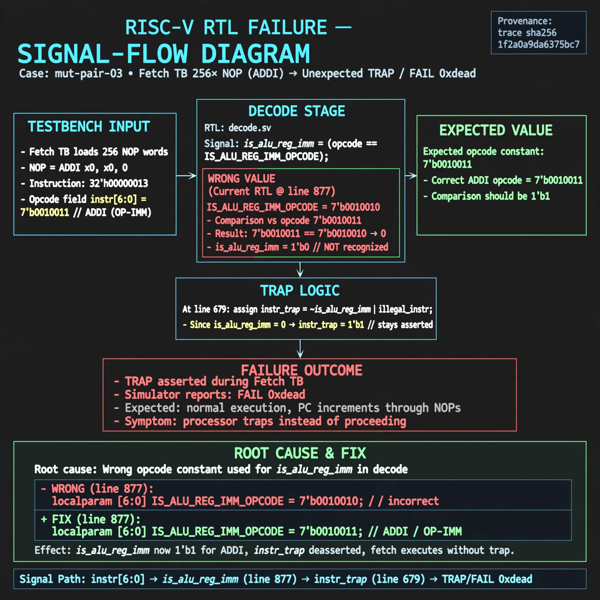

# Afterglow run report: wave-on-mut-pair-03-42

case `mut-pair-03` | status **GREEN** | mode `live` | seed `42`

wall start `2026-10-31T05:16:32Z` | wall end `2026-10-31T05:19:53Z` | time-to-green `200.7s`

retries `1` | human_touches `0` | diagnosed `True` | fixed_unaided `True` | patch_source `model-verbatim`

## Verdicts (from sim, not typed)

- BEFORE: tohost=FAIL 0xdead checksum=c2a7a4d6295484feeb9ec1ea9381732b8e39a7ccd1997c7d70f6454da2fb4659 cycles=2009 seed=42 pass=False
- AFTER: tohost=PASS checksum=5c28238265cb94168311e9914f0df355642c557d04dba11845d557ac8a64aa4a cycles=2009 seed=42 pass=True

## Diagnosis (verbatim from api/text_response.json)

```
Fetch TB with 256 NOP words (ADDI, opcode 0010011) asserts TRAP and reports FAIL 0xdead instead of progressing without trap. Line 877 decodes is_alu_reg_imm with 7'b0010010 vs expected 7'b0010011, so OP-IMM is never recognized and instr_trap from line 679 stays asserted. Root cause is the wrong opcode constant for is_alu_reg_imm in the excerpt.
```

expected re-sim signal: tohost PASS (not FAIL 0xdead), TRAP deasserted, checksum != c2a7a4d6295484feeb9ec1ea9381732b8e39a7ccd1997c7d70f6454da2fb4659

## Patch (4 lines, guard-checked)

```diff
diff --git a/picorv32.v b/picorv32.v
--- a/picorv32.v
+++ b/picorv32.v
@@ -679,3 +679,3 @@
-	assign instr_trap = (CATCH_ILLINSN || WITH_PCPI) || !{instr_lui, instr_auipc, instr_jal, instr_jalr,
+	assign instr_trap = (CATCH_ILLINSN || WITH_PCPI) && !{instr_lui, instr_auipc, instr_jal, instr_jalr,
 			instr_beq, instr_bne, instr_blt, instr_bge, instr_bltu, instr_bgeu,
 			instr_lb, instr_lh, instr_lw, instr_lbu, instr_lhu, instr_sb, instr_sh, instr_sw,
diff --git a/picorv32.v b/picorv32.v
--- a/picorv32.v
+++ b/picorv32.v
@@ -874,7 +874,7 @@
 			is_beq_bne_blt_bge_bltu_bgeu <= mem_rdata_latched[6:0] == 7'b1100011;
 			is_lb_lh_lw_lbu_lhu          <= mem_rdata_latched[6:0] == 7'b0000011;
 			is_sb_sh_sw                  <= mem_rdata_latched[6:0] == 7'b0100011;
-			is_alu_reg_imm               <= mem_rdata_latched[6:0] == 7'b0010010;
+			is_alu_reg_imm               <= mem_rdata_latched[6:0] == 7'b0010011;
 			is_alu_reg_reg               <= mem_rdata_latched[6:0] == 7'b0110011;
 
 			{ decoded_imm_j[31:20], decoded_imm_j[10:1], decoded_imm_j[11], decoded_imm_j[19:12], decoded_imm_j[0] } <= $signed({mem_rdata_latched[31:12], 1'b0});

```

## Provenance (judge checks)

- prompt file `/home/tuncay/afterglow/agent/prompts/v2.txt` sha256 `d31e1ef6b74ddf52ee59e790ebff2f3defa9b03be82e699f45ef620cf8e27a6e`
- input_trace.txt sha256 `1f2a0a9da6375bc74310aeeb647d2f60d0c1e48b48597696a4d782f408aa9a30` (9 lines, 69 tokens)
- prompt tokens `1149` (cap 2500)
- text model `muse-spark-1.3-contributor` latency `49724ms` request `chatcmpl-01a19066-30ce-7591-80eb-160f904d739d`
- image model `muse-image-1.0` latency `13773ms` request `06592135-85fe-480a-8315-46bd6affc9e6` status `ok`
- image prompt sha256 `78f1104e174e742ae3d09650ff371a9a0f8a52aa51d45b9cb22483ef898ed6f6`, trace sha `1f2a0a9da6375bc74310aeeb647d2f60d0c1e48b48597696a4d782f408aa9a30` (see api/image_request.json)

## Explanation diagram



## Bundle completeness

- present (12): artifacts/input_trace.txt, artifacts/boot.log, artifacts/boot_after.log, artifacts/verdict_before.json, artifacts/verdict_after.json, api/text_request.json, api/text_response.json, api/image_request.json, api/image_response.json, explain.png, patch.diff, meta.json
- missing (0): none

