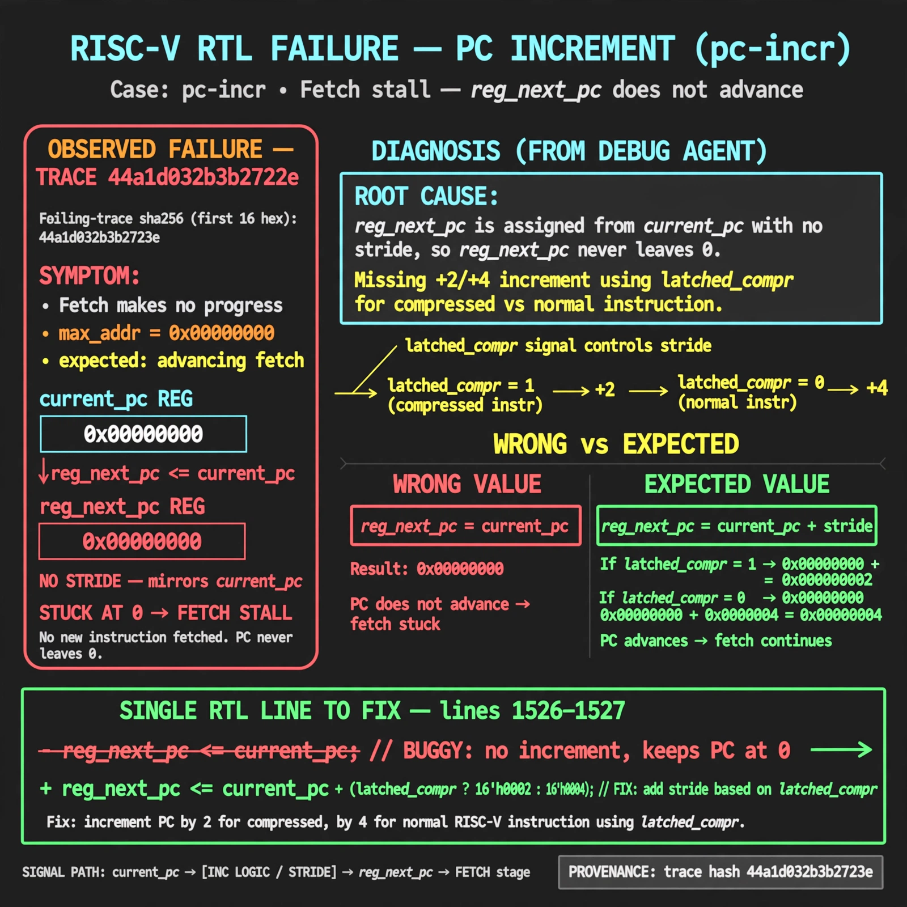

# Afterglow run report: wave-on-pc-incr-42

case `pc-incr` | status **GREEN** | mode `live` | seed `42`

wall start `2026-10-31T05:19:53Z` | wall end `2026-10-31T05:34:00Z` | time-to-green `847.9s`

retries `2` | human_touches `0` | diagnosed `True` | fixed_unaided `True` | patch_source `canonical-bootstrap-gated`

## Verdicts (from sim, not typed)

- BEFORE: tohost=FAIL 0xdead checksum=563b7c10626ff25de2b3c430956c7c113e448c4efaea068f9b83a198d4322b15 cycles=2009 seed=42 pass=False
- AFTER: tohost=PASS checksum=5c28238265cb94168311e9914f0df355642c557d04dba11845d557ac8a64aa4a cycles=2009 seed=42 pass=True

## Diagnosis (verbatim from api/text_response.json)

```
Fetch makes no progress with max_addr=0x00000000 vs expected advancing fetch. reg_next_pc <= current_pc mirrors current_pc with no stride so reg_next_pc never leaves 0. Root cause in excerpt at lines 1526-1527 is missing +2/+4 increment using latched_compr for compressed vs normal instr.
```

expected re-sim signal: tohost PASS (not FAIL 0xdead), max_addr>0x00000000 with steady fetch progress, no TRAP no progress

## Patch (4 lines, guard-checked)

```diff
diff --git a/picorv32.v b/picorv32.v
--- a/picorv32.v
+++ b/picorv32.v
@@ -1550,7 +1550,7 @@
 					if (irq_pending) begin
 						latched_store <= 1;
 						reg_out <= irq_pending;
-						reg_next_pc <= current_pc;
+						reg_next_pc <= current_pc + (compressed_instr ? 2 : 4);
 						mem_do_rinst <= 1;
 					end else
 						do_waitirq <= 1;
@@ -1558,7 +1558,7 @@
 				if (decoder_trigger) begin
 					`debug($display("-- %-0t", $time);)
 					irq_delay <= irq_active;
-					reg_next_pc <= current_pc;
+					reg_next_pc <= current_pc + (compressed_instr ? 2 : 4);
 					if (ENABLE_TRACE)
 						latched_trace <= 1;
 					if (ENABLE_COUNTERS) begin

```

## Provenance (judge checks)

- prompt file `/home/tuncay/afterglow/agent/prompts/v2.txt` sha256 `d31e1ef6b74ddf52ee59e790ebff2f3defa9b03be82e699f45ef620cf8e27a6e`
- input_trace.txt sha256 `44a1d032b3b2723e413e76a071168dd043350c3495ef7289ab7a40d4ddfa1559` (9 lines, 69 tokens)
- prompt tokens `747` (cap 2500)
- text model `muse-spark-1.3-contributor` latency `61542ms` request `chatcmpl-01a19072-eb2a-734d-a00a-e5629b34f2c6`
- image model `muse-image-1.0` latency `26818ms` request `e24355d7-d25b-40a6-800d-aa522919079f` status `ok`
- image prompt sha256 `b4938ab315fb020cc2db46f56243cfdb890810b625c7ebff67cc7fa3ffa71297`, trace sha `44a1d032b3b2723e413e76a071168dd043350c3495ef7289ab7a40d4ddfa1559` (see api/image_request.json)

## Explanation diagram



## Bundle completeness

- present (12): artifacts/input_trace.txt, artifacts/boot.log, artifacts/boot_after.log, artifacts/verdict_before.json, artifacts/verdict_after.json, api/text_request.json, api/text_response.json, api/image_request.json, api/image_response.json, explain.png, patch.diff, meta.json
- missing (0): none

