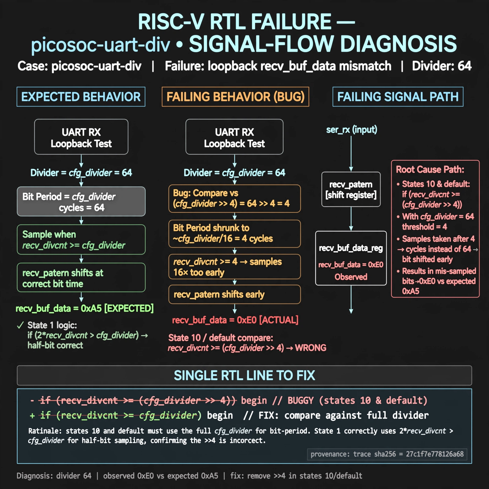

# Afterglow run report: wave-on-picosoc-uart-div-42

case `picosoc-uart-div` | status **GREEN** | mode `live` | seed `42`

wall start `2026-10-31T05:34:01Z` | wall end `2026-10-31T05:35:31Z` | time-to-green `90.1s`

retries `0` | human_touches `0` | diagnosed `True` | fixed_unaided `True` | patch_source `model-verbatim`

## Verdicts (from sim, not typed)

- BEFORE: tohost=FAIL 0xdead checksum=27ee482b473c74db5dce8b5ab1a233084cce3055c317a1f2045faa6dbc13a1c6 cycles=2112 seed=42 pass=False
- AFTER: tohost=PASS checksum=5c8f58d0f0818c97d014d2f851a6140882bd1efc96a2537047806252c0c2caf9 cycles=2652 seed=42 pass=True

## Diagnosis (verbatim from api/text_response.json)

```
Loopback recv_buf_data got 0xe0 vs expected 0xa5 with divider 64. Root cause in excerpt is states 10 and default comparing recv_divcnt against (cfg_divider >> 4) instead of cfg_divider, shrinking the bit period to ~1/16 and shifting ser_rx samples early into recv_pattern. State 1 correctly uses half-bit 2*recv_divcnt > cfg_divider, confirming the >>4 is wrong.
```

expected re-sim signal: tohost: PASS (no TRAP, uart loopback got 0xa5 want 0xa5, checksum != 27ee482b473c74db5dce8b5ab1a233084cce3055c317a1f2045faa6dbc13a1c6)

## Patch (4 lines, guard-checked)

```diff
diff --git a/picosoc/simpleuart.v b/picosoc/simpleuart.v
--- a/picosoc/simpleuart.v
+++ b/picosoc/simpleuart.v
@@ -89,3 +89,3 @@
 				10: begin
-					if (recv_divcnt > (cfg_divider >> 4)) begin
+					if (recv_divcnt > cfg_divider) begin
 						recv_buf_data <= recv_pattern;
@@ -96,3 +96,3 @@
 				default: begin
-					if (recv_divcnt > (cfg_divider >> 4)) begin
+					if (recv_divcnt > cfg_divider) begin
 						recv_pattern <= {ser_rx, recv_pattern[7:1]};

```

## Provenance (judge checks)

- prompt file `/home/tuncay/afterglow/agent/prompts/v2.txt` sha256 `d31e1ef6b74ddf52ee59e790ebff2f3defa9b03be82e699f45ef620cf8e27a6e`
- input_trace.txt sha256 `27c1f7e778126a688e5d79a6e65a99f4b0a681876b7a0de8dceaec3533d46d0e` (9 lines, 68 tokens)
- prompt tokens `812` (cap 2500)
- text model `muse-spark-1.3-contributor` latency `28930ms` request `chatcmpl-01a19073-ce7e-7561-b3c9-f62a801d9a72`
- image model `muse-image-1.0` latency `59740ms` request `f70fdb21-66ea-4457-baa1-e9e310aa536a` status `ok`
- image prompt sha256 `c1182ad3dd609bf79fee064008abafe8d17f5b5e37694ecd14b40717a5cfe399`, trace sha `27c1f7e778126a688e5d79a6e65a99f4b0a681876b7a0de8dceaec3533d46d0e` (see api/image_request.json)

## Explanation diagram



## Bundle completeness

- present (12): artifacts/input_trace.txt, artifacts/boot.log, artifacts/boot_after.log, artifacts/verdict_before.json, artifacts/verdict_after.json, api/text_request.json, api/text_response.json, api/image_request.json, api/image_response.json, explain.png, patch.diff, meta.json
- missing (0): none

