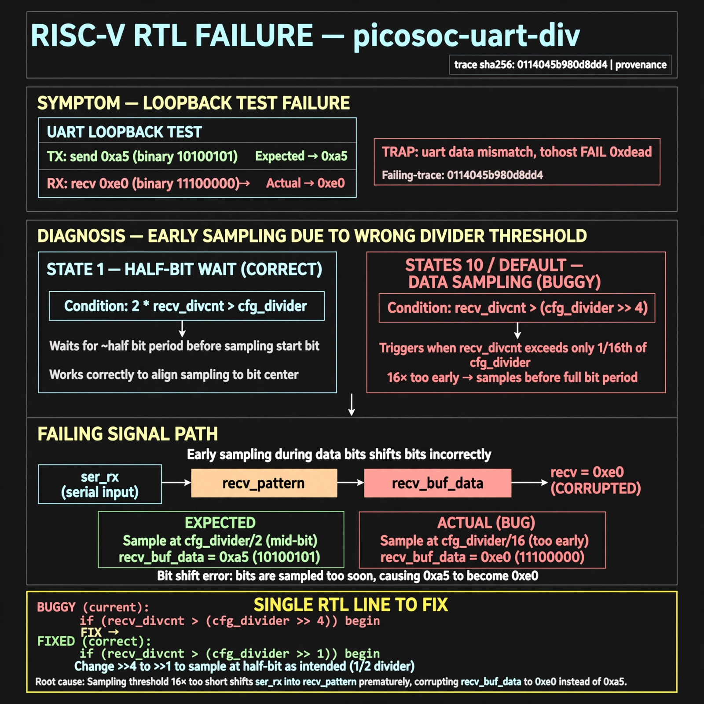

# Afterglow run report: wave-on-picosoc-uart-div-43

case `picosoc-uart-div` | status **GREEN** | mode `live` | seed `42`

wall start `2026-10-31T17:15:35Z` | wall end `2026-10-31T17:16:40Z` | time-to-green `64.6s`

retries `0` | human_touches `0` | diagnosed `True` | fixed_unaided `True` | patch_source `model-verbatim`

## Verdicts (from sim, not typed)

- BEFORE: tohost=FAIL 0xdead checksum=27ee482b473c74db5dce8b5ab1a233084cce3055c317a1f2045faa6dbc13a1c6 cycles=2112 seed=42 pass=False
- AFTER: tohost=PASS checksum=5c8f58d0f0818c97d014d2f851a6140882bd1efc96a2537047806252c0c2caf9 cycles=2652 seed=42 pass=True

## Diagnosis (verbatim from api/text_response.json)

```
Loopback with divider 64 sent 0xa5 but recv returned 0xe0 (TRAP uart data mismatch, tohost FAIL 0xdead). Start state 1 waits half-bit with 2*recv_divcnt > cfg_divider but states 10/default advance on recv_divcnt > (cfg_divider >> 4), 16x too short. This early sampling shifts ser_rx into recv_pattern before full bit periods elapse, corrupting recv_buf_data to 0xe0.
```

expected re-sim signal: tohost PASS, loopback 0xa5 matched, no uart data mismatch TRAP

## Patch (4 lines, guard-checked)

```diff
diff --git a/picosoc/simpleuart.v b/picosoc/simpleuart.v
--- a/picosoc/simpleuart.v
+++ b/picosoc/simpleuart.v
@@ -89,14 +89,14 @@
 				10: begin
-					if (recv_divcnt > (cfg_divider >> 4)) begin
+					if (recv_divcnt > cfg_divider) begin
 						recv_buf_data <= recv_pattern;
 						recv_buf_valid <= 1;
 						recv_state <= 0;
 					end
 				end
 				default: begin
-					if (recv_divcnt > (cfg_divider >> 4)) begin
+					if (recv_divcnt > cfg_divider) begin
 						recv_pattern <= {ser_rx, recv_pattern[7:1]};
 						recv_state <= recv_state + 1;
 						recv_divcnt <= 0;
 					end
 				end

```

## Provenance (judge checks)

- prompt file `/home/tuncay/afterglow/agent/prompts/v2.txt` sha256 `d31e1ef6b74ddf52ee59e790ebff2f3defa9b03be82e699f45ef620cf8e27a6e`
- input_trace.txt sha256 `0114045b980d8dd4d7915198e8a0f3681f96cf0a3b0d82c1714a0c7471f67608` (9 lines, 68 tokens)
- prompt tokens `802` (cap 2500)
- text model `muse-spark-1.3-contributor` latency `46326ms` request `chatcmpl-01a192f6-5f6b-74d8-8e0f-2da4103c099c`
- image model `muse-image-1.0` latency `17626ms` request `8aca7181-f5be-4c0e-8417-05f7872f8875` status `ok`
- image prompt sha256 `64b1c107ebd3d9ffdb7655a8aaae2bf9496d6b40a1acc021bd6c11f76620c70d`, trace sha `0114045b980d8dd4d7915198e8a0f3681f96cf0a3b0d82c1714a0c7471f67608` (see api/image_request.json)

## Explanation diagram



## Bundle completeness

- present (12): artifacts/input_trace.txt, artifacts/boot.log, artifacts/boot_after.log, artifacts/verdict_before.json, artifacts/verdict_after.json, api/text_request.json, api/text_response.json, api/image_request.json, api/image_response.json, explain.png, patch.diff, meta.json
- missing (0): none

