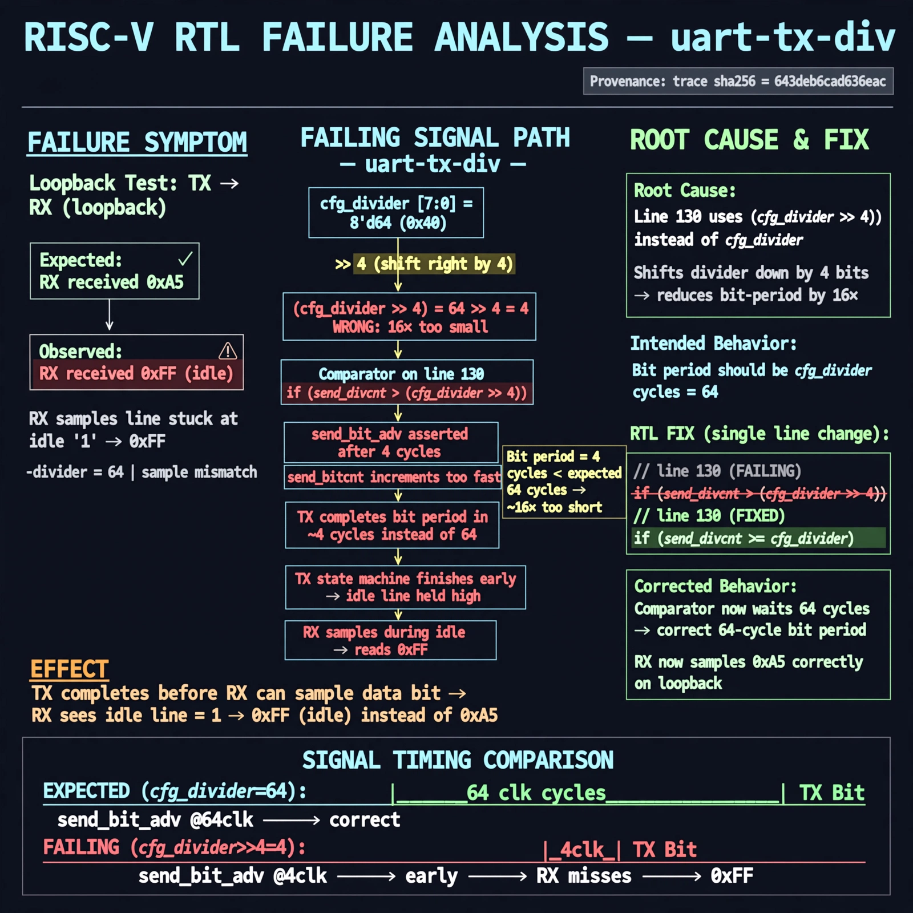

# Afterglow run report: wave-on-uart-tx-div-42

case `uart-tx-div` | status **GREEN** | mode `live` | seed `42`

wall start `2026-10-31T05:35:31Z` | wall end `2026-10-31T05:36:48Z` | time-to-green `77.0s`

retries `0` | human_touches `0` | diagnosed `True` | fixed_unaided `True` | patch_source `model-verbatim`

## Verdicts (from sim, not typed)

- BEFORE: tohost=FAIL 0xdead checksum=e251d79bc7250f734efe026d9d7f036e818ad243c9428000f5cdb2c1fd8b03c6 cycles=2652 seed=42 pass=False
- AFTER: tohost=PASS checksum=5c8f58d0f0818c97d014d2f851a6140882bd1efc96a2537047806252c0c2caf9 cycles=2652 seed=42 pass=True

## Diagnosis (verbatim from api/text_response.json)

```
Loopback RX got 0xff (idle) instead of 0xa5 for divider 64. TX advances on line 130 with `send_divcnt > (cfg_divider >> 4)`, making the bit period ~16x too short, so TX finishes before RX samples and RX reads idle 1s. Root cause is the `>> 4` divide on cfg_divider in the send_bitcnt shift condition.
```

expected re-sim signal: tohost: PASS (not FAIL 0xdead), TRAP uart data mismatch gone, log shows got 0xa5 want 0xa5; checksum changes from e251d79bc7250f734efe026d9d7f036e818ad243c9428000f5cdb2c1fd8b03c6

## Patch (2 lines, guard-checked)

```diff
diff --git a/picosoc/simpleuart.v b/picosoc/simpleuart.v
--- a/picosoc/simpleuart.v
+++ b/picosoc/simpleuart.v
@@ -125,9 +125,9 @@
 			if (reg_dat_we && !send_bitcnt) begin
 				send_pattern <= {1'b1, reg_dat_di[7:0], 1'b0};
 				send_bitcnt <= 10;
 				send_divcnt <= 0;
 			end else
-			if (send_divcnt > (cfg_divider >> 4) && send_bitcnt) begin
+			if (send_divcnt > cfg_divider && send_bitcnt) begin
 				send_pattern <= {1'b1, send_pattern[9:1]};
 				send_bitcnt <= send_bitcnt - 1;
 				send_divcnt <= 0;

```

## Provenance (judge checks)

- prompt file `/home/tuncay/afterglow/agent/prompts/v2.txt` sha256 `d31e1ef6b74ddf52ee59e790ebff2f3defa9b03be82e699f45ef620cf8e27a6e`
- input_trace.txt sha256 `643deb6cad636eacce63ad91b831f6a04cb0b17b952e7ded8661c93f83f93ef9` (9 lines, 68 tokens)
- prompt tokens `821` (cap 2500)
- text model `muse-spark-1.3-contributor` latency `60211ms` request `chatcmpl-01a19075-a5eb-724a-9a4a-9f693c6a6ea1`
- image model `muse-image-1.0` latency `16050ms` request `8551f902-be32-452b-ab92-66d4ccf1fe68` status `ok`
- image prompt sha256 `85e99b55f72753ece7c69ef1523ade1c7517285343eac3262876a42757e9a409`, trace sha `643deb6cad636eacce63ad91b831f6a04cb0b17b952e7ded8661c93f83f93ef9` (see api/image_request.json)

## Explanation diagram



## Bundle completeness

- present (12): artifacts/input_trace.txt, artifacts/boot.log, artifacts/boot_after.log, artifacts/verdict_before.json, artifacts/verdict_after.json, api/text_request.json, api/text_response.json, api/image_request.json, api/image_response.json, explain.png, patch.diff, meta.json
- missing (0): none

