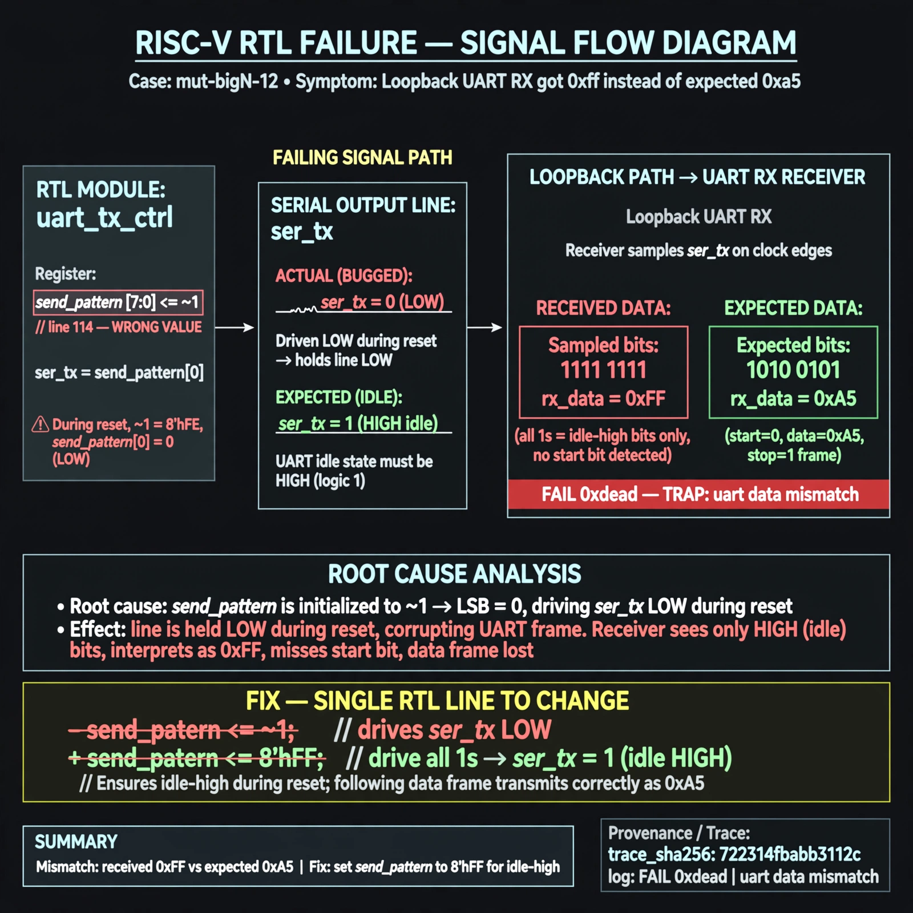

# Afterglow run report: wonder-off-mut-bigN-12-42

case `mut-bigN-12` | status **GREEN** | mode `live` | seed `42`

wall start `2026-11-04T20:44:19Z` | wall end `2026-11-04T20:47:25Z` | time-to-green `186.2s`

retries `0` | human_touches `0` | diagnosed `True` | fixed_unaided `True` | patch_source `model-verbatim`

## Verdicts (from sim, not typed)

- BEFORE: tohost=FAIL 0xdead checksum=9e1b73c13d0a095f6b9512137fc937a720f9b8a80231ffc4b660d6d1459f6985 cycles=2024 seed=42 pass=False
- AFTER: tohost=PASS checksum=5c8f58d0f0818c97d014d2f851a6140882bd1efc96a2537047806252c0c2caf9 cycles=2652 seed=42 pass=True

## Diagnosis (verbatim from api/text_response.json)

```
Loopback UART RX got 0xff instead of expected 0xa5, i.e. receiver sampled only idle-high bits and missed the start/data frame. Trace shows FAIL 0xdead with TRAP uart data mismatch. Root cause in excerpt is line 114 `send_pattern <= ~1` which drives `ser_tx = send_pattern[0]` low during reset instead of idle-high, corrupting framing for the following dummy and data transmission.
```

expected re-sim signal: tohost PASS (vs FAIL 0xdead), TRAP uart data mismatch gone, loopback recv 0xa5 matches send 0xa5

## Patch (2 lines, guard-checked)

```diff
diff --git a/picosoc/simpleuart.v b/picosoc/simpleuart.v
--- a/picosoc/simpleuart.v
+++ b/picosoc/simpleuart.v
@@ -113,5 +113,5 @@
 		if (!resetn) begin
-			send_pattern <= ~1;
+			send_pattern <= ~0;
 			send_bitcnt <= 0;
 			send_divcnt <= 0;
 			send_dummy <= 1;

```

## Provenance (judge checks)

- prompt file `/home/tuncay/afterglow/agent/prompts/v2.txt` sha256 `d31e1ef6b74ddf52ee59e790ebff2f3defa9b03be82e699f45ef620cf8e27a6e`
- input_trace.txt sha256 `722314fbabb3112c856bed5d303e00bd952e23bc342ca725bec41ff42b8942f4` (9 lines, 68 tokens)
- prompt tokens `689` (cap 2500)
- text model `muse-spark-1.3-contributor` latency `60066ms` request `chatcmpl-01a1a850-94e3-7217-a592-4aae948720e0`
- image model `muse-image-1.0` latency `29215ms` request `a3deba19-5758-45e9-884d-339084ed27e0` status `ok`
- image prompt sha256 `97a79eae26a21827ab24c8c5fc2651c4cb44b883aa53cd17be226c459d5002d6`, trace sha `722314fbabb3112c856bed5d303e00bd952e23bc342ca725bec41ff42b8942f4` (see api/image_request.json)

## Explanation diagram



## Bundle completeness

- present (12): artifacts/input_trace.txt, artifacts/boot.log, artifacts/boot_after.log, artifacts/verdict_before.json, artifacts/verdict_after.json, api/text_request.json, api/text_response.json, api/image_request.json, api/image_response.json, explain.png, patch.diff, meta.json
- missing (0): none

