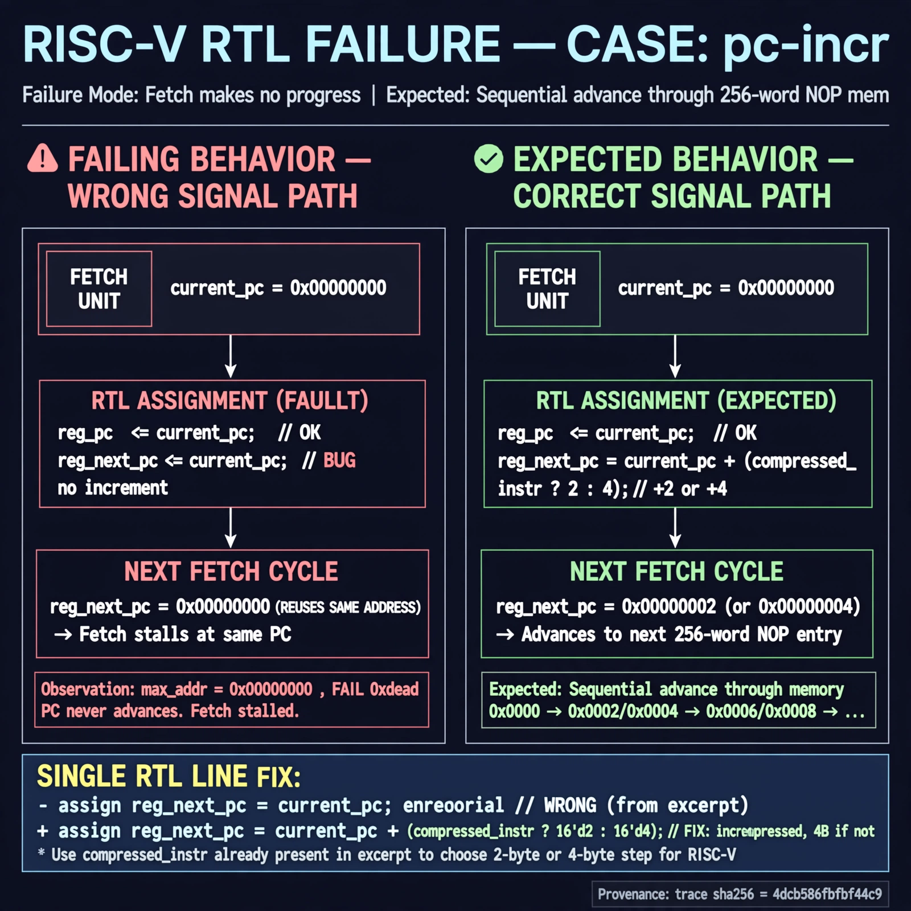

# Afterglow run report: wonder-off-pc-incr-42

case `pc-incr` | status **GREEN** | mode `live` | seed `42`

wall start `2026-11-04T20:47:25Z` | wall end `2026-11-04T21:00:21Z` | time-to-green `776.4s`

retries `1` | human_touches `0` | diagnosed `True` | fixed_unaided `True` | patch_source `model-verbatim`

## Verdicts (from sim, not typed)

- BEFORE: tohost=FAIL 0xdead checksum=563b7c10626ff25de2b3c430956c7c113e448c4efaea068f9b83a198d4322b15 cycles=2009 seed=42 pass=False
- AFTER: tohost=PASS checksum=5c28238265cb94168311e9914f0df355642c557d04dba11845d557ac8a64aa4a cycles=2009 seed=42 pass=True

## Diagnosis (verbatim from api/text_response.json)

```
Fetch makes no progress (max_addr=0x00000000, FAIL 0xdead) vs expected sequential advance through 256-word NOP mem. Both reg_pc and reg_next_pc are assigned current_pc in excerpt, so next fetch reuses same address and PC never increments. Root cause is missing PC increment on reg_next_pc; fix uses compressed_instr already in excerpt for 2/4-byte step.
```

expected re-sim signal: tohost PASS max_addr=0x000003fc, no FAIL 0xdead, progress through NOP mem

## Patch (2 lines, guard-checked)

```diff
diff --git a/picorv32.v b/picorv32.v
--- a/picorv32.v
+++ b/picorv32.v
@@ -1526,4 +1526,4 @@
 				reg_pc <= current_pc;
-				reg_next_pc <= current_pc;
+				reg_next_pc <= current_pc + (compressed_instr ? 2 : 4);
 				latched_store <= 0;
 				latched_stalu <= 0;

```

## Provenance (judge checks)

- prompt file `/home/tuncay/afterglow/agent/prompts/v2.txt` sha256 `d31e1ef6b74ddf52ee59e790ebff2f3defa9b03be82e699f45ef620cf8e27a6e`
- input_trace.txt sha256 `4dcb586fbfbf44c95c5e80a074de97dea679dff82e4ef6ccc0a041894037f70d` (9 lines, 69 tokens)
- prompt tokens `698` (cap 2500)
- text model `muse-spark-1.3-contributor` latency `74353ms` request `chatcmpl-01a1a85c-6050-707f-b601-4708686cca6b`
- image model `muse-image-1.0` latency `31673ms` request `7aaf7d6f-2710-4bfe-a947-e73d252f6d4c` status `ok`
- image prompt sha256 `c705bd74560b0f896abbb1cb531157fd89309be3b628de729d81f6b939b9c6d3`, trace sha `4dcb586fbfbf44c95c5e80a074de97dea679dff82e4ef6ccc0a041894037f70d` (see api/image_request.json)

## Explanation diagram



## Bundle completeness

- present (12): artifacts/input_trace.txt, artifacts/boot.log, artifacts/boot_after.log, artifacts/verdict_before.json, artifacts/verdict_after.json, api/text_request.json, api/text_response.json, api/image_request.json, api/image_response.json, explain.png, patch.diff, meta.json
- missing (0): none

