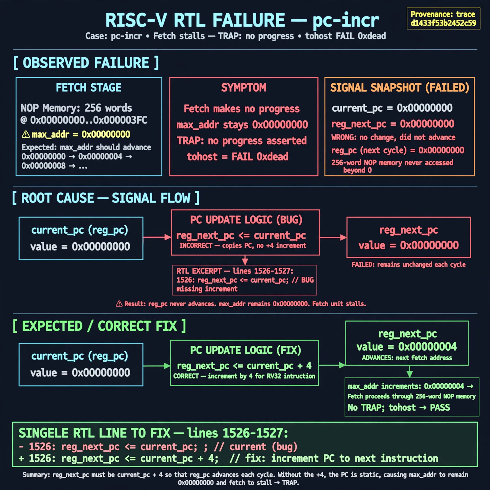

# Afterglow run report: wonder-on-pc-incr-42

case `pc-incr` | status **GREEN** | mode `live` | seed `42`

wall start `2026-11-04T22:49:38Z` | wall end `2026-11-04T22:50:56Z` | time-to-green `78.5s`

retries `0` | human_touches `0` | diagnosed `True` | fixed_unaided `True` | patch_source `model-verbatim`

## Verdicts (from sim, not typed)

- BEFORE: tohost=FAIL 0xdead checksum=563b7c10626ff25de2b3c430956c7c113e448c4efaea068f9b83a198d4322b15 cycles=2009 seed=42 pass=False
- AFTER: tohost=PASS checksum=5c28238265cb94168311e9914f0df355642c557d04dba11845d557ac8a64aa4a cycles=2009 seed=42 pass=True

## Diagnosis (verbatim from api/text_response.json)

```
Fetch makes no progress: max_addr stays 0x00000000 instead of advancing through the 256-word NOP memory, causing TRAP: no progress and tohost FAIL 0xdead. Expected reg_next_pc to advance to the next fetch address each cycle. Root cause in excerpt at lines 1526-1527 is reg_next_pc <= current_pc copying the current PC with no increment, so reg_pc never advances.
```

expected re-sim signal: tohost PASS (not FAIL 0xdead), progress with max_addr advancing through NOPs and trap on end-of-mem

## Patch (2 lines, guard-checked)

```diff
diff --git a/picorv32.v b/picorv32.v
--- a/picorv32.v
+++ b/picorv32.v
@@ -1527,1 +1527,1 @@
-				reg_next_pc <= current_pc;
+				reg_next_pc <= current_pc + 4;

```

## Provenance (judge checks)

- prompt file `/home/tuncay/afterglow/agent/prompts/v2.txt` sha256 `d31e1ef6b74ddf52ee59e790ebff2f3defa9b03be82e699f45ef620cf8e27a6e`
- input_trace.txt sha256 `d1433f53b2452c598a786584c4e0dabb36425db0b0678a61fae826111bfd8bfd` (9 lines, 69 tokens)
- prompt tokens `646` (cap 2500)
- text model `muse-spark-1.3-contributor` latency `44048ms` request `chatcmpl-01a1a8c1-991b-72bf-a844-55c978b130d5`
- image model `muse-image-1.0` latency `32857ms` request `5399ecae-be43-4374-a752-445df85fec74` status `ok`
- image prompt sha256 `762846663bfc2bb73753fe7e56c97ef256fb767b876a8d3416e9bbdd71590478`, trace sha `d1433f53b2452c598a786584c4e0dabb36425db0b0678a61fae826111bfd8bfd` (see api/image_request.json)

## Explanation diagram



## Bundle completeness

- present (12): artifacts/input_trace.txt, artifacts/boot.log, artifacts/boot_after.log, artifacts/verdict_before.json, artifacts/verdict_after.json, api/text_request.json, api/text_response.json, api/image_request.json, api/image_response.json, explain.png, patch.diff, meta.json
- missing (0): none

