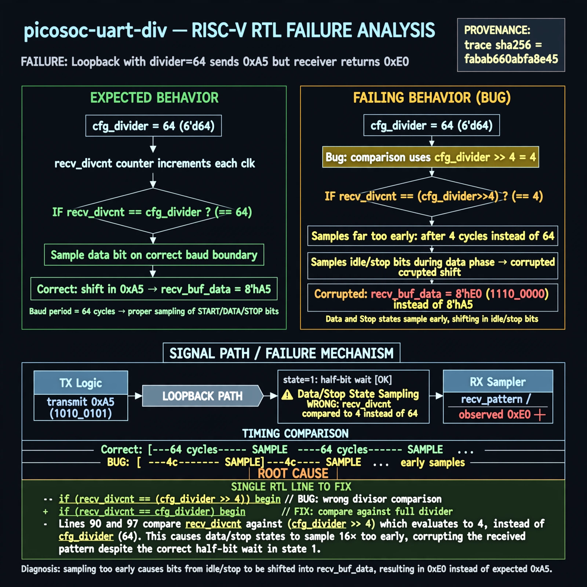

# Afterglow run report: wonder-on-picosoc-uart-div-42

case `picosoc-uart-div` | status **TRIAGE** | mode `live` | seed `42`

wall start `2026-11-04T22:50:56Z` | wall end `2026-11-04T23:00:10Z` | time-to-green `553.7s`

retries `2` | human_touches `0` | diagnosed `True` | fixed_unaided `False` | patch_source `none`

## Verdicts (from sim, not typed)

- BEFORE: tohost=FAIL 0xdead checksum=27ee482b473c74db5dce8b5ab1a233084cce3055c317a1f2045faa6dbc13a1c6 cycles=2112 seed=42 pass=False
- AFTER: tohost=PASS checksum=5c8f58d0f0818c97d014d2f851a6140882bd1efc96a2537047806252c0c2caf9 cycles=2652 seed=42 pass=True

## Diagnosis (verbatim from api/text_response.json)

```
Loopback RX latched recv_buf_data as 0xe0 instead of expected 0xa5, causing tohost FAIL 0xdead. Start half-bit in state 1 uses full cfg_divider (2*recv_divcnt > cfg_divider) but data/stop states 10/default sample when recv_divcnt > (cfg_divider>>4), i.e. 1/16th of the bit period. This 16x-early sampling mis-aligns bits and corrupts the byte. Root cause is the >>4 divisor in the excerpt.
```

expected re-sim signal: tohost PASS with uart loopback 0xa5 received correctly, no data mismatch TRAP

## Patch (0 lines, guard-checked)

```diff
diff --git a/picosoc/simpleuart.v b/picosoc/simpleuart.v
--- a/picosoc/simpleuart.v
+++ b/picosoc/simpleuart.v
@@ -89,14 +89,14 @@
 				10: begin
-					if (recv_divcnt > (cfg_divider >> 4)) begin
+					if (recv_divcnt > cfg_divider) begin
 						recv_buf_data <= recv_pattern;
 						recv_buf_valid <= 1;
 						recv_state <= 0;
 					end
 				end
 				default: begin
-					if (recv_divcnt > (cfg_divider >> 4)) begin
+					if (recv_divcnt > cfg_divider) begin
 						recv_pattern <= {ser_rx, recv_pattern[7:1]};
 						recv_state <= recv_state + 1;
 						recv_divcnt <= 0;
 					end
 				end

```

## Provenance (judge checks)

- prompt file `/home/tuncay/afterglow/agent/prompts/v2.txt` sha256 `d31e1ef6b74ddf52ee59e790ebff2f3defa9b03be82e699f45ef620cf8e27a6e`
- input_trace.txt sha256 `fabab660abfa8e45d7d78b40cb9e61dc5824a56fc5d47f6d60ce446dc40541d3` (9 lines, 68 tokens)
- prompt tokens `959` (cap 2500)
- text model `muse-spark-1.3-contributor` latency `33569ms` request `chatcmpl-01a1a8c2-3c2e-7088-b5f8-b476fd9035c1`
- image model `muse-image-1.0` latency `17458ms` request `32d6b456-c876-4445-b2a6-739776934a70` status `ok`
- image prompt sha256 `2e51b868569960248820751958f7ecae7b508183b6903f76916f5eed144953ba`, trace sha `fabab660abfa8e45d7d78b40cb9e61dc5824a56fc5d47f6d60ce446dc40541d3` (see api/image_request.json)

## Explanation diagram



## Bundle completeness

- present (12): artifacts/input_trace.txt, artifacts/boot.log, artifacts/boot_after.log, artifacts/verdict_before.json, artifacts/verdict_after.json, api/text_request.json, api/text_response.json, api/image_request.json, api/image_response.json, explain.png, patch.diff, meta.json
- missing (0): none

