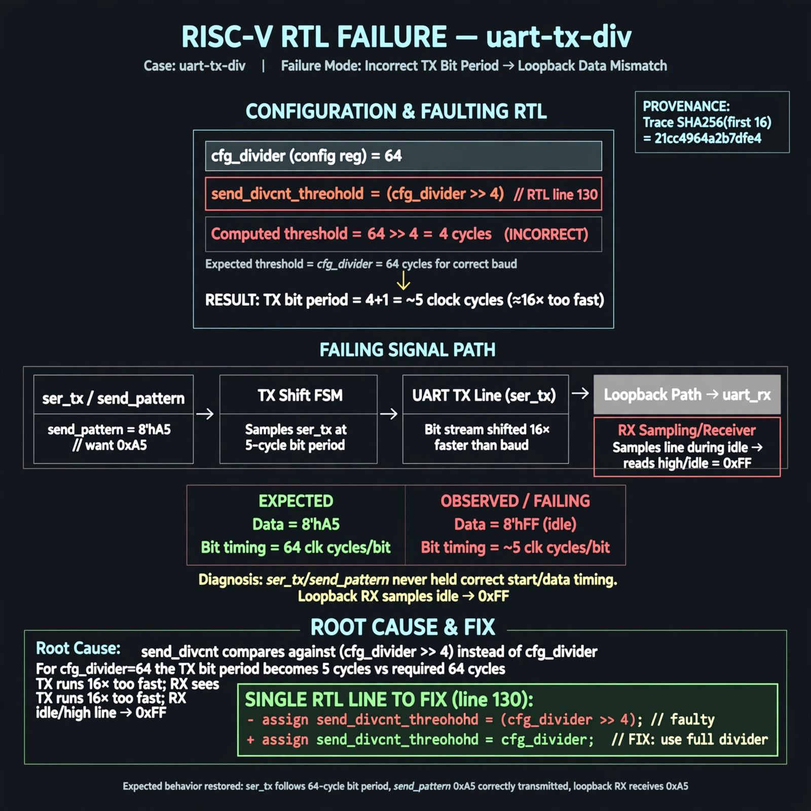

# Afterglow run report: wonder-on-uart-tx-div-42

case `uart-tx-div` | status **GREEN** | mode `live` | seed `42`

wall start `2026-11-04T23:00:10Z` | wall end `2026-11-04T23:01:33Z` | time-to-green `83.1s`

retries `0` | human_touches `0` | diagnosed `True` | fixed_unaided `True` | patch_source `model-verbatim`

## Verdicts (from sim, not typed)

- BEFORE: tohost=FAIL 0xdead checksum=e251d79bc7250f734efe026d9d7f036e818ad243c9428000f5cdb2c1fd8b03c6 cycles=2652 seed=42 pass=False
- AFTER: tohost=PASS checksum=5c8f58d0f0818c97d014d2f851a6140882bd1efc96a2537047806252c0c2caf9 cycles=2652 seed=42 pass=True

## Diagnosis (verbatim from api/text_response.json)

```
Loopback data got 0xff (idle) want 0xa5, ser_tx/send_pattern never held correct start/data timing. send_divcnt threshold uses (cfg_divider >> 4) on line 130, making TX bit period ~5 cycles instead of divider 64, 16x too fast for the configured baud. Loopback RX therefore samples idle and reports 0xff.
```

expected re-sim signal: tohost PASS (was FAIL 0xdead), no TRAP uart data mismatch, loopback got 0xa5 as expected

## Patch (2 lines, guard-checked)

```diff
diff --git a/picosoc/simpleuart.v b/picosoc/simpleuart.v
--- a/picosoc/simpleuart.v
+++ b/picosoc/simpleuart.v
@@ -125,9 +125,9 @@
 			if (reg_dat_we && !send_bitcnt) begin
 				send_pattern <= {1'b1, reg_dat_di[7:0], 1'b0};
 				send_bitcnt <= 10;
 				send_divcnt <= 0;
 			end else
-			if (send_divcnt > (cfg_divider >> 4) && send_bitcnt) begin
+			if (send_divcnt > cfg_divider && send_bitcnt) begin
 				send_pattern <= {1'b1, send_pattern[9:1]};
 				send_bitcnt <= send_bitcnt - 1;
 				send_divcnt <= 0;

```

## Provenance (judge checks)

- prompt file `/home/tuncay/afterglow/agent/prompts/v2.txt` sha256 `d31e1ef6b74ddf52ee59e790ebff2f3defa9b03be82e699f45ef620cf8e27a6e`
- input_trace.txt sha256 `21cc4964a2b7dfe44b10777666443bb414f847336ee5a12f16b9ca9f70470115` (9 lines, 68 tokens)
- prompt tokens `816` (cap 2500)
- text model `muse-spark-1.3-contributor` latency `48637ms` request `chatcmpl-01a1a8cb-50de-73bf-8c12-bdbc5f76666c`
- image model `muse-image-1.0` latency `33916ms` request `e8608c13-45cf-4283-8bce-7270a363cd31` status `ok`
- image prompt sha256 `2622d50347e230295733d36fa6279388aff1aa49c42b8b5974152cf08436e364`, trace sha `21cc4964a2b7dfe44b10777666443bb414f847336ee5a12f16b9ca9f70470115` (see api/image_request.json)

## Explanation diagram



## Bundle completeness

- present (12): artifacts/input_trace.txt, artifacts/boot.log, artifacts/boot_after.log, artifacts/verdict_before.json, artifacts/verdict_after.json, api/text_request.json, api/text_response.json, api/image_request.json, api/image_response.json, explain.png, patch.diff, meta.json
- missing (0): none

